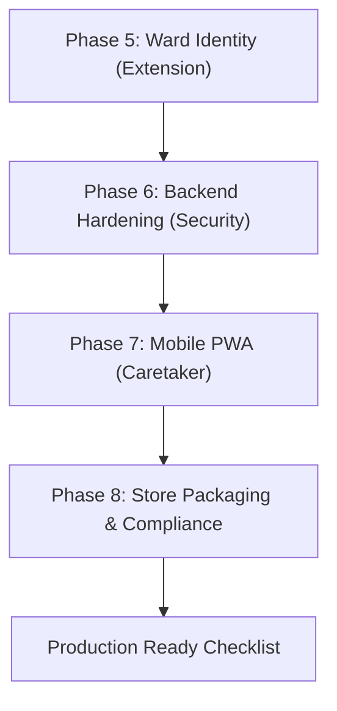

# Guardrail Production Roadmap & Implementation Specification

> **Status:** Active Execution Plan  
> **Target Release:** Guardrail Consumer Production v1.0  
> **Architecture Invariant:** Decoupled Human-in-the-Loop Protection (Separation of Duties)

---

## 1. Executive Summary & Real-World User Model

Guardrail provides client-side safety observability, high-risk action detection, synchronous interception into Staging Mode, and out-of-band approval routing for designated high-risk browser workflows.

In the real production product:
* **Ward A (The Protected User):** Runs Google Chrome with the Guardrail extension installed. Enjoys normal, unhindered web browsing until an anomalous, high-risk, or deceptive event occurs.
* **Caretaker B (The Trusted Contact / You):** Uses the Guardrail Caretaker Portal on desktop or mobile to review transparent, plain-English safety context and approve or decline paused actions.
* **Separation of Duties Guarantee:** Caretaker B *never* gains remote control over Ward A's screen, browsing history, or passwords. B only grants or denies consent; Ward A retains exclusive physical execution authority to confirm continuation.

```
┌─────────────────────────────────┐                       ┌─────────────────────────────────┐
│     WARD A's COMPUTER (Chrome)  │                       │   CARETAKER B's DEVICE (Phone)  │
│                                 │                       │                                 │
│  1. Extension installed         │                       │                                 │
│  2. Setup launches:             │                       │                                 │
│     "Who is your Caretaker?"    │                       │                                 │
│  3. Generates Pairing Code / QR │                       │                                 │
│     [ GR-INV-8K2M-9Q7X ]        │─── Share or Scan ────►│ 1. Open Guardrail App / Web     │
│                                 │                       │ 2. Sign in with Google / Passkey│
│                                 │                       │ 3. Enter Code: GR-INV-8K2M-9Q7X │
│                                 │◄── Pair Confirmed ────┤ 4. Tap "Confirm & Protect"      │
│  4. Shows "Protected by B"      │                       │ 5. Ward A appears in your list  │
└─────────────────────────────────┘                       └─────────────────────────────────┘
```

---

## 2. Phase-by-Phase Audit: What Has Been Built vs. What Is Left

### Phase 1: Ward A Onboarding & Pairing Initiation

```
Extension Installed ──► Auto-Launch Onboarding ──► Enter Caretaker Name ──► Generate GR-INV Code
```

#### What Has Been Built
* **Manifest V3 Foundation:** Complete MV3 configuration declaring service workers, content scripts, and storage permissions ([manifest.json](file:///Users/deepanshukhatri/Library/CloudStorage/GoogleDrive-deepanshukhatri20061972@gmail.com/My%20Drive/Cloud%20Desktop/Guardrail%20UI/guardrail/extension/public/manifest.json)).
* **Service Worker Lifecycle:** Automated onboarding tab launch on first-time installation via `chrome.runtime.onInstalled` ([background/index.ts](file:///Users/deepanshukhatri/Library/CloudStorage/GoogleDrive-deepanshukhatri20061972@gmail.com/My%20Drive/Cloud%20Desktop/Guardrail%20UI/guardrail/extension/src/background/index.ts)).
* **Educational Onboarding:** Explains permissions, privacy boundaries, Staging Mode, and how trusted contacts participate ([onboarding.html](file:///Users/deepanshukhatri/Library/CloudStorage/GoogleDrive-deepanshukhatri20061972@gmail.com/My%20Drive/Cloud%20Desktop/Guardrail%20UI/guardrail/extension/public/onboarding/onboarding.html)).
* **Guardian Coverage Inspector:** Section 05 (`GUARDIAN CONTACTS`) actively checks coverage, displays active contacts, and surfaces unconfigured warnings ([settings/component.ts](file:///Users/deepanshukhatri/Library/CloudStorage/GoogleDrive-deepanshukhatri20061972@gmail.com/My%20Drive/Cloud%20Desktop/Guardrail%20UI/guardrail/extension/src/settings/component.ts)).
* **Cryptographic Pairing Protocol:** Crockford Base32 `GR-INV-XXXX-YYYY` pairing code generator ($32^8 \approx 1.1 \times 10^{12}$ combinations, 7-day TTL, SHA-256 token hashing) ([api.ts](file:///Users/deepanshukhatri/Library/CloudStorage/GoogleDrive-deepanshukhatri20061972@gmail.com/My%20Drive/Cloud%20Desktop/Guardrail%20UI/guardrail/extension/src/approval/api.ts) & [sqlite-trusted-contact-registry.ts](file:///Users/deepanshukhatri/Library/CloudStorage/GoogleDrive-deepanshukhatri20061972@gmail.com/My%20Drive/Cloud%20Desktop/Guardrail%20UI/guardrail/server/src/sqlite-trusted-contact-registry.ts)).
* **Transactional Email Delivery Adapter:** Resend email adapter with instant optical scanner QR code GIF animation ([http-server.ts](file:///Users/deepanshukhatri/Library/CloudStorage/GoogleDrive-deepanshukhatri20061972@gmail.com/My%20Drive/Cloud%20Desktop/Guardrail%20UI/guardrail/server/src/http-server.ts)).

#### What Is Left
* [x] **Task 1.1 — In-Extension Invite Generator Dialog:** Add a visual "Invite Trusted Contact" button and modal inside the Extension Popup / Settings Page.
* [ ] **Task 1.2 — Chrome Web Store Packaging Pipeline:** Create packaging scripts to produce a signed `.zip` bundle ready for Google Chrome Web Store upload.

---

### Phase 2: Caretaker B Dashboard & Connecting the Ward

```
Open Dashboard ──► Sign In (Google / Passkey) ──► Enter GR-INV Code ──► Ward Linked (Active)
```

#### What Has Been Built
* **Standalone Reviewer Dashboard:** Vanilla TypeScript single-page application with responsive layout and minimal aesthetic ([guardrail/dashboard/](file:///Users/deepanshukhatri/Library/CloudStorage/GoogleDrive-deepanshukhatri20061972@gmail.com/My%20Drive/Cloud%20Desktop/Guardrail%20UI/guardrail/dashboard/)).
* **Connection Interface:** 3-step setup card with code input (`#gd-invitation-code-input`) validating `GR-INV-XXXX-YYYY` codes ([overview.ts](file:///Users/deepanshukhatri/Library/CloudStorage/GoogleDrive-deepanshukhatri20061972@gmail.com/My%20Drive/Cloud%20Desktop/Guardrail%20UI/guardrail/dashboard/src/components/overview.ts#L450-L540)).
* **Relationship Management:** View connected contacts, inspect coverage, and safely revoke associations ([relationships.ts](file:///Users/deepanshukhatri/Library/CloudStorage/GoogleDrive-deepanshukhatri20061972@gmail.com/My%20Drive/Cloud%20Desktop/Guardrail%20UI/guardrail/dashboard/src/components/relationships.ts)).
* **Backend Invitation Acceptance Endpoint:** `POST /api/v1/invitations/accept` verifies code, enforces non-self-pairing (`contactId !== wardId`), and binds SQLite association ([api.ts](file:///Users/deepanshukhatri/Library/CloudStorage/GoogleDrive-deepanshukhatri20061972@gmail.com/My%20Drive/Cloud%20Desktop/Guardrail%20UI/guardrail/extension/src/approval/api.ts)).
* **Authentication Modal & OIDC Verifier:** Clean modal displaying active identity session and token input ([auth-modal.ts](file:///Users/deepanshukhatri/Library/CloudStorage/GoogleDrive-deepanshukhatri20061972@gmail.com/My%20Drive/Cloud%20Desktop/Guardrail%20UI/guardrail/dashboard/src/components/auth-modal.ts)); server-side RS256 JWKS OIDC verifier ([oidc-token-verifier.ts](file:///Users/deepanshukhatri/Library/CloudStorage/GoogleDrive-deepanshukhatri20061972@gmail.com/My%20Drive/Cloud%20Desktop/Guardrail%20UI/guardrail/server/src/oidc-token-verifier.ts)).

#### What Is Left
* [x] **Task 2.1 — 1-Click Consumer Social Login Buttons:** Google & Apple OAuth redirect flows in caretaker portal.
* [ ] **Task 2.2 — Mobile PWA Companion Wrapper:** Progressive Web App manifest (`manifest.webmanifest`), mobile touch optimizations, and "Add to Home Screen" prompt.

---

### Phase 3: The Handshake & Persistent Association

```
Code Accepted ──► SQLite Relationship Established ──► Real-Time Sync to Ward & Caretaker
```

#### What Has Been Built
* **SQLite Persistent Registry:** Authoritative schema storing wards, caretakers, tokens, and statuses (`ACTIVE`, `REVOKED`) ([sqlite-trusted-contact-registry.ts](file:///Users/deepanshukhatri/Library/CloudStorage/GoogleDrive-deepanshukhatri20061972@gmail.com/My%20Drive/Cloud%20Desktop/Guardrail%20UI/guardrail/server/src/sqlite-trusted-contact-registry.ts)).
* **Immediate Dashboard State Propagation:** Accepting an invitation instantly refreshes relationship tables and updates overview to `Active Coverage` ([shell.ts](file:///Users/deepanshukhatri/Library/CloudStorage/GoogleDrive-deepanshukhatri20061972@gmail.com/My%20Drive/Cloud%20Desktop/Guardrail%20UI/guardrail/dashboard/src/shell.ts)).
* **Separation of Duties Verification:** Automated contracts verifying caretakers cannot initiate actions on behalf of wards ([test-trusted-contact-invitations.ts](file:///Users/deepanshukhatri/Library/CloudStorage/GoogleDrive-deepanshukhatri20061972@gmail.com/My%20Drive/Cloud%20Desktop/Guardrail%20UI/guardrail/extension/src/approval/test-trusted-contact-invitations.ts)).
* **Out-of-Band Push Notification Dispatcher (Web Push / VAPID):** Real-time Web Push notification service with RFC 8292 / VAPID cryptography delivering lock-screen alerts.

#### What Is Left
* [ ] **Task 3.2 — Multi-Ward Filter & Switcher:** Enable caretakers protecting multiple family members to toggle and filter approvals and history by ward.

---

### Phase 4: Daily Interception, Decision Routing & Execution

```
High-Risk Action ──► Synchronous Staging ──► Request Approval ──► Caretaker Decides ──► Ward Resumes
```

#### What Has Been Built
* **Synchronous DOM Interception:** Captures `click` and `submit` events before DOM dispatch via `preventDefault()` and `stopImmediatePropagation()` ([controller.ts](file:///Users/deepanshukhatri/Library/CloudStorage/GoogleDrive-deepanshukhatri20061972@gmail.com/My%20Drive/Cloud%20Desktop/Guardrail%20UI/guardrail/extension/src/interception/controller.ts)).
* **Deceptive URL & Action Detection:** Real-time heuristic detection of bank lookalikes, credential inputs, and financial operations.
* **Ivory Warning Modal UI:** Refined dialog with transparent risk context, `Request Approval`, and `Cancel & Stay` buttons.
* **Review Queue & Decision Engine:** Caretaker review queue with plain-English threat rationale and one-click `Approve` / `Reject` buttons.
* **Real-Time Status Synchronization (SSE):** Server-Sent Events stream updates Ward A's modal dynamically without page refresh.
* **Cryptographic Continuation Token:** `consume-continuation` prevents replay or hijacking of approved actions.
* **Cold Browser Restart Staged State Recovery:** Persistent storage serialization (`chrome.storage.local`) restores approved actions if the browser closed while pending.

---

## 3. Pre-Deployment Engineering Roadmap: Remaining Phases



### Phase 5: Ward Authentication & Identity in Chrome Extension
* **Goal:** Enable real users to sign in with their Google account in the extension instead of using the local mock dev token.
* **Deliverables:**
  1. Add "Sign in with Google" OAuth trigger in [popup.html](file:///Users/deepanshukhatri/Library/CloudStorage/GoogleDrive-deepanshukhatri20061972@gmail.com/My%20Drive/Cloud%20Desktop/Guardrail%20UI/guardrail/extension/public/popup/popup.html) and [onboarding.html](file:///Users/deepanshukhatri/Library/CloudStorage/GoogleDrive-deepanshukhatri20061972@gmail.com/My%20Drive/Cloud%20Desktop/Guardrail%20UI/guardrail/extension/public/onboarding/onboarding.html).
  2. Implement OAuth callback handling using `chrome.identity.getAuthToken` or PKCE redirect.
  3. Store and refresh JWT in `chrome.storage.local` under `guardrailAuthToken`.
  4. Display real user name/email in the popup header badge.
* **Files:**
  - `guardrail/extension/src/approval/auth-manager.ts`
  - `guardrail/extension/src/popup/index.ts`
  - `guardrail/extension/public/popup/popup.html`

### Phase 6: Backend Hardening & Rate Limiting
* **Goal:** Protect public endpoints from abuse, email spamming, and brute force.
* **Deliverables:**
  1. Rate limiting on `POST /api/v1/invitations/send` (max 5 emails/hour per user/IP).
  2. Rate limiting and lockout on `POST /api/v1/invitations/accept` (max 5 attempts/15 min).
  3. SQLite snapshot rotation and daily WAL backup hook in `data/backups/`.
* **Files:**
  - `guardrail/server/src/http-server.ts`
  - `guardrail/server/src/runtime-config.ts`

### Phase 7: Mobile PWA Companion & Multi-Ward Caretaker UX
* **Goal:** Full mobile installability and multi-ward management on smartphones.
* **Deliverables:**
  1. PWA `manifest.webmanifest` with standalone display and brand theme colors.
  2. "Add to Home Screen" mobile install guidance banner.
  3. Multi-ward selector dropdown in Pending Approvals & History when protecting >1 ward.
* **Files:**
  - `guardrail/dashboard/public/manifest.webmanifest`
  - `guardrail/dashboard/src/shell.ts`
  - `guardrail/dashboard/src/components/pending-list.ts`

### Phase 8: Chrome Web Store Packaging & Compliance Audit
* **Goal:** Clean, store-compliant extension release bundle.
* **Deliverables:**
  1. Build script `npm run package:extension` creating `dist/guardrail-extension-v1.0.0.zip`.
  2. Manifest V3 cleanup (bump to `1.0.0`, verify icons 16/48/128, clean permissions).
  3. Privacy Policy document detailing the Separation of Duties guarantee.
* **Files:**
  - `guardrail/extension/public/manifest.json`
  - `guardrail/extension/package.json`
  - `guardrail/docs/PRIVACY_POLICY.md`

---

## 4. Verification Checklist & Safety Invariants

```bash
# 1. Warning Modal UI tests (146 tests)
npm --prefix guardrail/extension run test:warning-ui

# 2. Invitation & Pairing Protocol tests (135 tests)
npm --prefix guardrail/extension run test:invitations

# 3. Interception & Continuation contracts (248 tests)
npm --prefix guardrail/extension run test:interception

# 4. Caretaker Dashboard verification suite (104 tests)
npm --prefix guardrail/dashboard run test:verify-day12

# 5. Dashboard sync & shell suite (660 tests)
npm --prefix guardrail/dashboard run test:shell
```
