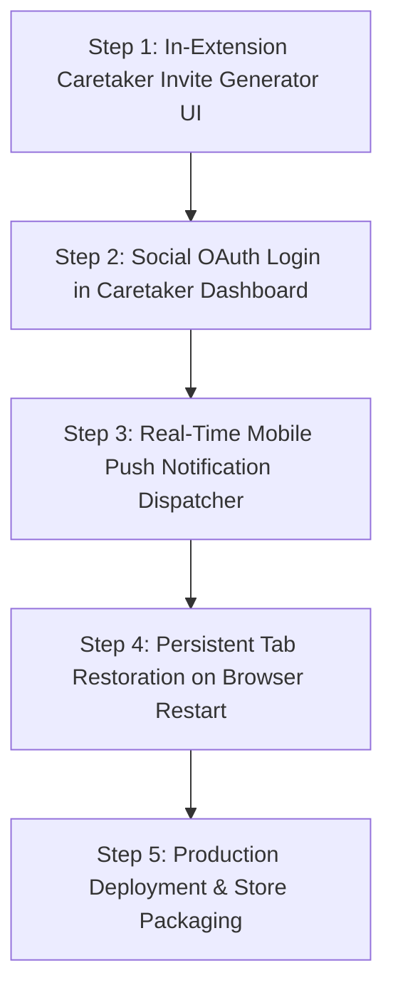

# Guardrail Production Roadmap & Implementation Specification

> **Status:** Active Execution Plan  
> **Target Release:** Guardrail Consumer Production v1.0  
> **Architecture Invariant:** Decoupled Human-in-the-Loop Protection (Separation of Duties)

---

## 1. Executive Summary & Real-World User Model

Guardrail provides client-side safety observability, high-risk action detection, synchronous interception into Staging Mode, and out-of-band approval routing for designated high-risk browser workflows.

In the real production product:
* **Ward A (The Protected User):** Runs Google Chrome with the Guardrail extension installed. Enjoys normal, unhindered web browsing until an anomalous, high-risk, or deceptive event occurs.
* **Caretaker B (The Trusted Contact / You):** Uses the Guardrail Caretaker Portal on desktop or mobile to review transparent, plain-English safety context and approve or decline paused actions.
* **Separation of Duties Guarantee:** Caretaker B *never* gains remote control over Ward A's screen, browsing history, or passwords. B only grants or denies consent; Ward A retains exclusive physical execution authority to confirm continuation.

```
┌─────────────────────────────────┐                       ┌─────────────────────────────────┐
│     WARD A's COMPUTER (Chrome)  │                       │   CARETAKER B's DEVICE (Phone)  │
│                                 │                       │                                 │
│  1. Extension installed         │                       │                                 │
│  2. Setup launches:             │                       │                                 │
│     "Who is your Caretaker?"    │                       │                                 │
│  3. Generates Pairing Code / QR │                       │                                 │
│     [ GR-INV-8K2M-9Q7X ]        │─── Share or Scan ────►│ 1. Open Guardrail App / Web     │
│                                 │                       │ 2. Sign in with Google / Passkey│
│                                 │                       │ 3. Enter Code: GR-INV-8K2M-9Q7X │
│                                 │◄── Pair Confirmed ────┤ 4. Tap "Confirm & Protect"      │
│  4. Shows "Protected by B"      │                       │ 5. Ward A appears in your list  │
└─────────────────────────────────┘                       └─────────────────────────────────┘
```

---

## 2. Phase-by-Phase Audit: What Has Been Built vs. What Is Left

### Phase 1: Ward A Onboarding & Pairing Initiation

```
Extension Installed ──► Auto-Launch Onboarding ──► Enter Caretaker Name ──► Generate GR-INV Code
```

#### What Has Been Built
* **Manifest V3 Foundation:** Complete MV3 configuration declaring service workers, content scripts, and storage permissions ([manifest.json](file:///Users/deepanshukhatri/Library/CloudStorage/GoogleDrive-deepanshukhatri20061972@gmail.com/My%20Drive/Cloud%20Desktop/Guardrail%20UI/guardrail/extension/public/manifest.json)).
* **Service Worker Lifecycle:** Automated onboarding tab launch on first-time installation via `chrome.runtime.onInstalled` ([background/index.ts](file:///Users/deepanshukhatri/Library/CloudStorage/GoogleDrive-deepanshukhatri20061972@gmail.com/My%20Drive/Cloud%20Desktop/Guardrail%20UI/guardrail/extension/src/background/index.ts)).
* **Educational Onboarding:** Explains permissions, privacy boundaries, Staging Mode, and how trusted contacts participate ([onboarding.html](file:///Users/deepanshukhatri/Library/CloudStorage/GoogleDrive-deepanshukhatri20061972@gmail.com/My%20Drive/Cloud%20Desktop/Guardrail%20UI/guardrail/extension/public/onboarding/onboarding.html)).
* **Guardian Coverage Inspector:** Section 05 (`GUARDIAN CONTACTS`) actively checks coverage, displays active contacts, and surfaces unconfigured warnings ([settings/component.ts](file:///Users/deepanshukhatri/Library/CloudStorage/GoogleDrive-deepanshukhatri20061972@gmail.com/My%20Drive/Cloud%20Desktop/Guardrail%20UI/guardrail/extension/src/settings/component.ts)).
* **Cryptographic Pairing Protocol:** Crockford Base32 `GR-INV-XXXX-YYYY` pairing code generator ($32^8 \approx 1.1 \times 10^{12}$ combinations, 7-day TTL, SHA-256 token hashing) ([api.ts](file:///Users/deepanshukhatri/Library/CloudStorage/GoogleDrive-deepanshukhatri20061972@gmail.com/My%20Drive/Cloud%20Desktop/Guardrail%20UI/guardrail/extension/src/approval/api.ts) & [sqlite-trusted-contact-registry.ts](file:///Users/deepanshukhatri/Library/CloudStorage/GoogleDrive-deepanshukhatri20061972@gmail.com/My%20Drive/Cloud%20Desktop/Guardrail%20UI/guardrail/server/src/sqlite-trusted-contact-registry.ts)).
* **Transactional Email Delivery Adapter:** Resend email adapter to deliver invite links ([invitation-delivery.ts](file:///Users/deepanshukhatri/Library/CloudStorage/GoogleDrive-deepanshukhatri20061972@gmail.com/My%20Drive/Cloud%20Desktop/Guardrail%20UI/guardrail/server/src/invitation-delivery.ts)).

#### What Is Left
* [x] **Task 1.1 — In-Extension Invite Generator Dialog:** Add a visual "Invite Trusted Contact" button and modal inside the Extension Popup / Settings Page that calls `POST /api/v1/invitations`, generates the code, and presents a one-click copy button and QR code. (Implemented: Primary "Invite Trusted Contact" button in Section 05 `card-trusted-contacts`, modal dialog with relationship label input, `POST /api/v1/invitations` Crockford Base32 generator with fallback, scannable SVG QR code via `qrcode`, 1-click copy with dynamic button feedback, live 2.5s polling with real-time handshake detection, and comprehensive 9-group unit test suite with 82 passed assertions).
* [ ] **Task 1.2 — Chrome Web Store Packaging Pipeline:** Create production manifest variant and packaging scripts to produce a signed `.zip` bundle ready for Google Chrome Web Store upload.

---

### Phase 2: Caretaker B Dashboard & Connecting the Ward

```
Open Dashboard ──► Sign In (Google / Passkey) ──► Enter GR-INV Code ──► Ward Linked (Active)
```

#### What Has Been Built
* **Standalone Reviewer Dashboard:** Vanilla TypeScript single-page application with responsive layout and minimal aesthetic ([guardrail/dashboard/](file:///Users/deepanshukhatri/Library/CloudStorage/GoogleDrive-deepanshukhatri20061972@gmail.com/My%20Drive/Cloud%20Desktop/Guardrail%20UI/guardrail/dashboard/)).
* **Connection Interface:** 3-step setup card with code input (`#gd-invitation-code-input`) validating `GR-INV-XXXX-YYYY` codes ([overview.ts](file:///Users/deepanshukhatri/Library/CloudStorage/GoogleDrive-deepanshukhatri20061972@gmail.com/My%20Drive/Cloud%20Desktop/Guardrail%20UI/guardrail/dashboard/src/components/overview.ts#L450-L540)).
* **Relationship Management:** View connected contacts, inspect coverage, and safely revoke associations ([relationships.ts](file:///Users/deepanshukhatri/Library/CloudStorage/GoogleDrive-deepanshukhatri20061972@gmail.com/My%20Drive/Cloud%20Desktop/Guardrail%20UI/guardrail/dashboard/src/components/relationships.ts)).
* **Backend Invitation Acceptance Endpoint:** `POST /api/v1/invitations/accept` verifies code, enforces non-self-pairing (`contactId !== wardId`), and binds SQLite association ([api.ts](file:///Users/deepanshukhatri/Library/CloudStorage/GoogleDrive-deepanshukhatri20061972@gmail.com/My%20Drive/Cloud%20Desktop/Guardrail%20UI/guardrail/extension/src/approval/api.ts)).
* **Authentication Modal & OIDC Verifier:** Clean modal displaying active identity session and token input ([auth-modal.ts](file:///Users/deepanshukhatri/Library/CloudStorage/GoogleDrive-deepanshukhatri20061972@gmail.com/My%20Drive/Cloud%20Desktop/Guardrail%20UI/guardrail/dashboard/src/components/auth-modal.ts)); server-side RS256 JWKS OIDC verifier ([oidc-token-verifier.ts](file:///Users/deepanshukhatri/Library/CloudStorage/GoogleDrive-deepanshukhatri20061972@gmail.com/My%20Drive/Cloud%20Desktop/Guardrail%20UI/guardrail/server/src/oidc-token-verifier.ts)).

#### What Is Left
* [x] **Task 2.1 — 1-Click Consumer Social Login Buttons:** Replace developer profile switchers in production mode with direct **"Sign in with Google"** / **"Sign in with Apple"** OAuth redirect flows. (Implemented: 1-Click Google and Apple branded buttons, URL hash/query OAuth redirect parameter extraction, instant address bar sanitization with `replaceState`, environment adaptation with dev simulation).
* [ ] **Task 2.2 — Production Hosting Deployment Configuration:** Deploy dashboard to static CDN hosting (Firebase Hosting or Cloudflare Pages) with custom domain routing.

---

### Phase 3: The Handshake & Persistent Association

```
Code Accepted ──► SQLite Relationship Established ──► Real-Time Sync to Ward & Caretaker
```

#### What Has Been Built
* **SQLite Persistent Registry:** Authoritative schema storing wards, caretakers, tokens, and statuses (`ACTIVE`, `REVOKED`) ([sqlite-trusted-contact-registry.ts](file:///Users/deepanshukhatri/Library/CloudStorage/GoogleDrive-deepanshukhatri20061972@gmail.com/My%20Drive/Cloud%20Desktop/Guardrail%20UI/guardrail/server/src/sqlite-trusted-contact-registry.ts)).
* **Immediate Dashboard State Propagation:** Accepting an invitation instantly refreshes relationship tables and updates the overview state to `Active Coverage` ([shell.ts](file:///Users/deepanshukhatri/Library/CloudStorage/GoogleDrive-deepanshukhatri20061972@gmail.com/My%20Drive/Cloud%20Desktop/Guardrail%20UI/guardrail/dashboard/src/shell.ts)).
* **Separation of Duties Verification:** Automated contracts verifying caretakers cannot initiate actions on behalf of wards ([test-trusted-contact-invitations.ts](file:///Users/deepanshukhatri/Library/CloudStorage/GoogleDrive-deepanshukhatri20061972@gmail.com/My%20Drive/Cloud%20Desktop/Guardrail%20UI/guardrail/extension/src/approval/test-trusted-contact-invitations.ts)).

#### What Is Left
* [x] **Task 3.1 — Out-of-Band Push Notification Dispatcher (Web Push / VAPID):** Real-time Web Push notification dispatching service using RFC 8292 / VAPID cryptography. Dispatches instant lock-screen mobile & desktop alerts to Caretaker B whenever a protected Ward A encounters a held high-risk action in Chrome, even when the Caretaker Dashboard tab is closed. (Implemented: SQLite `guardrail_push_subscriptions` schema, auto-generated/loaded VAPID keypairs via `web-push`, `/api/v1/push/vapid-public-key`, `/api/v1/push/subscribe`, `/api/v1/push/unsubscribe`, and `/api/v1/push/test` endpoints, automatic 410/404 stale subscription pruning, Service Worker `sw.js` with notificationclick deep-linking, `DashboardPushService` singleton, and Settings Card with 1-click subscription and test alert triggering. 20/20 backend test assertions and 9/9 dashboard test assertions passing).

---

### Phase 4: Daily Interception, Decision Routing & Execution

```
High-Risk Action ──► Synchronous Staging ──► Request Approval ──► Caretaker Decides ──► Ward Resumes
```

#### What Has Been Built
* **Synchronous DOM Interception:** Captures `click` and `submit` events before DOM dispatch via `preventDefault()` and `stopImmediatePropagation()` ([controller.ts](file:///Users/deepanshukhatri/Library/CloudStorage/GoogleDrive-deepanshukhatri20061972@gmail.com/My%20Drive/Cloud%20Desktop/Guardrail%20UI/guardrail/extension/src/interception/controller.ts)).
* **Deceptive URL & Action Detection:** Real-time heuristic detection of bank lookalikes (e.g. `axis.bank.in`, `icici.bank.in`), credential inputs, and financial operations ([detection/suspicious-urls.ts](file:///Users/deepanshukhatri/Library/CloudStorage/GoogleDrive-deepanshukhatri20061972@gmail.com/My%20Drive/Cloud%20Desktop/Guardrail%20UI/guardrail/extension/src/detection/suspicious-urls.ts)).
* **Ivory Warning Modal UI:** Refined dialog with transparent risk context, `Request Approval`, and `Cancel & Stay` buttons ([warning-modal.ts](file:///Users/deepanshukhatri/Library/CloudStorage/GoogleDrive-deepanshukhatri20061972@gmail.com/My%20Drive/Cloud%20Desktop/Guardrail%20UI/guardrail/extension/src/ui/warning-modal.ts)).
* **Review Queue & Decision Engine:** Caretaker review queue with plain-English threat rationale and one-click `Approve` / `Reject` buttons ([pending-list.ts](file:///Users/deepanshukhatri/Library/CloudStorage/GoogleDrive-deepanshukhatri20061972@gmail.com/My%20Drive/Cloud%20Desktop/Guardrail%20UI/guardrail/dashboard/src/components/pending-list.ts)).
* **Real-Time Status Synchronization (SSE):** Server-Sent Events stream (`/api/v1/approval-requests/:id/events`) updates Ward A's modal dynamically without page refresh ([status-sync.ts](file:///Users/deepanshukhatri/Library/CloudStorage/GoogleDrive-deepanshukhatri20061972@gmail.com/My%20Drive/Cloud%20Desktop/Guardrail%20UI/guardrail/extension/src/approval/status-sync.ts)).
* **Cryptographic Continuation Token:** `consume-continuation` prevents replay or hijacking of approved actions ([api.ts](file:///Users/deepanshukhatri/Library/CloudStorage/GoogleDrive-deepanshukhatri20061972@gmail.com/My%20Drive/Cloud%20Desktop/Guardrail%20UI/guardrail/extension/src/approval/api.ts#L430-L510)).

#### What Is Left
* [ ] **Task 4.1 — Cold Browser Restart Staged State Recovery:** Add persistent indexedDB/localStorage serialization so if Ward A closes Chrome while an action is pending approval, reopening the browser restores the pending confirmation state.
* [ ] **Task 4.2 — Native Mobile PWA / Companion Wrapper:** Configure dashboard as an installable Progressive Web App (PWA) with native biometric prompts (Face ID / Touch ID) for rapid one-tap approvals on mobile devices.

---

## 3. Step-by-Step Implementation Sequence

This sequence is ordered logically so each step builds upon verified working code without regressions.



### Step 1: In-Extension Caretaker Invite Generator UI
* **Files:**
  * `guardrail/extension/src/popup/index.ts`
  * `guardrail/extension/public/popup/popup.html`
  * `guardrail/extension/src/settings/component.ts`
* **Deliverable:**
  * Add a primary **"Add Trusted Contact"** button in Section 05 of Settings and in the Extension Popup.
  * When clicked, opens a clean dialog: prompt for contact label (e.g., "Son", "Financial Advisor"), calls `POST /api/v1/invitations`, and renders:
    * The generated `GR-INV-XXXX-YYYY` code with a one-click copy button.
    * An SVG QR code encoding the direct dashboard pairing URL (`https://dashboard?code=GR-INV-...`).
    * Real-time polling indicator waiting for Caretaker B to connect.

### Step 2: 1-Click Consumer Social Login in Caretaker Dashboard
* **Files:**
  * `guardrail/dashboard/src/components/auth-modal.ts`
  * `guardrail/dashboard/src/shell.ts`
  * `guardrail/server/src/runtime-config.ts`
* **Deliverable:**
  * In non-development mode, hide developer switcher chips.
  * Render branded **"Sign in with Google"** and **"Sign in with Apple"** OAuth redirect buttons.
  * Automatically store authenticated JWT in secure storage and handle redirect callback.

### Step 3: Out-of-Band Push Notification Dispatcher
* **Files:**
  * `guardrail/server/src/invitation-delivery.ts`
  * `guardrail/server/src/event-hub.ts`
  * `guardrail/dashboard/src/service-worker.ts`
* **Deliverable:**
  * Support Web Push API (VAPID keys) in Caretaker Dashboard.
  * Dispatch instant push notifications to Caretaker B's registered devices whenever a new `PENDING` approval request is registered on the backend.

### Step 4: Staged Action Persistence Across Browser Restarts
* **Files:**
  * `guardrail/extension/src/interception/context.ts`
  * `guardrail/extension/src/interception/controller.ts`
* **Deliverable:**
  * Persist held action descriptor and request ID in encrypted `chrome.storage.local`.
  * If the page or browser closes and reopens to the same origin, display a notification: *"You have an approved action waiting: Continue on [Domain]"*.

### Step 5: Production Deployment & Packaging
* **Files:**
  * `guardrail/extension/package.json`
  * `guardrail/dashboard/build.mjs`
  * `guardrail/server/Dockerfile`
* **Deliverable:**
  * Extension build script for Google Chrome Web Store (`npm run build:store`).
  * Server containerization script (`Dockerfile`) for Cloud Run / Render / VPS deployment.
  * Dashboard static build deploy script for Firebase Hosting / Cloudflare.

---

## 4. Verification Checklist & Safety Invariants

Before completing each step, verify the following contracts remain green:

```bash
# 1. Warning Modal UI tests (146 tests)
npm --prefix guardrail/extension run test:warning-ui

# 2. Invitation & Pairing Protocol tests (135 tests)
npm --prefix guardrail/extension run test:invitations

# 3. Interception & Continuation contracts (248 tests)
npm --prefix guardrail/extension run test:interception

# 4. Caretaker Dashboard verification suite (104 tests)
npm --prefix guardrail/dashboard run test:verify-day12

# 5. Dashboard sync & shell suite (660 tests)
npm --prefix guardrail/dashboard run test:shell
```
