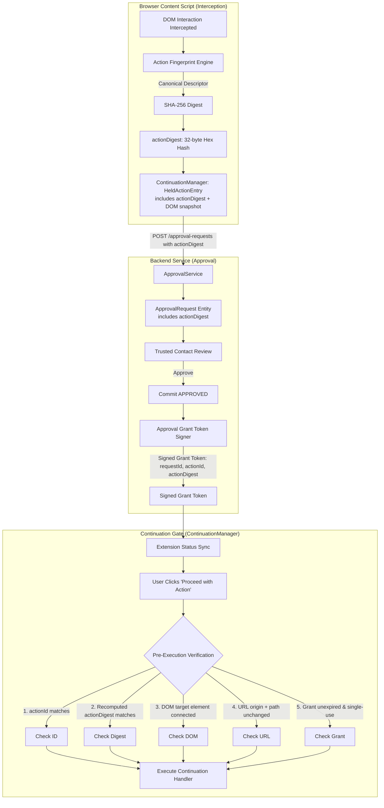

# Intercepted Actions & Backend Approval Requests: Security & Binding Audit

## 1. Executive Summary & Objective

This document provides a comprehensive security audit of the relationship between **intercepted browser actions** and **backend approval requests** across the Guardrail UI architecture (Browser Extension, Backend API, and Trusted-Contact Dashboard).

Guardrail operates as a browser safety layer designed to protect users (wards, elderly individuals, or assisted users) when interacting with high-risk, irreversible web operations (e.g., financial transactions, account deletions, external authentications).
* **Day 8** implemented synchronous capturing-phase interception (`InterceptionController`, `ContinuationManager`, and DOM event halting).
* **Day 9** introduced **Staging Mode** (isolated Shadow DOM quarantine) and explicit user cancellation.
* **Days 10–11** introduced the **Backend Approval Domain Model, State Machine, REST API Router, and Submission Operations** (`POST /api/v1/approval-requests`).
* **Day 12** established the **Trusted-Contact Dashboard** (`guardrail/dashboard/`) for caretakers to review requests and issue `APPROVED` or `REJECTED` verdicts.
* **Day 13** hardened **Approval Status Synchronization** using adaptive polling over `GET /api/v1/approval-requests/:id`.

### The Core Audit Objective:
Before implementing changes to action continuation or approval-to-action binding, this audit critically inspects the current repository implementation, data models, runtime lifecycle, and security boundaries to answer:
1. *How is an intercepted action identified?*
2. *Does an approval request bind 1-to-1 to that specific action?*
3. *Does the binding survive page reloads, tab navigation, or extension service worker suspension?*
4. *Can an approval request or decision be substituted or replayed for a different action?*
5. *How are page mutations, cancellations, and expirations handled?*
6. *Does the backend independently validate the request-action relationship?*
7. *What continuation mechanisms actually exist in the codebase today?*

---

## 2. End-to-End Flow Trace (Current Implementation)

The end-to-end lifecycle spans 7 discrete stages across the browser content script, extension background service worker, backend API service, and dashboard:

```mermaid
sequenceDiagram
    autonumber
    actor User as Protected User (Ward)
    participant DOM as Web Page DOM
    participant Content as Content Script
    participant Controller as InterceptionController
    participant CM as ContinuationManager
    participant Modal as StagingModal (Shadow DOM)
    participant BG as Background Service Worker
    participant API as Backend Approval API
    participant Repo as ApprovalRequestRepository
    participant Dash as Trusted Contact Dashboard
    actor Contact as Trusted Contact (Caretaker)

    Note over User,DOM: 1. Protected Action Detected
    User->>DOM: Triggers high-risk interaction (e.g., Click 'Delete Account')
    DOM->>Content: Capturing-phase listener fires (useCapture: true)
    Content->>Content: ActionDetector -> ActionFactory (creates GuardrailAction)
    Content->>Content: Classifier -> RiskEngine -> ResponseEngine: PROTECT

    Note over Content,CM: 2. Interception Record Created
    Content->>DOM: event.preventDefault(); event.stopImmediatePropagation();
    Content->>Controller: register(action) -> HELD record
    Content->>CM: registerHeldAction(action, record, testHandlerCallback)

    Note over Content,Modal: 3. Staging Session Opened
    Content->>Modal: showStagingModal(context, state: 'active')
    Modal->>User: Displays quarantined action details & risk reasons

    Note over User,Repo: 4. Approval Request Created & Sent to Backend
    User->>Modal: Clicks "Request Approval"
    Modal->>Content: dispatchSubmitApprovalRequestToBackground(actionId, context)
    Content->>BG: chrome.runtime.sendMessage(GUARDRAIL_SUBMIT_APPROVAL_REQUEST)
    BG->>API: POST /api/v1/approval-requests (Bearer user_token)
    API->>API: Service verifies AuthContext (requesterId)
    API->>API: Checks ActionOwnershipRegistry (isActionOwnedByUser)
    API->>Repo: Idempotency lookup (requesterId, actionId) & save(PENDING)
    API-->>BG: 201 Created (ApprovalRequest apr_...)
    BG-->>Content: Success response
    Content->>Modal: Transitions UI: approval_requested (Pill: "Approval Pending")
    Modal->>API: Starts adaptive polling GET /api/v1/approval-requests/apr_...

    Note over Contact,Dash: 5. Trusted Contact Reviews & Decides
    Contact->>Dash: Logs in; queries GET /api/v1/approvals/pending
    API->>Repo: Filters requests where Contact is assigned to Requester
    API-->>Dash: 200 OK [ApprovalRequest apr_...]
    Dash->>Contact: Displays request card, risk score, origin, element text
    Contact->>Dash: Clicks "Approve Action", confirms in modal
    Dash->>API: POST /api/v1/approvals/apr_.../decide { decision: 'APPROVED' }
    API->>Repo: Validates role, lazy expiration, transitions to APPROVED
    API-->>Dash: 200 OK (Resolved ApprovalRequest)

    Note over Modal,API: 6. Extension Retrieves Decision
    Modal->>API: GET /api/v1/approval-requests/apr_...
    API-->>Modal: 200 OK { status: 'APPROVED', decision: {...} }
    Modal->>Modal: Halts polling loop; transitions to approval_confirmed_approved
    Note over Modal: reqBtn disabled ("Approval Confirmed")<br/>Action remains safely HELD

    Note over User,CM: 7. Continuation or Cancellation Handling
    alt User Cancels Action
        User->>Modal: Clicks "Cancel Action"
        Modal->>CM: cancelAction(actionId) -> record: CANCELLED
        CM->>CM: Handler count = 0; temporary state cleared
    else User Continues Action (External Test Control Only)
        User->>DOM: Clicks external #btn-continue-test-action on test page
        DOM->>CM: continueAction(actionId) -> record: CONTINUED
        CM->>CM: Executes registered test callback exactly once
    end
```

### Flow Breakdown & Code References:

1. **Step 1: Protected Action Detected**
   - **File:** [`guardrail/extension/src/detector/action-detector.ts`](file:///Users/deepanshukhatri/Library/CloudStorage/GoogleDrive-deepanshukhatri20061972@gmail.com/My%20Drive/Cloud%20Desktop/Guardrail%20UI/guardrail/extension/src/detector/action-detector.ts), [`action-factory.ts`](file:///Users/deepanshukhatri/Library/CloudStorage/GoogleDrive-deepanshukhatri20061972@gmail.com/My%20Drive/Cloud%20Desktop/Guardrail%20UI/guardrail/extension/src/detector/action-factory.ts), [`content/index.ts:L383-L411`](file:///Users/deepanshukhatri/Library/CloudStorage/GoogleDrive-deepanshukhatri20061972@gmail.com/My%20Drive/Cloud%20Desktop/Guardrail%20UI/guardrail/extension/src/content/index.ts#L383-L411)
   - Capturing-phase listener on `document` catches the interaction before host page bubbling.
   - `createGuardrailAction()` constructs a normalized, detached data structure.
   - Evaluated synchronously through `classifyAction()`, `assessRisk()`, and `decideResponse()`.

2. **Step 2: Interception Record Created**
   - **File:** [`guardrail/extension/src/content/index.ts:L479-L508`](file:///Users/deepanshukhatri/Library/CloudStorage/GoogleDrive-deepanshukhatri20061972@gmail.com/My%20Drive/Cloud%20Desktop/Guardrail%20UI/guardrail/extension/src/content/index.ts#L479-L508), [`controller.ts`](file:///Users/deepanshukhatri/Library/CloudStorage/GoogleDrive-deepanshukhatri20061972@gmail.com/My%20Drive/Cloud%20Desktop/Guardrail%20UI/guardrail/extension/src/interception/controller.ts), [`continuation.ts:L69-L89`](file:///Users/deepanshukhatri/Library/CloudStorage/GoogleDrive-deepanshukhatri20061972@gmail.com/My%20Drive/Cloud%20Desktop/Guardrail%20UI/guardrail/extension/src/interception/continuation.ts#L69-L89)
   - When decision is `ResponseAction.PROTECT`:
     - Calls `event.preventDefault()` and `event.stopImmediatePropagation()`.
     - `defaultInterceptionController.register(action)` moves state to `DETECTED`.
     - `defaultInterceptionController.holdAction(action.id)` moves state to `HELD`.
     - `defaultContinuationManager.registerHeldAction(action, heldRecord, handler)` stores the held entry in content script memory.

3. **Step 3: Staging Session Opened**
   - **File:** [`guardrail/extension/src/staging/modal.ts`](file:///Users/deepanshukhatri/Library/CloudStorage/GoogleDrive-deepanshukhatri20061972@gmail.com/My%20Drive/Cloud%20Desktop/Guardrail%20UI/guardrail/extension/src/staging/modal.ts), [`content/index.ts:L570-L581`](file:///Users/deepanshukhatri/Library/CloudStorage/GoogleDrive-deepanshukhatri20061972@gmail.com/My%20Drive/Cloud%20Desktop/Guardrail%20UI/guardrail/extension/src/content/index.ts#L570-L581)
   - `createStagingActionContext()` snapshots sanitized interaction attributes.
   - `showStagingModal()` mounts an isolated Shadow DOM container with focus trap and ARIA live regions.
   - Primary action is "Request Approval"; secondary action is "Cancel Action".

4. **Step 4: Approval Request Created and Sent to Backend**
   - **File:** [`guardrail/extension/src/approval/submit-operation.ts:L508-L680`](file:///Users/deepanshukhatri/Library/CloudStorage/GoogleDrive-deepanshukhatri20061972@gmail.com/My%20Drive/Cloud%20Desktop/Guardrail%20UI/guardrail/extension/src/approval/submit-operation.ts#L508-L680), [`service.ts:L250-L330`](file:///Users/deepanshukhatri/Library/CloudStorage/GoogleDrive-deepanshukhatri20061972@gmail.com/My%20Drive/Cloud%20Desktop/Guardrail%20UI/guardrail/extension/src/approval/service.ts#L250-L330)
   - Pre-condition: Checks that action is actively `HELD` in `InterceptionController`.
   - `ActiveSubmissionRegistry` enforces single active submission per `actionId`.
   - Payload is strictly whitelisted and validated (`validateClientPayloadIntegrity`).
   - Dispatched via `ApprovalApiClient.createApprovalRequest()` to `POST /api/v1/approval-requests`.
   - Server assigns authoritative `requesterId` from session token; enforces compound idempotency `(requesterId, actionId)`.
   - Returns `201 Created` with canonical `ApprovalRequest` (`apr_...`).

5. **Step 5: Trusted Contact Approves or Rejects**
   - **File:** [`guardrail/dashboard/src/components/detail.ts:L600-L750`](file:///Users/deepanshukhatri/Library/CloudStorage/GoogleDrive-deepanshukhatri20061972@gmail.com/My%20Drive/Cloud%20Desktop/Guardrail%20UI/guardrail/dashboard/src/components/detail.ts#L600-L750), [`guardrail/extension/src/approval/service.ts:L450-L560`](file:///Users/deepanshukhatri/Library/CloudStorage/GoogleDrive-deepanshukhatri20061972@gmail.com/My%20Drive/Cloud%20Desktop/Guardrail%20UI/guardrail/extension/src/approval/service.ts#L450-L560)
   - Caretaker logs into Dashboard, views `GET /api/v1/approvals/pending`.
   - Submits `POST /api/v1/approvals/:id/decide` with `APPROVED` or `REJECTED`.
   - Server enforces `authContext.actorId !== request.requesterId` (self-approval prohibited).
   - Atomic CAS transition commits the decision in repository; records `decidedBy`, `decidedAt`, `decisionReason`.

6. **Step 6: Extension Retrieves Decision**
   - **File:** [`guardrail/extension/src/approval/sync-client.ts:L200-L350`](file:///Users/deepanshukhatri/Library/CloudStorage/GoogleDrive-deepanshukhatri20061972@gmail.com/My%20Drive/Cloud%20Desktop/Guardrail%20UI/guardrail/extension/src/approval/sync-client.ts#L200-L350), [`staging/modal.ts:L1878-L1916`](file:///Users/deepanshukhatri/Library/CloudStorage/GoogleDrive-deepanshukhatri20061972@gmail.com/My%20Drive/Cloud%20Desktop/Guardrail%20UI/guardrail/extension/src/staging/modal.ts#L1878-L1916)
   - Adaptive polling loop queries `GET /api/v1/approval-requests/:id`.
   - Server confirms `status: 'APPROVED'`.
   - Polling terminates immediately (terminal state).
   - Modal reflects `approval_confirmed_approved`:
     - Badge updates to "Approval Confirmed".
     - Notice updates to "Approval Confirmed • Action: HELD".
     - `reqBtn` is disabled (`reqBtn.textContent = 'Approval Confirmed'; reqBtn.disabled = true;`).
     - **Invariable invariant:** The held action is NOT executed automatically.

7. **Step 7: Continuation or Cancellation Handling**
   - **File:** [`guardrail/extension/src/interception/continuation.ts:L112-L219`](file:///Users/deepanshukhatri/Library/CloudStorage/GoogleDrive-deepanshukhatri20061972@gmail.com/My%20Drive/Cloud%20Desktop/Guardrail%20UI/guardrail/extension/src/interception/continuation.ts#L112-L219), [`content/index.ts:L682-L750`](file:///Users/deepanshukhatri/Library/CloudStorage/GoogleDrive-deepanshukhatri20061972@gmail.com/My%20Drive/Cloud%20Desktop/Guardrail%20UI/guardrail/extension/src/content/index.ts#L682-L750)
   - **Cancellation:** If user clicks "Cancel Action" in the modal, `ContinuationManager.cancelAction(actionId)` moves state to `CANCELLED`, clears `currentHeldAction`, and ensures handler count is strictly 0.
   - **Continuation:** In the current implementation, `modal.ts` has **no continuation button**. Continuation is only triggered from the demo page's external HTML button (`#btn-continue-test-action`) or debug API. When invoked, `ContinuationManager.continueAction(actionId)` runs the registered test callback and marks state `CONTINUED`.

---

## 3. Findings Across the 7 Core Determinations

### Determination 1: How Each Protected Action Is Uniquely Identified
* **Current Mechanism:** Generated in [`guardrail/extension/src/utils/metadata.ts`](file:///Users/deepanshukhatri/Library/CloudStorage/GoogleDrive-deepanshukhatri20061972@gmail.com/My%20Drive/Cloud%20Desktop/Guardrail%20UI/guardrail/extension/src/utils/metadata.ts) via `generateActionId('act')`:
  ```ts
  return `${prefix}_${crypto.randomUUID()}`;
  ```
* **Security Gap:** The `actionId` is a purely opaque, client-generated UUID.
  - It carries **no cryptographic binding** to the target element's DOM attributes, form action URL, HTTP method, or payload schema.
  - It does not prove that the action was created by Guardrail's trusted capturing hook rather than an untrusted script on the host page.

### Determination 2: Whether Each Approval Request References Exactly One Action
* **Data Model:** `ApprovalRequest` contains an `actionId` string property.
* **Storage Constraint:** Compound index `(requesterId, actionId)` enforces 1:1 active mapping in `ApprovalRequestRepository`.
* **Security Gap (Action Substitution / Semantics Decoupling):**
  - While the database row has a 1:1 relation to the string `actionId`, the backend has no knowledge of what `actionId` physically does.
  - An attacker or rogue script could intercept a benign action (e.g., clicking "Accept Cookies"), obtain caretaker approval, and then present that approval grant to authorize execution of a destructive action (e.g., "Wire ₹50,000") if the client runtime does not enforce structural integrity checks.

### Determination 3: Whether the Reference Survives Relevant Workflows
* **Extension Suspension & Background Worker:** The background service worker is stateless with respect to DOM events. The content script retains in-memory references as long as the tab remains loaded.
* **Page Reloads & Navigation (CRITICAL FAILURE):**
  - In `ContinuationManager`, the held action and continuation handler are stored as an **in-memory JavaScript closure**:
    ```ts
    private currentHeldAction: HeldActionEntry | null = null;
    ```
  - If the user reloads the page, navigates to another URL, or the browser tab closes, **the entire execution closure is irrevocably destroyed**.
  - Meanwhile, the backend approval request remains in `PENDING` status on the server until the 15-minute TTL expires.
  - If a caretaker approves the request after a page reload, **the extension cannot resume the action**. Resumption across page reloads is fundamentally impossible under the current closure-based architecture.

### Determination 4: Whether an Approval Request Can Be Reused for Another Action
* **Current Vulnerability:**
  - `ContinuationManager.continueAction(actionId)` only checks:
    1. `record.state === InterceptionState.HELD`
    2. `executionCount === 0`
  - It **does NOT take or verify an approval grant token**, a backend request ID, or a signature!
  - If an approval decision is received for Request $X$ (which was for Action $A$), nothing in `ContinuationManager` cryptographically restricts continuation to Action $A$. If an attacker calls `continueAction(Action B)`, `ContinuationManager` will execute Action $B$ as long as Action $B$ is held!

### Determination 5: Handling of Navigation, Reloads, Expiration, Cancellation, and Changed Page State
* **Page Navigation & Reloads:** Unhandled. In-memory state is wiped. The server request becomes orphaned in `PENDING` state until TTL timeout.
* **Changed Page State / DOM Mutation (TOCTOU):**
  - While an action sits in Staging Mode waiting for caretaker approval (up to 15 minutes), the host page's scripts continue executing.
  - A malicious or dynamic script could alter form field values, change a form's `action` target, delete the target DOM button, or redirect the page.
  - When continuation occurs, the system does not re-validate that the target element or page state matches the state captured at interception time.
* **Expiration:** Handled robustly. 15-minute server expiration transitions requests to `EXPIRED`, returning HTTP `410 Gone` for late reviewer decisions. Polling synchronizes `EXPIRED` to the extension, which blocks continuation.
* **Cancellation:** Handled cleanly. User cancellation transitions the client record to `CANCELLED`, clears the held entry, and prevents execution.

### Determination 6: Whether the Backend Independently Validates the Request-Action Relationship
* **Finding:** **NO**. The backend has no visibility into the client DOM or native browser events.
* **Flaw in Action Ownership Verification:**
  - In [`guardrail/extension/src/approval/authorization.ts:L236-L240`](file:///Users/deepanshukhatri/Library/CloudStorage/GoogleDrive-deepanshukhatri20061972@gmail.com/My%20Drive/Cloud%20Desktop/Guardrail%20UI/guardrail/extension/src/approval/authorization.ts#L236-L240):
    ```ts
    public isActionOwnedByUser(actionId: string, userId: string): boolean {
      const owner = this.actionOwners.get(actionId);
      if (!owner) {
        // If no explicit prior owner is registered, the action is unconstrained
        return true;
      }
      return owner === userId;
    }
    ```
  - Because actions are never pre-registered by an isolated authority, **any authenticated user can claim any newly observed `actionId`**.
  - The backend accepts the client's `actionDescription`, `origin`, `actionType`, and `riskLevel` at face value.

### Determination 7: Reality of Existing Action-Continuation Mechanisms
* **Finding:** The repository contains **no general-purpose DOM event replay mechanism** (`element.click()`, `form.requestSubmit()`, or synthetic event dispatch).
* **Controlled Test Callback Only:**
  - `ContinuationManager` explicitly documents:
    > *"Executes registered controlled test handlers directly. Does NOT attempt to replay synthetic DOM clicks (`element.click()`), which is dangerous, unreliable, and susceptible to recursive interception loops."*
  - The continuation callback in `content/index.ts` only logs to the console and dispatches a custom DOM event (`guardrail:controlled-handler-executed`) for automated test fixtures.
  - In `modal.ts`, when status becomes `APPROVED`, the primary button is disabled (`reqBtn.textContent = 'Approval Confirmed'; reqBtn.disabled = true;`). There is currently **no user-facing continuation trigger inside the Staging Modal**.

---

## 4. Comprehensive Security Gap Catalog

| ID | Vulnerability / Architectural Gap | Severity | Description & Threat Vector |
| :---: | :--- | :---: | :--- |
| **G-1** | **Unauthenticated Action Identity** | **High** | The `actionId` is an arbitrary client-generated string. The backend does not verify whether the action originated from the extension's secure pipeline or from a hostile page script. |
| **G-2** | **Semantic Action Substitution** | **High** | Approval requests are not cryptographically bound to the structural attributes of the action (DOM element ID, tag, form action URL, method, non-sensitive field keys). An approval for a benign action could be swapped for a high-risk action. |
| **G-3** | **Default-Permissive Action Ownership** | **Medium** | `InMemoryActionOwnershipRegistry` returns `true` for any action that was not explicitly pre-registered. Any user session can claim arbitrary action IDs. |
| **G-4** | **Total State Loss Across Page Reloads** | **High** | Held actions and continuation handlers are stored purely in content script memory closures. Page reload destroys the closure while leaving the backend request pending. Resumption across reloads is impossible. |
| **G-5** | **Time-of-Check to Time-of-Use (TOCTOU) DOM Mutation** | **Medium** | While waiting up to 15 minutes for approval, the host page can mutate form actions, alter DOM trees, or remove elements without Guardrail detecting the drift before continuation. |
| **G-6** | **Grantless Action Continuation** | **High** | `ContinuationManager.continueAction(actionId)` requires only that the action be in `HELD` state. It does not accept, inspect, or verify a signed Approval Grant Token issued by the backend. |
| **G-7** | **Missing Continuation Trigger in Staging Modal** | **Low (UX)** | Upon discovering `APPROVED` status, the Staging Modal disables the primary button (`reqBtn.disabled = true`). There is no UI button for the user to proceed with the action from within the modal. |

---

## 5. Minimal, Secure Design: Cryptographic Action-Approval Binding

To satisfy all security requirements without fabricating ungrounded subsystems or inventing an unstable architecture, we extend the existing data models and components as follows:



### 5.1 Canonical Action Fingerprint / Digest (`actionDigest`)

At the moment of interception, the content script generates a deterministic **Action Fingerprint**:
1. **Canonical Attributes Included (Non-Sensitive Only):**
   - `origin`: Normalized URL origin (`scheme://host:port`).
   - `pathname`: Normalized URL pathname (excluding query parameters and hash fragments to prevent credential/token leakage).
   - `actionType`: `CLICK`, `SUBMIT`, `INPUT`, `NAVIGATION`.
   - `targetTagName`: Target element's tag name (e.g. `BUTTON`, `FORM`, `A`).
   - `targetId`: Element ID if present (`test-action-btn`).
   - `targetName`: Form field or button name attribute (`transferSubmit`).
   - `formAction`: Normalized form action URL path (if form submission).
   - `formMethod`: Form method (`POST`, `GET`).
   - `formFieldKeys`: Alphabetically sorted list of input element `name` attributes present in the form (e.g., `["account", "amount", "notes"]`).
   - `actionLabel`: Sanitized visible button/link text (trimmed and capped at 100 characters).

2. **Strict Privacy Safeguards (Zero Secrets):**
   - **NO** form input values (no amounts, no text entries).
   - **NO** passwords, PINs, or passphrases.
   - **NO** credit card numbers, CVVs, or bank account numbers.
   - **NO** OTPs or 2FA codes.
   - **NO** URL query parameters (which may contain auth tokens).
   - **NO** session cookies or authorization headers.

3. **Digest Computation:**
   - Serialize the canonical attributes to a deterministic JSON string with sorted keys:
     ```ts
     const canonicalString = JSON.stringify(canonicalDescriptor, Object.keys(canonicalDescriptor).sort());
     ```
   - Compute SHA-256 digest:
     ```ts
     const actionDigest = await crypto.subtle.digest('SHA-256', new TextEncoder().encode(canonicalString));
     ```
   - Result: 64-character hex string (e.g., `d2d2a4...`).

### 5.2 Binding in Approval Request & Authoritative Grant

1. **Client Submission Payload:**
   - `ClientApprovalRequestPayload` includes `actionDigest: string`.
2. **Backend Entity Persistence:**
   - `ApprovalRequest` stores `actionDigest`.
   - When a caretaker reviews the request on the Dashboard, they review the human-readable summary, but the server's record is anchored to `actionDigest`.
3. **Approval Grant Token:**
   - When a trusted contact approves, the server issues an **Approval Grant** containing:
     ```json
     {
       "requestId": "apr_01J9X4M5...",
       "actionId": "act_f47ac10b...",
       "actionDigest": "d2d2a4e9b7...",
       "requesterId": "usr_alice",
       "decidedBy": "tc_bob",
       "grantedAt": "2026-10-24T02:00:00.000Z",
       "expiresAt": "2026-10-24T02:15:00.000Z"
     }
     ```

### 5.3 Client-Side Pre-Execution Validation (Continuation Gate)

When the extension discovers `APPROVED` status:
1. The Staging Modal presents an active **"Proceed with Action"** button.
2. The action is **NEVER executed automatically**. The user must explicitly click "Proceed with Action".
3. When clicked, `ContinuationManager.continueAction(actionId, grant)` executes the **Continuation Gate**:
   - **Verification 1 (Action ID):** `heldEntry.action.id === grant.actionId`.
   - **Verification 2 (Digest Match):** Re-compute the action fingerprint on the live DOM target element and assert:
     $$\text{RecomputedDigest} === \text{grant.actionDigest}$$
     *If an attacker swapped the DOM form action from `/transfer` to `/steal`, the digest mismatch aborts execution.*
   - **Verification 3 (DOM Liveness):** Assert `targetElement.isConnected === true`.
   - **Verification 4 (URL Integrity):** Assert `window.location.origin === heldEntry.action.page.url.origin` and `window.location.pathname` matches.
   - **Verification 5 (Expiration):** Assert `Date.now() < Date.parse(grant.expiresAt)`.
   - **Verification 6 (Single-Use):** Mark grant consumed.

### 5.4 Page Reload & Navigation Invalidation Policy

* **Truthful Claim:** In-memory execution closures cannot survive page reloads. We explicitly state:
  > **POLICY:** An intercepted action held in browser runtime is **valid only for the lifetime of that specific page document context**. If the tab reloads or navigates, the held action is permanently invalidated.
* **Cleanup on Unload:**
  - Attach a `beforeunload` / `unload` handler to the content script.
  - If an action is `HELD` and an approval request is `PENDING`, dispatch a beacon to cancel the request:
    `POST /api/v1/approval-requests/:id/cancel` with reason `PAGE_UNLOADED_BY_USER`.
  - If a user reloads the page, any subsequent response received is rejected with `ACTION_INVALIDATED_BY_PAGE_RELOAD`.

---

## 6. Review of Security Requirements

| Requirement | Audit Finding & Architectural Compliance |
| :--- | :--- |
| **Do not assume client-provided action ID proves legitimacy** | Addressed: Action IDs are treated as arbitrary client references. The secure binding is enforced via the `actionDigest` and pre-execution continuation gate. |
| **Do not treat hostname or URL alone as proof of identity** | Addressed: Action identity incorporates target element tag, element ID, form action URL, method, and non-sensitive form field key sets. |
| **Do not include passwords, OTPs, card numbers, or raw values** | Addressed: The `actionDigest` fingerprint schema explicitly whitelists only structural keys and element tags; all values and sensitive fields are omitted. |
| **Do not claim actions survive reloads unless supported** | Addressed: Documented that actions are strictly ephemeral in-memory closures. Resumability across reloads is explicitly disclaimed and handled via invalidation. |
| **Do not create a new architecture if existing can be extended** | Addressed: Reuses `InterceptionController`, `ContinuationManager`, `ApprovalRequest`, `ApprovalApiClient`, and `StagingModal` without adding new subsystems. |
| **Do not automatically execute held actions on status change** | Addressed: Invariant strictly upheld. Status changes update the UI only. Execution requires explicit user confirmation via the Continuation Gate. |

---

## 7. Files Changed / To Be Modified

When implementing this secure binding design in subsequent tasks:

1. **`guardrail/extension/src/types/actions.ts` & `staging.ts`**:
   - Add `ActionFingerprintDescriptor` interface and `actionDigest` property to `GuardrailAction` and `StagingActionContext`.
2. **`guardrail/extension/src/utils/fingerprint.ts`** *(New)*:
   - Implement `computeActionDigest(action, element)` using Web Crypto `crypto.subtle.digest`.
3. **`guardrail/extension/src/types/approval.ts`**:
   - Add `actionDigest` to `ClientApprovalRequestPayload`, `ApprovalRequest`, and `ApprovalDecisionMetadata`.
   - Add `ApprovalGrant` interface.
4. **`guardrail/extension/src/approval/model.ts`**:
   - Validate `actionDigest` format (64-character lowercase hex string).
5. **`guardrail/extension/src/approval/service.ts`**:
   - Preserve `actionDigest` during `createRequest` and attach `ApprovalGrant` upon `APPROVED` decision.
6. **`guardrail/extension/src/interception/continuation.ts`**:
   - Update `continueAction(actionId, grant)` to enforce the 5-point Continuation Gate before executing the held closure.
7. **`guardrail/extension/src/staging/modal.ts`**:
   - Replace disabled button in `approval_confirmed_approved` with an enabled "Proceed with Action" button wired to `continueAction`.
8. **`guardrail/extension/src/content/index.ts`**:
   - Add `beforeunload` listener to invalidate held actions and notify backend upon tab unload.

---

## 8. Unresolved Questions & Next Steps

1. **Form Value Restoration vs. Native Submission:**
   - If an action is a form submission (`SUBMIT`), the form fields currently remain filled in the DOM while Staging Mode is open.
   - When continuation is triggered, does Guardrail invoke `HTMLFormElement.prototype.requestSubmit()` directly, or will it remain a controlled callback for demo sites?
2. **Multi-Tab Concurrency:**
   - If a user opens the same page in two tabs and triggers two distinct actions, both generate distinct `actionId`s.
   - Because `ContinuationManager` currently holds only a single `currentHeldAction`, a second action in the same content script will overwrite the first. Should `ContinuationManager` maintain a `Map<string, HeldActionEntry>` instead of a single slot?
3. **Backend Persistent Datastore:**
   - `DevelopmentInMemoryApprovalRequestRepository` is currently development-only. When `guardrail/server` is initialized with PostgreSQL/SQLite, database migrations must include `action_digest` with an index on `(requester_id, action_digest)`.
