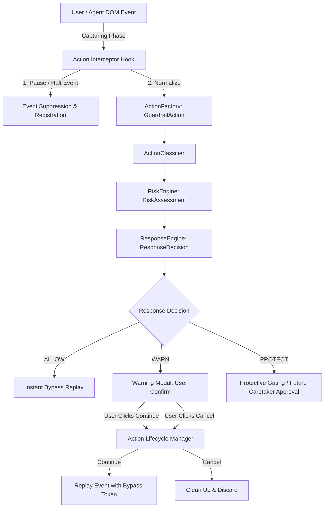
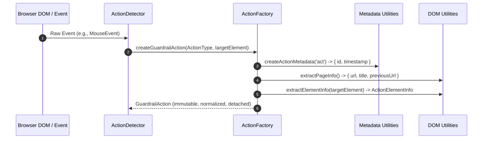
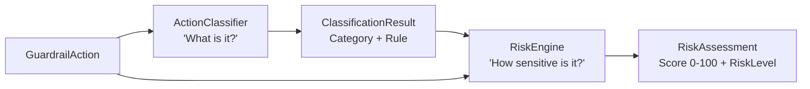
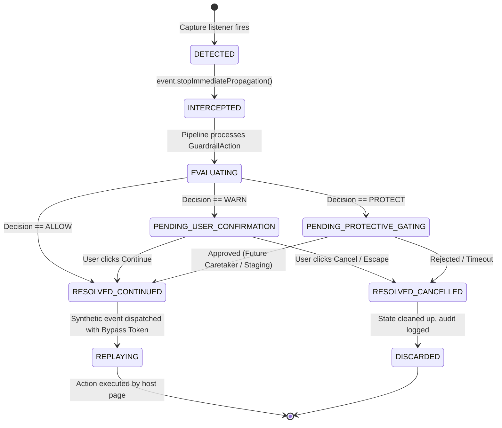
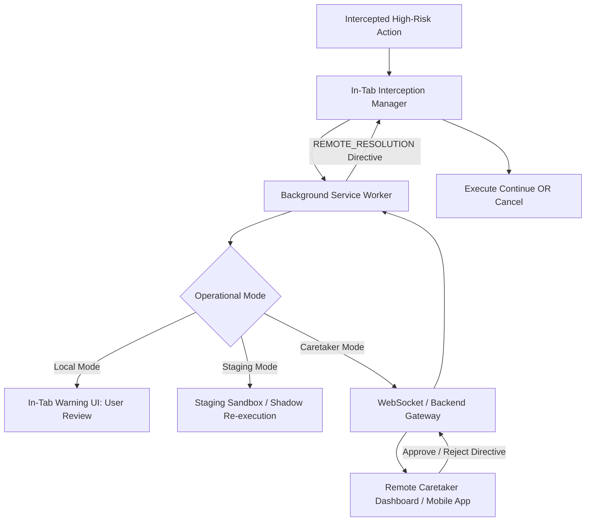

# Browser Action Interception Architecture

## 1. Executive Summary & Objective

This document defines the architectural blueprint and operational mechanics for **Browser Action Interception** within the Guardrail UI system.

Guardrail monitors, evaluates, and mediates user and agent interactions in web browsers. In Days 1 through 7, the system established:
* Normalized interaction models (**`GuardrailAction`**)
* An ambient sensor layer (**`ActionDetector`**)
* A semantic domain classifier (**`ActionClassifier`**)
* A quantitative risk evaluation engine (**`RiskEngine`**)
* A deterministic policy governance engine (**`ResponseEngine`**)
* An isolated Shadow DOM user advisory interface (**Guardrail Warning UI**)
* A centralized background service worker coordinator (**Service Worker**)

Prior to Day 8, the pipeline operated in **passive observation mode**: events were detected, categorized, scored, and logged, but the underlying browser actions proceeded unimpeded.

The objective of Day 8 is to establish active **Interception Architecture**: the capability to intercept, suspend, gate, and either resume or abort high-risk interactions before irreversible state changes occur in the host web application.



---

## 2. Current Browser Event Detection Architecture

Browser events are currently detected via an ambient sensor layer implemented in `guardrail/extension/src/detector/action-detector.ts`.

### 2.1 Event Delegation in the Capturing Phase
`ActionDetector` uses top-level event delegation on the root `document` object using the DOM capturing phase (`useCapture: true`):

```typescript
// src/detector/action-detector.ts
document.addEventListener('click', this.handleClick, true);
document.addEventListener('change', this.handleChange, true);
document.addEventListener('submit', this.handleSubmit, true);
window.addEventListener('popstate', this.handleSpaNavigation);
window.addEventListener('hashchange', this.handleSpaNavigation);
```

Registering listeners in the capturing phase ensures that Guardrail receives DOM events at the window/document level *before* they descend down the DOM tree to target elements in the standard bubbling phase.

### 2.2 Event Detection Mechanics by Type

| Action Type | Trigger Event | Detection Logic & Helpers | Current Behavior |
| :--- | :--- | :--- | :--- |
| **`CLICK`** | `click` | Inspects `event.target` using `findInteractiveElement()` (`src/utils/dom.ts`). Matches interactive tags (`button`, `a`, `[role="button"]`, etc.). Skips Guardrail's internal Shadow DOM UI (`#guardrail-warning-ui-host`). Defers form submit buttons to the `SUBMIT` handler via `isFormSubmitTrigger()`. | **Passive**: Clicks are inspected and forwarded to callbacks. The native event continues propagating down the DOM immediately. |
| **`INPUT`** | `change` | Inspects `event.target` using `findFormInputElement()` (`src/utils/dom.ts`). Matches form controls (`input:not([type="button"])`, `textarea`, `select`). | **Passive**: Triggers upon form control blur/change. Does not block keystrokes or value mutations. |
| **`SUBMIT`** | `submit` | Checks if `event.target` is an `HTMLFormElement` or closest ancestor form. | **Passive**: Form submission proceeds natively without call to `preventDefault()`. |
| **`NAVIGATION`** | Initial load, `popstate`, `hashchange` | Compares `window.location.href` against `lastTrackedUrl` in `trackNavigation()`. | **Passive**: Logs navigation events after or during route transitions. |

### 2.3 Passive Observation Status
In the current implementation, event listener callbacks (`handleClick`, `handleChange`, `handleSubmit`) do **not** invoke `event.preventDefault()`, `event.stopPropagation()`, or `event.stopImmediatePropagation()`. Consequently, all events trigger host application logic without delay.

---

## 3. How `GuardrailAction` Objects Are Created

When an event triggers `ActionDetector`, it delegates creation of the normalized data model to `createGuardrailAction()` in `src/detector/action-factory.ts`.



### 3.1 Data Model Contract (`GuardrailAction`)
Defined in `src/types/actions.ts`:
* **`id`**: Unique identifier prefixed with `act_` (e.g., `act-1710000000-abc123`).
* **`type`**: Canonical enum (`CLICK`, `INPUT`, `SUBMIT`, `NAVIGATION`).
* **`category`**: Semantic classification category (added during classification).
* **`element`**: Detached `ActionElementInfo` (`tagName`, `id`, `className`, `visibleText`).
* **`page`**: Detached `ActionPageInfo` (`url`, `title`, `previousUrl`).
* **`timestamp`**: ISO 8601 string.

### 3.2 Strict Privacy Safeguards & Non-Sensitive Sanitization
To prevent credential and financial data leakage:
1. **Zero Input Value Capture**: `extractVisibleText()` in `src/utils/dom.ts` strictly ignores the `.value` property of text inputs, password fields, textareas, credit card fields, and select controls.
2. **Placeholder Only**: For text-based input controls, only the static `placeholder` string is extracted.
3. **Button Values Only**: The `.value` property is extracted only for explicit button-style elements (`<input type="submit">`, `<input type="button">`).
4. **Length Capping**: Visible text strings are truncated at 200 characters.

---

## 4. Classification and Risk Assessment Pipeline

Once a `GuardrailAction` is constructed, it is evaluated across two decoupled layers:



### 4.1 Action Classification (`ActionClassifier`)
Defined in `src/classifier/classifier.ts` and `rules.ts`:
* **Purpose**: Determines the semantic intent behind an action without evaluating risk severity.
* **Mechanism**: Evaluates the action against an ordered sequence of deterministic heuristic rules (`CLASSIFICATION_RULES`).
* **Categories**:
  * `AUTHENTICATION`: Login, password inputs, SSO, credential forms.
  * `PAYMENT`: Checkout buttons, payment forms, ₹/$/€ amounts.
  * `DESTRUCTIVE`: Delete account, purge, drop, cancel subscription.
  * `DOWNLOAD`: Export data, download PDF/ZIP/CSV.
  * `EXTERNAL_NAVIGATION`: Off-origin links, third-party redirects.
  * `GENERAL`: Fallback category for standard UI interactions.
* **Output**: `ActionClassificationResult` containing `actionId`, `category`, `matchedRule`, `confidence`, and non-sensitive `reason`.

### 4.2 Risk Assessment (`RiskEngine`)
Defined in `src/risk/engine.ts`, `rules.ts`, and `signals.ts`:
* **Purpose**: Evaluates operational and security sensitivity on a normalized quantitative scale (0–100).
* **Guiding Principles**:
  * **Heuristic Indicator Only**: Risk score is a measure of operational sensitivity, not a statistical probability of malice or fraud.
  * **No Proof of Malice**: Elevated scores reflect potential blast radius under Guardrail policy, not malicious intent.
* **Evaluation Pipeline**:
  1. Evaluates declarative rules (`INITIAL_RISK_RULES`) against the action and classification context.
  2. Maps matched rules to distinct risk signals (`PAYMENT_ACTION`, `DESTRUCTIVE_ACTION`, `AUTHENTICATION_ACTION`, `DOWNLOAD_ACTION`, `EXTERNAL_NAVIGATION`).
  3. Deduplicates signals (retaining highest score contribution per signal).
  4. Sums score contributions (e.g., Destructive `+50`, Payment `+40`, Auth `+20`, Download `+10`, External `+20`).
  5. Clamps final score to `[0, 100]`.
  6. Maps clamped score to categorical `RiskLevel` using centralized thresholds:
     * **`LOW`**: 0 to 24 (Routine read/navigation interactions)
     * **`MEDIUM`**: 25 to 49 (Moderate impact, reversible changes)
     * **`HIGH`**: 50 to 74 (Sensitive operations, financial triggers, authentication)
     * **`CRITICAL`**: 75 to 100 (Severe impact, permanent deletions, compounded high-risk signals)
* **Output**: `RiskAssessment` containing `actionId`, `score`, `riskLevel`, `reasons`, and `evaluatedAt`.

---

## 5. How Response Decisions Are Generated

The governance policy layer is strictly decoupled from risk assessment:

```mermaid
flowchart LR
    Assessment[RiskAssessment<br/>Score + RiskLevel] --> RespEngine[ResponseEngine<br/>'What policy applies?']
    PolicyConfig[ResponsePolicyMapping] --> RespEngine
    RespEngine --> Decision[ResponseDecision<br/>ALLOW | WARN | PROTECT]
```

### 5.1 Response Engine (`ResponseEngine`)
Defined in `src/response/engine.ts` and `rules.ts`:
* **Separation of Concerns**: The Risk Engine determines *how sensitive an action is*; the Response Engine determines *how Guardrail should govern it*.
* **Current Policy Mapping (`DEFAULT_RESPONSE_POLICY`)**:
  * `LOW` $\rightarrow$ **`ALLOW`**: Routine interaction; permitted without intervention.
  * `MEDIUM` $\rightarrow$ **`WARN`**: Advisory notification; user attention recommended.
  * `HIGH` $\rightarrow$ **`WARN`**: Elevated risk; confirmation modal presented before continuing.
  * `CRITICAL` $\rightarrow$ **`PROTECT`**: Protective mechanism required before execution.
* **Output**: `ResponseDecision` containing `actionId`, `response`, `reasons`, and `createdAt`.

### 5.2 Current Content Script Branching (`src/content/index.ts`)
* **`ALLOW`**: Action proceeds natively; telemetry dispatched to Service Worker.
* **`WARN`**: Mounts the isolated Shadow DOM warning modal (`showWarningModal()`). The modal presents "Continue" and "Cancel" buttons, but currently only logs console messages on user click.
* **`PROTECT`**: Logs an advisory warning; currently does not block execution in prototype mode.

---

## 6. Where Interception Must Occur in the Architecture

To transition from passive observation to active enforcement, interception must be placed at a specific boundary in the browser execution model.

```mermaid
graph TD
    subgraph Browser Event Loop
        NativeEvent[Native DOM Event Dispatched] --> CapturePhase[Window / Document Capture Phase]
        CapturePhase --> TargetPhase[Target Element Handlers]
        TargetPhase --> BubblePhase[Bubbling Phase Handlers]
        BubblePhase --> DefaultAction[Browser Default Action]
    end

    subgraph Guardrail Interception Hook
        CapturePhase -->|Synchronous Hook| InterceptCheck{Should Intercept?}
        InterceptCheck -->|Yes| HaltEvent[event.preventDefault()<br/>event.stopImmediatePropagation()]
        HaltEvent --> Enqueue[Hold in Action Lifecycle Manager]
        InterceptCheck -->|No / Bypassed| AllowThrough[Pass Down to Target Handlers]
    end
```

### 6.1 The Synchronous Execution Dilemma
A fundamental constraint of the browser DOM event loop is that **event dispatch is synchronous**:
* You cannot pause a native JavaScript event dispatch while awaiting an asynchronous Promise (such as message passing to the Service Worker or remote network calls).
* If an event listener returns without calling `preventDefault()` or `stopPropagation()`, the event continues propagating to page handlers immediately.

### 6.2 Architectural Placement of the Interception Boundary
Interception must occur at the **Synchronous Capture Boundary** on the `document` root:
1. **Entry Point**: The `ActionDetector` capturing listener (`useCapture: true`) receives the raw DOM event first.
2. **Synchronous Evaluation / Pre-Filter**: The interceptor checks whether the event represents an interactive target requiring gating.
3. **Immediate Suppression**: For actionable candidate events, the interceptor immediately halts propagation (`event.preventDefault()` and `event.stopImmediatePropagation()`).
4. **Action Enqueueing**: The physical event context (target element, event attributes) is stored in the **Action Lifecycle Manager**.
5. **Decoupled Evaluation**: The normalized `GuardrailAction` is evaluated through the `ActionClassifier`, `RiskEngine`, and `ResponseEngine`.
6. **Resolution Routing**:
   * If `ALLOW`: The action is immediately re-dispatched via synthetic bypass.
   * If `WARN`: The Warning Modal is mounted; action remains suspended.
   * If `PROTECT`: Gated pending protective resolution.

### 6.3 Decoupling Rules & Constraints
* **No DOM in Risk Scoring**: `RiskEngine` must remain pure TypeScript operating on serializable objects. It must never access `document`, `HTMLElement`, or browser APIs.
* **No Risk Scoring in the Interceptor Hook**: The interceptor hook only coordinates event capture and suppression; it delegates scoring to `RiskEngine`.
* **Not All-in-Content-Script**: The content script manages DOM event suppression and replay. The Service Worker manages tab session state, cross-tab audit trails, policy configurations, and future server coordination.

---

## 7. Lifecycle Ownership of an Intercepted Action

The intercepted action's lifecycle is owned by the **Action Lifecycle Manager** residing in the tab's content script runtime, coordinated with the **Background Service Worker**.



### 7.1 State Machine Specification

| State | Responsible Component | Description |
| :--- | :--- | :--- |
| **`DETECTED`** | `ActionDetector` | Raw DOM event captured at `document` capturing phase. |
| **`INTERCEPTED`** | `InterceptionManager` | Event suppressed; target element reference and context held in memory. |
| **`EVALUATING`** | Pipeline (`Classifier`, `Risk`, `Response`) | Synchronous / microtask evaluation of classification, risk, and response. |
| **`PENDING_USER_CONFIRMATION`** | `WarningModal` + `InterceptionManager` | Modal displayed in Shadow DOM; action held waiting for user action. |
| **`PENDING_PROTECTIVE_GATING`** | `InterceptionManager` + `ServiceWorker` | Action suspended pending high-level or remote approval. |
| **`RESOLVED_CONTINUED`** | `InterceptionManager` | Approval granted; action marked for replay. |
| **`RESOLVED_CANCELLED`** | `InterceptionManager` | Rejection or cancellation; action marked for disposal. |
| **`REPLAYING`** | `InterceptionManager` | Programmatic invocation or synthetic dispatch with bypass flag. |
| **`DISCARDED`** | `InterceptionManager` + `ServiceWorker` | Memory released; cancellation event dispatched to audit log. |

### 7.2 Ownership Boundary: Tab vs Service Worker
* **In-Tab Interception Manager**:
  * Owns the **live DOM node reference** (`HTMLElement`).
  * Owns the event replay mechanism (`element.click()`, `form.requestSubmit()`).
  * Owns the visual modal presentation in the active tab.
* **Background Service Worker**:
  * Owns the **session audit log** across all tabs.
  * Owns cross-tab correlation and persistence.
  * Owns communication with future external policy servers.
  * Cannot own DOM references (service workers have no DOM access).

---

## 8. How an Action Is Continued or Cancelled

When an event has been intercepted, the browser's native event dispatch has been halted. The system must provide reliable mechanisms to either execute the intended interaction or safely abort it.

### 8.1 Action Continuation (Execution)
Resuming an intercepted action requires re-triggering the interaction without triggering an infinite interception loop:

1. **Bypass Token Mechanism**:
   * A unique symbol, WeakSet, or custom attribute (e.g., `__GUARDRAIL_BYPASS__`) marks the action or synthetic event as approved by Guardrail.
   * When `ActionDetector` encounters an event bearing the bypass token, it ignores it and allows it to pass directly to host page handlers.
2. **Replay Strategy by Interaction Mechanism**:
   * **Button Clicks (`HTMLButtonElement`)**:
     * Invoke native `targetElement.click()` with bypass flag set.
   * **Links (`HTMLAnchorElement`)**:
     * If native `click()` fails or behaves inconsistently across browsers, trigger navigation programmatically via `window.location.assign(anchor.href)` (if target is same-tab) or `window.open(anchor.href, anchor.target)`.
   * **Form Submissions (`HTMLFormElement`)**:
     * Use modern `form.requestSubmit(submitterButton)`. Unlike legacy `form.submit()`, `requestSubmit()` triggers HTML5 form validation and form submit event handlers while identifying the originating submit button.
   * **Form Inputs (`change` / `input`)**:
     * Restore input value and dispatch a synthetic `Event('change', { bubbles: true })` marked with the bypass token.

### 8.2 Action Cancellation (Abortion)
When an action is cancelled (user clicks Cancel, presses Escape, closes the modal, or a timeout expires):
1. **Discard Held Context**: The reference to the target DOM element in `InterceptionManager` is dereferenced to prevent memory leaks.
2. **Dismiss UI**: `dismissWarningModal()` removes the host container and Shadow DOM from the document.
3. **Audit Dispatch**: A cancellation notification (`GUARDRAIL_ACTION_CANCELLED`) is transmitted to the Service Worker for telemetry.
4. **Zero Page Mutation**: The webpage DOM is left completely intact; no host scripts are invoked, and no form submission or navigation occurs.

---

## 9. Technical Limitations of Browser-Level Interception

Event interception within the Web Extensions security architecture has inherent constraints. Accurate documentation of these limitations is required to maintain engineering integrity.

### 9.1 `event.preventDefault()` vs. Custom Page Event Listeners
* `event.preventDefault()` **only** cancels the user agent's default behavior (e.g., preventing a link from navigating or a form from submitting).
* `event.preventDefault()` **does NOT** stop custom JavaScript event listeners attached by the web page (via `addEventListener`) from executing!
* To stop custom page listeners, Guardrail must call `event.stopImmediatePropagation()`.
* **The Registration Race**: `event.stopImmediatePropagation()` only prevents other listeners from executing if Guardrail's listener fires **before** them. By attaching to `document` in the capturing phase (`useCapture: true`), Guardrail ensures its listener executes before any bubbling or target-phase listeners on descendant elements.

### 9.2 The `isTrusted` Event Constraint
* Browsers distinguish between authentic user gestures (`event.isTrusted = true`) and script-generated events (`event.isTrusted = false`).
* Web extension content scripts **cannot** fabricate or set `isTrusted = true` on synthetic `Event` objects.
* Certain high-security web applications (e.g., banking portals, payment SDKs) verify `event.isTrusted` before processing submissions.
* Invoking native DOM methods (such as `element.click()`) produces events that some browsers still flag as untrusted if initiated from content script contexts.

### 9.3 Extension Isolation and Script Injection Timing
* Under Manifest V3, content scripts execute in an **isolated world**:
  * Content scripts share the DOM with the host page, but have a separate JavaScript execution heap.
  * Content scripts cannot access JavaScript variables, closures, or framework state (React fibers, Vue instances) directly in the host page's main world.
* If a host page attaches capture listeners to `window` before the content script initializes, or uses inline HTML attributes (`onclick="..."`), event handling order can vary.

### 9.4 Shadow DOM & Third-Party iFrames
* **Closed Shadow Roots**: Content scripts cannot inspect or intercept DOM trees inside elements created with `{ mode: 'closed' }`.
* **Cross-Origin iFrames**: Content scripts can only inspect frames where the extension has explicit host permissions. Cross-origin payment iframes (such as Stripe Elements or Razorpay modal frames) operate in distinct security origins and cannot be intercepted from the parent document's content script.

### 9.5 No Claim of Universal Interception
Guardrail does **not** claim universal interception across all arbitrary websites. Canvas-rendered UIs, WebAssembly runtimes, proprietary plugins, and closed-origin iframes cannot be governed purely through standard DOM event capture.

---

## 10. Why a Controlled Test Website Is Necessary

Because arbitrary commercial websites employ aggressive anti-extension scripts, obfuscated single-page application frameworks, WebAssembly, and cross-origin payment iframes, developing and validating interception against random live websites introduces significant confounding variables.

A controlled test suite (located in `guardrail/demo-sites/test-page/`) is necessary for the following reasons:

1. **Deterministic Test Fixtures**:
   * Provides clean, standardized instances of standard HTML elements: native `<button>`, anchor links `<a>`, multi-field `<form>` elements, text inputs, textareas, and dropdowns.
2. **Explicit Verification of Event Suppression**:
   * The test page maintains an independent local event log (`Page Event Log` in `script.js`).
   * When Guardrail intercepts an event, automated and manual tests can verify that the test page's local handler **did not fire**, confirming genuine event suppression.
3. **Verification of Continuation / Replay**:
   * When "Continue" is selected, tests can verify that the replayed action reaches the test page's listener and logs the expected entry.
4. **Edge Case Simulation**:
   * Enables reproducible testing for rapid repeated clicks, dynamic DOM element creation, false-positive heuristic keywords ("Learn about payments" vs "Pay ₹5,000"), and SPA navigation transitions without network flakiness.

---

## 11. Future Readiness: Staging Mode and Caretaker Approval

The architecture established for Day 8 is intentionally decoupled to support future extensions without requiring redesign of the core pipeline:



### 11.1 Local vs. Remote Agnostic Protocol
* The `InterceptionManager` does not know or care whether an action approval originates from:
  1. A local user clicking "Continue" in the warning modal.
  2. A local Staging Mode sandbox verifying payload safety.
  3. A remote family member or caretaker clicking "Approve" on an administrative dashboard.
* The contract is a unified resolution message:
  ```typescript
  interface ActionResolutionDirective {
    actionId: string;
    resolution: 'CONTINUE' | 'CANCEL';
    source: 'LOCAL_USER' | 'STAGING_MODE' | 'CARETAKER_REMOTE';
    reason?: string;
  }
  ```

### 11.2 Staging Mode Integration
* In future Staging Mode, actions classified as `CRITICAL` or `PROTECT` will not be directly executed against live endpoints.
* Instead, the intercepted action payload will be forwarded to a mock or staging sandbox where side-effects are previewed before final confirmation.

### 11.3 Caretaker Approval Integration
* High-risk actions from protected users (e.g., elderly users, automated agents) will enter `PENDING_PROTECTIVE_GATING`.
* The background Service Worker transmits an event notification across a secure WebSocket channel to the Guardrail Server (`guardrail/server/`).
* A caretaker reviews the transaction context on the Guardrail Dashboard (`guardrail/dashboard/`).
* Upon caretaker decision, the server issues a signed approval directive back through the Service Worker to the tab's `InterceptionManager`, triggering action continuation or cancellation.

---

## 12. Existing Code Limitations Affecting Day 8

Prior to implementing Day 8 interception code, the following limitations in the existing codebase must be acknowledged and addressed:

1. **No Event Suppression in `ActionDetector`**:
   * In `src/detector/action-detector.ts`, `handleClick`, `handleChange`, and `handleSubmit` currently do not call `event.preventDefault()` or `event.stopImmediatePropagation()`. Events fire down to the page immediately.
2. **Missing Interception Manager Module**:
   * The `src/interception/` directory is currently empty. There is no controller managing the queue or state machine of pending intercepted actions.
3. **Passive Warning UI Integration**:
   * In `src/content/index.ts`, `showWarningModal()` is invoked asynchronously after the action has already occurred. The `onContinue` and `onCancel` callbacks only log messages to the console; they do not resume or halt any intercepted action.
4. **Absence of a Bypass Mechanism**:
   * There is currently no token or symbol check in `ActionDetector`. If an action were replayed via `target.click()`, `ActionDetector` would catch it again, triggering an infinite loop.
5. **Form Submit Button De-duplication**:
   * `handleClick` currently ignores submit buttons (`isFormSubmitTrigger`) and waits for `handleSubmit`. For active interception, intercepting a submit button click vs. intercepting the form `submit` event requires careful coordination so that the user's intent is halted at the click stage before form validation or submission triggers.
6. **Isolated World Event Replay Nuances**:
   * Synthetic clicks dispatched from content scripts will have `event.isTrusted = false`. The test harness and demo site must account for standard DOM dispatch mechanisms.
