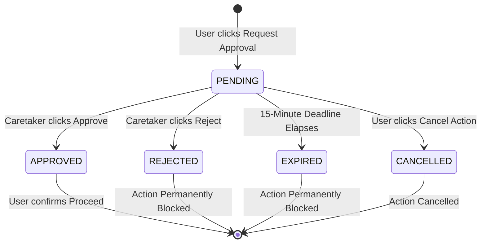

# Guardrail Approval Status Synchronization Specification

## 1. Executive Summary & Verification Context

This document establishes the verified technical specification for **Approval Status Synchronization** between the **Guardrail Browser Extension** (running on the protected user's / ward's browser) and the **Trusted-Contact Dashboard** (operated by designated caretakers).

Guardrail is an in-browser safety system designed to assist individuals who need support evaluating high-risk, irreversible, or sensitive website interactions:
* **Day 8** implemented **controlled action interception** (`InterceptionController`, `ContinuationManager`, DOM capture-phase cancellation).
* **Day 9** introduced **Staging Mode** (an accessible Shadow DOM quarantine environment) and explicit user cancellation.
* **Day 10** established the **server-side approval domain model, lifecycle state machine, multi-tenant authorization rules, coordination service, and REST API router** (`guardrail/extension/src/approval/`).
* **Day 11** verified **approval request submission, API client dispatch, mutual exclusion locking, compound idempotency, and network failure hardening**.
* **Day 12** implemented and verified the complete **Trusted-Contact Dashboard** (`guardrail/dashboard/`), enabling caretakers to review pending requests, evaluate risk heuristics, and submit authoritative `APPROVED` or `REJECTED` verdicts over real local HTTP.

> [!IMPORTANT]
> **SYNCHRONIZATION PRINCIPLE: SIMPLICITY & PROVEN RELIABILITY OVER SPECULATIVE REAL-TIME COMPLEXITY**
> An architectural audit confirms that **no WebSocket or Server-Sent Events (SSE) infrastructure currently exists** in the repository. `guardrail/server` remains an uninitialized milestone placeholder.
> 
> Rather than introducing heavy, fragile real-time brokers solely to claim real-time capabilities, this specification defines a **robust, low-overhead HTTP Polling Synchronization Strategy with Adaptive Backoff** built directly upon the existing, fully-verified REST endpoints (`GET /api/v1/approval-requests/:id` and `GET /api/v1/approvals/pending`).

---

## 2. Current End-to-End Approval Flow Audit

The interaction lifecycle traces through six discrete stages across extension, backend, and dashboard boundaries:

```mermaid
sequenceDiagram
    autonumber
    actor Ward as Protected User (Ward)
    participant DOM as Web Page DOM
    participant Ext as Content Script & Staging UI
    participant BG as Extension Background SW
    participant API as ApprovalApiRouter & Service
    participant Repo as ApprovalRequestRepository
    participant Dash as Trusted-Contact Dashboard
    actor Contact as Trusted Contact (Caretaker)

    Note over Ward,DOM: 1. Action Interception & Staging
    Ward->>DOM: Clicks high-risk action (e.g. Wire Transfer)
    DOM->>Ext: Capturing-phase event trapped
    Ext->>Ext: InterceptionController: state = HELD
    Ext->>Ext: ContinuationManager: stores handler (execCount = 0)
    Ext->>Ward: Opens Staging Mode Modal (quarantined)

    Note over Ward,API: 2. Approval Request Creation
    Ward->>Ext: Clicks "Request Approval"
    Ext->>BG: chrome.runtime.sendMessage(GUARDRAIL_SUBMIT_APPROVAL_REQUEST)
    BG->>API: POST /api/v1/approval-requests (Bearer user_token)
    API->>Repo: Idempotent lookup & atomic save(PENDING)
    API-->>BG: 201 Created (ApprovalRequest apr_...)
    BG-->>Ext: GuardrailSubmitApprovalRequestResponse
    Ext->>Ward: UI state: approval_requested (Pill: "Approval Pending")

    Note over Contact,Dash: 3. Caretaker Review & Decision
    Contact->>Dash: Opens Dashboard (Bearer contact_token)
    Dash->>API: GET /api/v1/approvals/pending
    API->>Repo: Queries pending requests for assigned wards
    API-->>Dash: 200 OK [ApprovalRequest apr_...]
    Dash->>Contact: Displays request card, risk explanation & disclaimer
    Contact->>Dash: Reviews metadata, clicks "Approve Action", confirms
    Dash->>API: POST /api/v1/approvals/apr_.../decide { decision: 'APPROVED' }
    API->>Repo: Validates role, lazy expiration, transitions to APPROVED
    API-->>Dash: 200 OK (Resolved ApprovalRequest)
    Dash->>Contact: Displays success banner; moves to Decision History

    Note over Ext,API: 4. Approval Status Synchronization (The Strategy)
    loop Adaptive Polling (2s -> 3s -> 5s -> 10s)
        Ext->>API: GET /api/v1/approval-requests/apr_... (Bearer user_token)
        API->>Repo: Validates ownership (actorId == requesterId)
        API-->>Ext: 200 OK { status: 'APPROVED', decision: {...} }
    end
    Ext->>Ext: Transitions UI: approval_confirmed_approved
    Ext->>Ext: Terminates polling loop

    Note over Ward,DOM: 5. Controlled Continuation (Decoupled Execution)
    Ext->>Ward: Pill: "Approval Confirmed" • Action remains safely HELD
    Ward->>Ext: Reviews caretaker consent, clicks "Proceed with Action"
    Ext->>DOM: ContinuationManager.continueAction() executes handler exactly once
    DOM-->>Ward: Protected action completes
```

### Flow Breakdown:

1. **Interception**: An interaction is halted during DOM capturing. Default action and propagation are stopped (`preventDefault()`, `stopImmediatePropagation()`). The action is placed in `HELD` state in `InterceptionController`. The execution callback is registered in `ContinuationManager`.
2. **Submission**: The user clicks "Request Approval" in Staging Mode. A `ClientApprovalRequestPayload` (strictly sanitized; zero form values, passwords, or tokens) is dispatched through the Background Service Worker to `POST /api/v1/approval-requests`.
3. **Storage & State Machine**: The server authenticates the user via Bearer token, assigns authoritative `requesterId`, validates action ownership, checks compound idempotency (`requesterId`, `actionId`), and stores a new `ApprovalRequest` in `PENDING` state with a 15-minute expiration timestamp (`expiresAt`).
4. **Dashboard Retrieval**: The caretaker logs into the dashboard, authenticating with their trusted contact token. The dashboard queries `GET /api/v1/approvals/pending`. The server filters pending requests strictly by the caretaker's assigned active relationships.
5. **Decision Operation**: The caretaker reviews the action description, website origin, and risk reasons, confirms the deliberate dialog, and submits `POST /api/v1/approvals/:id/decide`. The backend validates the request is unresolved and unexpired, commits the decision atomically, sets `status = APPROVED` (or `REJECTED`), and records `decidedBy: 'tc_carol'`.
6. **Status Discovery (The Current Gap)**: Once submitted, the extension enters `approval_requested` state. The user remains waiting in Staging Mode. The extension must now query the backend to learn when the caretaker has submitted their decision.

---

## 3. Authority and Persistence Model

### 3.1 The Backend is the Sole Authority
* **Single Source of Truth**: The Guardrail Backend (`ApprovalService` + `ApprovalRequestRepository`) is the **sole authoritative owner** of request lifecycles.
* **Client Projections**: Both the Browser Extension (Staging Mode, Service Worker) and the Trusted-Contact Dashboard are **read-only downstream projections**. Neither client can mutate a request's state without authoritative backend confirmation.
* **Server-Side Validation**: Status transitions are executed through atomic compare-and-swap operations on the server. If a client attempts to supply a `status` or `decision` during request creation, the server strictly rejects the payload with HTTP `400 VALIDATION_ERROR`.
* **Conflict Precedence**: In any disagreement between cached client state and server response, the server's response is unconditionally authoritative.

### 3.2 Current Persistence Reality
* **Current Storage**: Decisions and requests are held in memory via `DevelopmentInMemoryApprovalRequestRepository` (`guardrail/extension/src/approval/repository.ts`).
* **Metadata Classification**: `PERSISTENCE_METADATA.TYPE` is explicitly flagged as `EPHEMERAL_DEVELOPMENT_ONLY_IN_MEMORY` with `IS_PRODUCTION: false`.
* **Concurrency Protection**: The repository implements atomic conditional transitions with synchronous mutex locks to prevent race conditions during concurrent reviewer submissions.
* **Future Production Database**: Cross-process database persistence (PostgreSQL / SQLite in `guardrail/server`) is a documented Day 10+ roadmap milestone. When implemented, database tables will map 1-to-1 to the established domain models.

---

## 4. Current Status Discovery Mechanisms & Infrastructure Audit

### 4.1 Infrastructure Audit: WebSockets and SSE
A thorough audit of the entire codebase was conducted:
* **WebSockets**: Zero WebSocket client or server code exists. Mentions in code comments are design roadmap placeholders only.
* **Server-Sent Events (SSE)**: Zero `EventSource` or SSE streaming endpoints exist.
* **Daemon Status**: `guardrail/server` is uninitialized and has no active HTTP or WebSocket process running.

### 4.2 Existing Capabilities in Current Codebase
While automated polling is not yet wired into the Staging Mode timer loop, all underlying technical prerequisites are already implemented and tested:

1. **Verified Status Retrieval Endpoint**:
   * `GET /api/v1/approval-requests/:id` is implemented in [ApprovalApiRouter](file:///Users/deepanshukhatri/Library/CloudStorage/GoogleDrive-deepanshukhatri20061972@gmail.com/My%20Drive/Cloud%20Desktop/Guardrail%20UI/guardrail/extension/src/approval/api.ts#L322-L327) and [ApprovalService.getRequest](file:///Users/deepanshukhatri/Library/CloudStorage/GoogleDrive-deepanshukhatri20061972@gmail.com/My%20Drive/Cloud%20Desktop/Guardrail%20UI/guardrail/extension/src/approval/service.ts#L364-L393).
   * Enforces server-side authentication (`Authorization: Bearer <user_token>`).
   * Enforces multi-tenant ownership: Only the requesting ward (`authContext.actorId === request.requesterId`), an authorized trusted contact, or an admin can access the record. Unrelated users receive opaque HTTP `404 Not Found` (`NOT_FOUND_OR_DENIED`).
   * Evaluates lazy expiration against the authoritative clock.
2. **Verified Typed API Client Method**:
   * `ApprovalApiClient.getApprovalRequest(requestId)` is implemented in [ApprovalApiClient](file:///Users/deepanshukhatri/Library/CloudStorage/GoogleDrive-deepanshukhatri20061972@gmail.com/My%20Drive/Cloud%20Desktop/Guardrail%20UI/guardrail/extension/src/approval/client.ts#L424-L447).
   * Returns a typed `ApiClientResult<ApprovalRequest>`.
3. **Staging UI Target States Already Implemented**:
   * `StagingModal` in [modal.ts](file:///Users/deepanshukhatri/Library/CloudStorage/GoogleDrive-deepanshukhatri20061972@gmail.com/My%20Drive/Cloud%20Desktop/Guardrail%20UI/guardrail/extension/src/staging/modal.ts#L1806-L1910) already includes full visual rendering, badges, titles, aria live regions, and button bindings for:
     - `approval_confirmed_approved`
     - `approval_confirmed_rejected`
     - `approval_confirmed_expired`
     - `approval_confirmed_cancelled`
4. **Dashboard Pending Feed**:
   * `DashboardShell` queries `GET /api/v1/approvals/pending` via `ApprovalApiClient.listPendingApprovals()`.
   * Dashboard handles concurrent resolution (`409 ALREADY_RESOLVED`) and expiration (`410 REQUEST_EXPIRED`) by dynamically refetching authoritative details and pruning records.

---

## 5. Missing Functionality vs. Existing Functionality

| Layer / Feature | Existing (Must NOT Duplicate) | Missing (To Be Implemented) |
| :--- | :--- | :--- |
| **Backend REST Endpoint** | `GET /api/v1/approval-requests/:id` with auth, anti-enumeration, and lazy expiration. | None. Endpoint is complete. |
| **Backend Status Model** | Deterministic enum: `PENDING`, `APPROVED`, `REJECTED`, `EXPIRED`, `CANCELLED`. | Dedicated `GET /api/v1/approvals/history` on server roadmap. |
| **API Client** | `ApprovalApiClient.getApprovalRequest(id)` handles serialization, headers, and timeouts. | None. Client method is complete. |
| **Extension Staging UI** | Status pills, confirmation banners, accessible live regions, and button transitions. | Automated polling timer triggering status refresh. |
| **Extension Background** | Message dispatching and held record tracking in `backgroundInterceptionController`. | Background polling coordinator or alarm handler for multi-tab synchronization. |
| **Dashboard UI** | Two-pane layout, risk badges, deliberate confirmation step, and history list. | Low-frequency periodic background refresh (e.g. 15s–30s or on window focus). |

---

## 6. Recommended Synchronization Strategy: Short Polling with Adaptive Backoff

### 6.1 Architectural Rationale
1. **Zero New Dependencies**: Reuses the verified `GET /api/v1/approval-requests/:id` endpoint. Requires no WebSocket servers, no Redis pub/sub, and no SSE connection handlers.
2. **Manifest V3 Compatibility**: Chrome Manifest V3 service workers terminate after ~30 seconds of inactivity. Maintaining open WebSockets in MV3 service workers is notoriously unreliable and leads to socket drops. In contrast, short HTTP requests can be initiated from the active tab content script (where Staging Mode is mounted) or scheduled via `chrome.alarms`.
3. **Lifecycle Scoping**: Approval requests are short-lived transactions (TTL = 15 minutes). The user is actively seated at the browser waiting for a caretaker response. Polling for a few minutes consumes negligible network bandwidth (< 1 KB per payload).
4. **Resilience to Network Drops**: If a poll fails due to transient packet loss or network switching, the client simply retries on the next interval. No socket reconnection state machines or message replay buffers are required.

### 6.2 Polling Schedule & Interval Specification

The polling loop operates with an **adaptive interval schedule**:

| Interval Phase | Elapsed Waiting Time | Polling Frequency | Rationale |
| :--- | :--- | :--- | :--- |
| **Immediate Probe** | 0s – 6s | Every **2 seconds** | Catches fast caretaker approvals (e.g., active on mobile app/dashboard). |
| **Normal Polling** | 6s – 30s | Every **3 seconds** | Balanced responsiveness for active reviews. |
| **Relaxed Polling** | 30s – 2 minutes | Every **5 seconds** | Mitigates server load while maintaining acceptable latency. |
| **Capped Standby** | 2 min – 15 minutes | Every **10 seconds** | Conservative cadence while waiting for caretaker availability. |
| **Terminal Cutoff** | Expiration (`expiresAt`) | **STOP (0 Hz)** | Halts immediately upon reaching the 15-minute deadline. |

### 6.3 Page Visibility & Lifecycle Sensitivity
* **Tab Hidden (`document.visibilityState === 'hidden'`)**: When the user switches tabs, polling frequency reduces to once every **30 seconds** to conserve CPU and network resources.
* **Tab Visible (`visibilitychange` event)**: When the tab regains focus, an immediate poll probe is dispatched to refresh state instantaneously.
* **Staging Mode Dismissal**: If the user dismisses Staging Mode or clicks "Cancel Action", the polling timer is immediately cleared.
* **Window Unload**: Any active timer is cleared on `beforeunload` or component unmount.

---

## 7. State-by-State Expected Behavior Matrix



### Detailed State Behavior:

| ApprovalStatus | Backend Authoritative State | Caretaker Dashboard Display | Extension Staging Mode Display | Controlled Action Execution Status | Polling Lifecycle |
| :--- | :--- | :--- | :--- | :--- | :--- |
| **`PENDING`** | Request created. `decision` is `undefined`. `expiresAt > now`. | Rendered in Pending list with risk badge. Action Details, Risk Analysis, and Decision Controls active. | State: `approval_requested`<br>Pill: `"Approval Pending"`<br>"Request Approval" button disabled.<br>"Cancel Action" enabled.<br>Screen reader: announces pending review. | **Strictly HELD**.<br>Continuation execution count is strictly 0.<br>Action remains paused in tab memory. | **ACTIVE**.<br>Polling continues on adaptive schedule. |
| **`APPROVED`** | `decision.verdict = 'APPROVED'`. `decidedBy = contactId`. `resolvedAt = timestamp`. | Pruned from pending list.<br>Success banner shown.<br>Status pill: `APPROVED`.<br>Appended to Decision History. | State: `approval_confirmed_approved`<br>Pill: `"Approval Confirmed"`<br>Info banner: displays reviewer ID and time.<br>"Cancel Action" enabled.<br>Action buttons updated. | **STILL HELD**.<br>Approving records consent on server, but **NEVER executes the action remotely**.<br>Continuation requires explicit user action. | **TERMINATED**.<br>Polling stops immediately. |
| **`REJECTED`** | `decision.verdict = 'REJECTED'`. `decidedBy = contactId`. `decisionReason` recorded. | Pruned from pending list.<br>Status pill: `REJECTED`.<br>Appended to Decision History with rejection reason. | State: `approval_confirmed_rejected`<br>Pill: `"Approval Denied"`<br>Warning banner: explains contact rejected action.<br>Displays rejection reason if provided. | **PERMANENTLY BLOCKED**.<br>Action will NEVER execute.<br>Continuation callback discarded upon modal close. | **TERMINATED**.<br>Polling stops immediately. |
| **`EXPIRED`** | `expiresAt <= now`. Evaluated lazily or by timer. Terminal. | Pruned from pending list.<br>If reviewer attempts decision, server returns HTTP `410 REQUEST_EXPIRED`. Dashboard shows error banner. | State: `approval_confirmed_expired`<br>Pill: `"Request Expired"`<br>Notice: review deadline elapsed.<br>User given option to dismiss or retry. | **PERMANENTLY BLOCKED**.<br>Action will NEVER execute.<br>Expired actions cannot proceed. | **TERMINATED**.<br>Polling stops immediately. |
| **`CANCELLED`** | User cancelled action. `cancellationReason` recorded. Terminal. | Pruned from pending list.<br>If reviewer attempts decision, server returns HTTP `409 ALREADY_RESOLVED`. | State: `approval_confirmed_cancelled`<br>Modal closes or returns to standard browser view. | **CANCELLED**.<br>`ContinuationManager.cancelAction()` releases held reference.<br>Execution count remains 0. | **TERMINATED**.<br>Polling stops immediately. |

---

## 8. Decoupled Execution & Continuation Security Architecture

The most critical safety invariant of Guardrail is the **Decoupled Execution Architecture**:

```
[ Caretaker Approves on Dashboard ]
                │
                ▼
      POST /api/v1/approvals/:id/decide
                │
                ▼
[ Backend Commits Decision: APPROVED ]
                │
                ▼
      Poll Response: status = 'APPROVED'
                │
                ▼
[ Staging Mode Updates: "Approval Confirmed" ]
                │
          DOES NOT EXECUTE!
                │
                ▼
[ Protected User Must Click "Proceed with Action" ]
                │
                ▼
   ContinuationManager.continueAction()
                │
                ▼
  [ Action Executes in Web Page DOM ]
```

### Safety Principles:
1. **Remote Decisions Grant Consent, Not Remote Control**: A caretaker dashboard approval records authoritative consent on the backend. Under no circumstances does the server or extension background trigger synthetic DOM clicks or automatically release the held action.
2. **User Retains Ultimate Autonomy**: The elderly or protected user sitting in front of the browser retains sole authority to execute the action. If the user changed their mind, noticed a page change, or feels uncomfortable, they can click "Cancel Action" even after the contact has approved it.
3. **Zero Synthetic Replay**: Continuation uses controlled callback execution via `ContinuationManager`. It never attempts synthetic DOM event reinjection (`element.click()`), preventing recursive capture loops and untrusted event forgery.

---

## 9. API Contract Specification for Synchronization

### 9.1 Endpoint 1: Query Approval Request Status
* **HTTP Method**: `GET`
* **Route Path**: `/api/v1/approval-requests/:id`
* **Headers**:
  ```http
  Authorization: Bearer <user_token>
  Accept: application/json
  ```
* **Success Response (200 OK)**:
  ```json
  {
    "success": true,
    "data": {
      "id": "apr_01J9X4M5N2P3Q4R5S6T7U8V9W0",
      "actionId": "act_01J9X4A1B2C3D4E5F6G7H8J9K0",
      "requesterId": "usr_alice",
      "status": "APPROVED",
      "actionDescription": "Authorize $500 Wire Transfer to External Account",
      "actionType": "CLICK",
      "category": "PAYMENT",
      "riskLevel": "CRITICAL",
      "riskScore": 95,
      "riskReasons": [
        "Destination account is unverified external entity",
        "Transaction exceeds standard threshold"
      ],
      "origin": "https://bank.example.com",
      "hostname": "bank.example.com",
      "createdAt": "2026-10-20T19:00:00.000Z",
      "expiresAt": "2026-10-20T19:15:00.000Z",
      "resolvedAt": "2026-10-20T19:02:30.000Z",
      "decision": {
        "decision": "APPROVED",
        "decidedBy": "tc_carol",
        "decidedAt": "2026-10-20T19:02:30.000Z",
        "decisionReason": "Verbally verified with Alice by phone"
      }
    }
  }
  ```
* **Error Responses**:
  * `401 UNAUTHENTICATED`: Missing or invalid Bearer token.
  * `404 NOT_FOUND_OR_DENIED`: Request does not exist, or caller is not authorized (anti-enumeration).
  * `429 RATE_LIMIT_EXCEEDED`: Polling frequency exceeds configured threshold. Client must respect `Retry-After`.

---

### 9.2 Endpoint 2: Cancel Pending Approval Request
* **HTTP Method**: `POST`
* **Route Path**: `/api/v1/approval-requests/:id/cancel`
* **Headers**:
  ```http
  Authorization: Bearer <user_token>
  Content-Type: application/json
  ```
* **Request Body**:
  ```json
  {
    "reason": "User decided not to proceed with wire transfer"
  }
  ```
* **Success Response (200 OK)**:
  ```json
  {
    "success": true,
    "data": {
      "id": "apr_01J9X4M5N2P3Q4R5S6T7U8V9W0",
      "status": "CANCELLED",
      "cancellationReason": "User decided not to proceed with wire transfer",
      "resolvedAt": "2026-10-20T19:03:00.000Z"
    }
  }
  ```

---

## 10. Implementation Plan & Unresolved Prerequisites

When implementing the synchronization polling coordinator in the upcoming milestone, the following tasks must be completed:

1. **Extension Polling Coordinator (`extension/src/approval/polling-coordinator.ts`)**:
   - Construct a dedicated `ApprovalStatusPoller` class accepting `requestId`, `apiClient`, interval options, and callbacks (`onStatusChange`, `onError`, `onTerminal`).
   - Implement adaptive backoff timer (2s $\rightarrow$ 3s $\rightarrow$ 5s $\rightarrow$ 10s).
   - Hook into `document.addEventListener('visibilitychange')` to back off when hidden and probe immediately upon visible.
   - Wire `ApprovalStatusPoller` into `StagingModal` when state transitions to `approval_requested`.
2. **Manifest V3 Host Permissions**:
   - Update `guardrail/extension/public/manifest.json` to include:
     ```json
     "host_permissions": [
       "http://localhost:*",
       "http://127.0.0.1:*",
       "https://api.guardrail-safety.org/*"
     ]
     ```
3. **Dashboard Background Refresh**:
   - In `DashboardShell`, attach a window focus listener (`window.addEventListener('focus')`) and an optional 30-second low-frequency interval to invoke `fetchPendingRequests()` so caretakers automatically see newly created ward requests without manual button clicks.
4. **Persistent Datastore in `guardrail/server`**:
   - Transition from in-memory `DevelopmentInMemoryApprovalRequestRepository` to persistent SQL storage (PostgreSQL/SQLite) so approval states survive server restarts.
