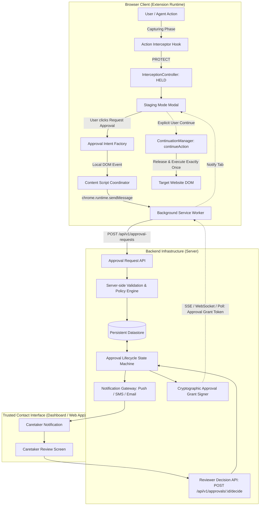
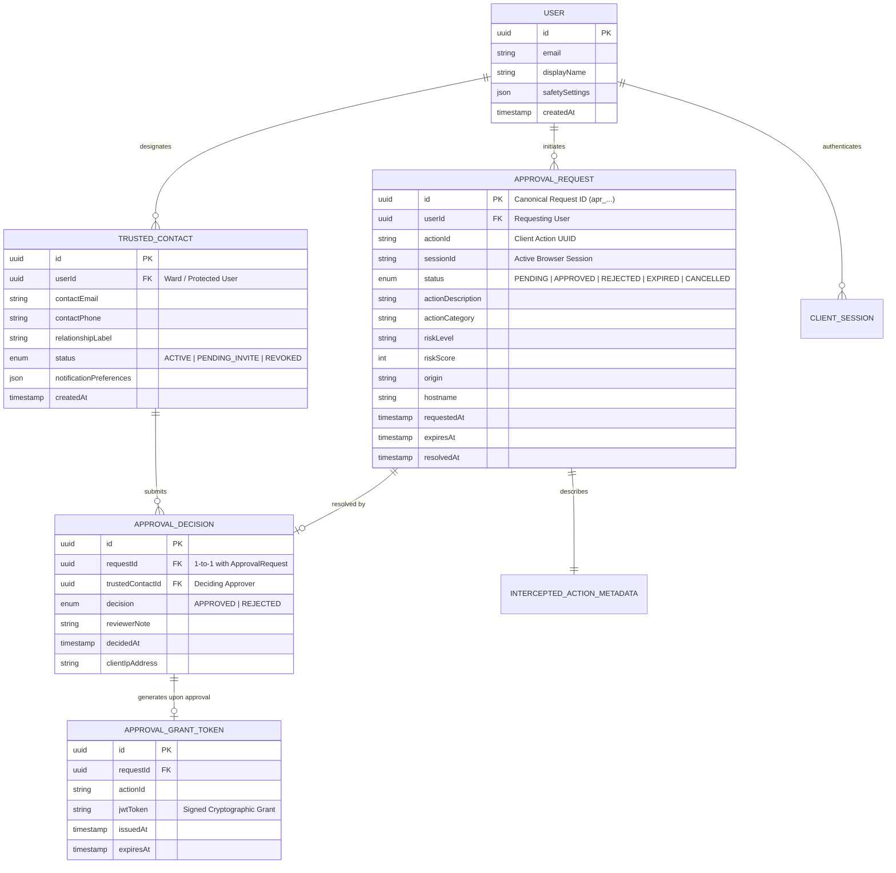
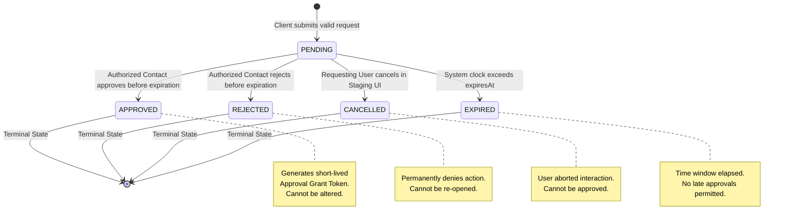

# Guardrail Backend Approval Workflow Contract

## 1. Executive Summary & Context

This document specifies the authoritative **Backend Approval Workflow Contract** for the Guardrail UI safety architecture. 

Guardrail is an in-browser safety layer designed to assist individuals who need support evaluating potentially risky, irreversible, or sensitive website interactions.
* **Day 8** implemented the active **browser action-interception foundation** (`InterceptionController`, `ContinuationManager`, and DOM capture-phase halting).
* **Day 9** introduced **Staging Mode** (an isolated Shadow DOM review environment), **explicit user cancellation**, and a **local approval-request intent** (`ApprovalRequestIntent` marked `LOCAL_PROTOTYPE_ONLY`).
* **Day 10+** establishes the **Remote Approval Architecture**: the contract governing how an intercepted action waiting in a user's browser is securely transmitted to a backend, dispatched to designated **Trusted Contacts** (approvers / caretakers), evaluated, decided, and safely resolved without compromising user privacy, security, or autonomy.



---

## 2. Existing Implementation vs. Prototype Gap Analysis

An audit of the repository reveals clear boundaries between currently operating production components and prototype stubs:

| Component / Layer | Current Status | Implemented Functionality | Gaps / Missing for Remote Backend |
| :--- | :---: | :--- | :--- |
| **`ActionDetector`** | **Production** | Captures `CLICK`, `INPUT`, `SUBMIT`, `NAVIGATION` via DOM capture phase. Sanitizes elements. | None for client sensor. |
| **`ActionClassifier`** | **Production** | Heuristic rules classify actions into `ActionCategory` (`PAYMENT`, `DESTRUCTIVE`, etc.). | Server-side secondary validation not yet implemented. |
| **`RiskEngine`** | **Production** | Scores risk (0–100) and assigns `RiskLevel` (`LOW`, `MEDIUM`, `HIGH`, `CRITICAL`). | Server-side independent risk re-evaluation. |
| **`ResponseEngine`** | **Production** | Maps `RiskLevel` to `ResponseAction` (`ALLOW`, `WARN`, `PROTECT`). | Server policy overrides. |
| **`InterceptionController`** | **Production** | Canonical client state machine (`DETECTED` $\rightarrow$ `HELD` $\rightarrow$ `CONTINUED` / `CANCELLED`). | Remote synchronization protocol. |
| **`ContinuationManager`** | **Production** | Holds execution callbacks in memory; guarantees at-most-once continuation; zero execution on cancel. | Acceptance of signed remote approval grant tokens. |
| **`StagingModal` UI** | **Production** | Shadow DOM dialog, WCAG 2.1 AA focus trap, plain text sanitization, accessible risk cards, live regions. | Remote polling / live WebSocket listener for incoming approval grants. |
| **`ApprovalRequestIntent`** | **Prototype** | Typed local intent (`src/types/approval.ts`) marked `LOCAL_PROTOTYPE_ONLY`. Excludes secrets. | Persistent server-side `ApprovalRequest` entity. |
| **Background Service Worker** | **Prototype** | Receives `GUARDRAIL_APPROVAL_REQUEST` message, logs intent locally, returns mock response. | HTTPS API client, token management, WebSocket client. |
| **Server (`guardrail/server`)** | **Uninitialized** | Placeholder `README.md` only. No dependencies, routes, or databases. | Entire backend service (APIs, auth, DB, state machine, notifications). |
| **Dashboard (`guardrail/dashboard`)**| **Uninitialized** | Placeholder `README.md` only. | Caretaker review interface, contact management UI. |

---

## 3. Domain Model & Entity Relationships

The backend approval architecture models five core entities with strict role isolation and relational boundaries:



### 3.1 Entity Roles & Separation of Concerns

1. **User (The Protected Ward)**:
   - The individual using the browser extension.
   - Owns the browser session and the held action.
   - May initiate an approval request or cancel their own held action at any time.
   - **Never** reviews or approves their own requests (separation of duties).

2. **Trusted Contact (The Approver / Caretaker)**:
   - A verified third party (family member, supervisor, support coordinator) designated in advance by the user or an administrative policy.
   - Linked to a specific user through the `TRUSTED_CONTACT` relationship.
   - Authorized to inspect sanitized action metadata and submit an `APPROVED` or `REJECTED` decision.
   - Has no direct access to the user's browser, tabs, or private credentials.

3. **Intercepted Action (Client Runtime)**:
   - A transient, in-memory browser event suspended by `InterceptionController` (`HELD` state) in a specific browser tab.
   - Governed by the client `ContinuationManager`.
   - Cannot be directly deserialized or run on the backend.

4. **Approval Request (Server Entity)**:
   - The persistent record created on the backend representing an open request for caretaker evaluation.
   - Bridges the gap between the client-held action and the remote reviewer.
   - Tracks the lifecycle from creation to resolution.

5. **Approval Decision (Server Entity)**:
   - The immutable verdict submitted by an authorized Trusted Contact.
   - Produces an audit log and triggers either a rejection notification or a signed **Approval Grant Token**.

---

## 4. Approval Request Data Contract

### 4.1 Minimum Client-to-Backend Payload

To preserve strict privacy while giving trusted contacts adequate context, the client sends only the minimal safe metadata defined in `StagingActionContext` and `ApprovalRequestIntent`:

```json
{
  "actionId": "act-1710000000-abc123",
  "actionType": "CLICK",
  "description": "Click button 'Delete All Account Data'",
  "category": "DESTRUCTIVE",
  "riskLevel": "CRITICAL",
  "riskScore": 100,
  "riskReasons": [
    "Target element is a destructive delete button",
    "Action causes permanent bulk data removal"
  ],
  "origin": "https://app.example.com",
  "hostname": "app.example.com",
  "pageTitle": "Account Settings",
  "clientTimestamp": "2026-10-18T12:00:00.000Z"
}
```

### 4.2 Strict Exclusion of Sensitive Information

Under **no circumstances** may the following data be transmitted or stored in approval requests:
* **Passwords, PINs, or Secret Codes**: Form fields of `type="password"`, security questions, or PIN inputs.
* **One-Time Passwords (OTPs)**: 2FA tokens, SMS codes, or authenticator digits.
* **Payment Card Data**: Full PAN (Primary Account Number), CVV/CVC, expiration dates, or bank account numbers.
* **Authentication Tokens & Cookies**: Session cookies, `Authorization` headers of host pages, or OAuth tokens.
* **Query Parameters with Embedded Secrets**: Any URL containing tokens (e.g., `?token=...`, `?key=...`, `?session=...`, `#access_token=...`) must have query strings stripped prior to serialization.
* **User-Typed Form Content**: Free-form text fields, emails, search queries, or internal document bodies.
* **DOM Node References**: Live DOM elements or raw HTML snippets.

### 4.3 Server-Enriched Attributes

Upon receipt, the backend validates and enriches the record with server-controlled properties:

* **`requestId`**: Globally unique canonical identifier prefixed with `apr_` (e.g., `apr_01J9X4M5N2...`).
* **`userId`**: Authenticated user ID extracted directly from the verified session token (`req.user.id`). **Never accepted from client JSON.**
* **`createdAt`**: Server system clock timestamp.
* **`expiresAt`**: Calculated expiration timestamp (`createdAt + userPolicy.approvalTtlSeconds`, default 15 minutes).
* **`status`**: Set to `PENDING`.
* **`targetContacts`**: Array of resolved `trustedContactId`s configured for this user and action category.
* **`integrityHash`**: SHA-256 digest of (`userId`, `actionId`, `origin`, `category`, `createdAt`, `expiresAt`) signed with a server secret to prevent tampering.

---

## 5. Approval Lifecycle State Machine

The approval request moves through a formal deterministic state machine:



### 5.1 Permitted vs. Rejected Transitions

| From State | To State | Permitted? | Authorized Actor | Pre-Conditions & Constraints |
| :--- | :--- | :---: | :--- | :--- |
| **`[*]`** | **`PENDING`** | **YES** | Authenticated User | Valid session; action in client `HELD` state; no active pending request for `actionId`. |
| **`PENDING`** | **`APPROVED`** | **YES** | Verified Trusted Contact | Contact assigned to user; `now() < expiresAt`; request integrity valid. |
| **`PENDING`** | **`REJECTED`** | **YES** | Verified Trusted Contact | Contact assigned to user; `now() < expiresAt`; request integrity valid. |
| **`PENDING`** | **`CANCELLED`** | **YES** | Authenticated User | Initiating user cancels via Staging UI or closes host page tab. |
| **`PENDING`** | **`EXPIRED`** | **YES** | System Engine / Cron | `now() >= expiresAt`; no decision was recorded prior to deadline. |
| **`APPROVED`** | *Any State* | **NO** | None | **Terminal.** Once approved, a decision cannot be reversed or cancelled. |
| **`REJECTED`** | *Any State* | **NO** | None | **Terminal.** Rejection is final. Cannot be resurrected or approved. |
| **`CANCELLED`** | *Any State* | **NO** | None | **Terminal.** User-aborted interactions can never be approved by a contact. |
| **`EXPIRED`** | *Any State* | **NO** | None | **Terminal.** Late approval submissions must be rejected with `410 Gone`. |

---

## 6. Decoupling Approval Decision from Action Execution

A foundational principle of Guardrail architecture is the **strict separation between approval decisions and action execution**:

$$\text{Approval Request} \neq \text{Approval Decision} \neq \text{Action Execution}$$

```mermaid
sequenceDiagram
    autonumber
    participant Page as Web Page DOM
    participant SW as Extension SW
    participant Server as Guardrail Server
    participant Contact as Trusted Contact
    participant User as Ward / User (Staging UI)
    participant CM as ContinuationManager

    Note over Page,CM: Action is HELD in Browser Runtime
    User->>Server: 1. POST /api/v1/approval-requests (PENDING)
    Server->>Contact: 2. Notification (SMS / Push / Email)
    Contact->>Server: 3. POST /api/v1/approvals/:id/decide (APPROVED)
    
    Note over Server: Decision is Recorded (APPROVED)<br/>Action is NOT Executed!
    Server->>Server: 4. Generate Signed Approval Grant Token
    Server-->>SW: 5. Dispatch Grant (WebSocket / SSE / Poll)
    SW-->>User: 6. Update Staging Modal: "Approved by Contact"
    
    Note over User,CM: Safe Intermission: User Reviews Approval
    alt User Confirms Execution
        User->>CM: 7. User clicks "Proceed" in Modal
        CM->>CM: 8. Verify Token: actionId, origin, expiry
        CM->>Page: 9. Execute Controlled Continuation Handler (Exactly Once)
        CM-->>User: 10. Show "Action Completed"
    else User Cancels or Navigates Away
        User->>CM: 7b. User clicks "Cancel" or closes tab
        CM->>CM: 8b. Abort execution; handler count remains 0
    end
```

### 6.1 Why Remote Automated Execution is Prohibited

1. **Host Page State Drift**: Web applications are dynamic. By the time a caretaker responds (e.g., 5 minutes later), the page DOM may have changed, forms may have reset, or the shopping cart may have expired. Executing blind continuation without user presence can corrupt application state.
2. **Tab & Navigation Teardown**: The user may have closed the tab, logged out, or navigated to a different domain. Attempting blind execution in a detached or redirected context creates cross-site vulnerabilities.
3. **User Agency & Consent**: Safety tools must empower users, not convert their browser into a remote-controlled zombie. The user retains ultimate agency to proceed or abort even after a caretaker approves.
4. **Hijacking & CSRF Prevention**: If a decision automatically executed arbitrary actions, any compromise of an approver account could instantly execute arbitrary code in a user's active session. Decoupling requires the client extension to validate the grant against the active held context.

---

## 7. Authentication, Authorization & Security Architecture

### 7.1 Multi-Tenant Access Control Model

| Operation | Endpoint | Required Actor | Authentication Mechanism | Authorization Rule |
| :--- | :--- | :--- | :--- | :--- |
| **Create Request** | `POST /api/v1/approval-requests` | User (Ward) | User Session Bearer Token | `token.userId` must match request; active account status; rate limit not exceeded. |
| **Check Request Status** | `GET /api/v1/approval-requests/:id` | User (Ward) | User Session Bearer Token | `request.userId === token.userId`. |
| **Cancel Request** | `POST /api/v1/approval-requests/:id/cancel`| User (Ward) | User Session Bearer Token | `request.userId === token.userId` and status is `PENDING`. |
| **List Pending Approvals**| `GET /api/v1/approvals/pending` | Trusted Contact | Contact Session / Magic Link JWT | Must be designated in `TRUSTED_CONTACT` table for the corresponding users. |
| **Inspect Request Details**| `GET /api/v1/approvals/:id` | Trusted Contact | Contact Session / Magic Link JWT | Contact ID must be listed in request's `targetContacts`. Returns sanitized metadata only. |
| **Submit Decision** | `POST /api/v1/approvals/:id/decide` | Trusted Contact | Contact Session / Magic Link JWT | Contact ID matches; request is `PENDING`; `now() < expiresAt`. |

### 7.2 Zero-Trust Server-Side Validation

The backend treats the client browser as an untrusted environment:
1. **Never Trust Client `userId`**: The user identity is extracted strictly from the server-validated JWT/session token.
2. **Never Trust Client `status` or Decision**: Clients cannot self-approve or supply their own resolution state.
3. **Re-evaluate Heuristic Plausibility**: The backend verifies that the submitted `riskLevel` and `category` match known patterns for the declared element and origin. If a client claims a button labelled `"Delete Database"` is `LOW` risk, the backend flags the request for anomalous tampering.
4. **Origin Validation**: Origin must conform to standard URL format (`scheme://host[:port]`) without embedded userinfo or illegal characters.
5. **Separation of Roles**: An identity authenticated as a User cannot approve requests where `request.userId === auth.userId`.

### 7.3 Protection of Trusted Contact Privacy

* The browser extension and host webpage DOM **never** receive the names, phone numbers, email addresses, or account IDs of the user's trusted contacts.
* When the Staging UI indicates that an approval intent was created, it displays generic reassurance: *"Approval request prepared for your trusted contacts"* without enumerating personal contact details into the page DOM.

---

## 8. Concurrency, Duplication & Cryptographic Binding

### 8.1 First-Responder Concurrency Model

A user may have multiple designated trusted contacts (e.g., two family members). If both contacts inspect the request simultaneously, race conditions are prevented using **atomic database-level conditional updates**:

```sql
UPDATE approval_requests
SET 
    status = :newDecision,
    resolved_at = :now,
    decided_by = :contactId,
    decision_reason = :note,
    version = version + 1
WHERE 
    id = :requestId 
    AND status = 'PENDING' 
    AND expires_at > :now;
```

* **Winner**: Exactly one contact's update affects row count `1`. The server records the decision and generates the grant token.
* **Subsequent Attempts**: The second contact's update matches row count `0`. The server rejects the submission with `409 Conflict` and returns: *"This request has already been decided by another trusted contact."*

### 8.2 Duplicate Request Suppression & Idempotency

* **Idempotency Key**: The compound key `(userId, actionId)` is unique for all active requests.
* If a user clicks "Request Approval" multiple times, the client mutual-locking flag (`isOperationActive`) blocks immediate duplicates.
* If duplicate network requests reach the backend, the database unique constraint rejects secondary creation:
  - If existing status is `PENDING`, return `200 OK` with the existing `requestId` (idempotent submission).
  - If existing status is in a terminal state (`APPROVED`, `REJECTED`, `EXPIRED`, `CANCELLED`), return `409 Conflict: Action already resolved`.

### 8.3 Cryptographic Scoping (The Approval Grant Token)

To guarantee that an approval applies **only** to the exact request and action for which it was issued, the server issues a digitally signed, short-lived **Approval Grant Token**:

```json
{
  "iss": "https://api.guardrail-safety.org",
  "sub": "apr_01J9X4M5N2ABCD1234EFGH",
  "aud": "guardrail-extension-client",
  "actionId": "act-1710000000-abc123",
  "userId": "usr_789xyz",
  "origin": "https://app.example.com",
  "decision": "APPROVED",
  "iat": 1729252800,
  "exp": 1729253700,
  "jti": "grnt_01J9X4Q9Z7"
}
```

#### Client Grant Verification Checklist (ContinuationManager):
Before `ContinuationManager.continueAction()` can execute:
1. **Signature Integrity**: Verified using backend public key / shared HMAC secret.
2. **Action Identity Binding**: `grant.actionId === heldAction.action.id`.
3. **Origin Scoping**: `grant.origin === window.location.origin`.
4. **Time Bounding**: `grant.exp > Date.now()` (token has not expired).
5. **Single Use Token**: Grant token ID (`jti`) is marked used; subsequent attempts with the same token fail.

---

## 9. Next Steps & Implementation Roadmap

| Phase | Milestone | Deliverables | Target Component |
| :---: | :--- | :--- | :--- |
| **Day 10** | **Backend Scaffolding & Schemas** | Implement server entrypoint, database models (`User`, `Contact`, `ApprovalRequest`), migration scripts, and unit tests. | `guardrail/server` |
| **Day 11** | **Approval REST APIs & State Machine** | Implement `POST /approval-requests`, `GET /approvals/pending`, `POST /approvals/:id/decide`, expiration worker. | `guardrail/server` |
| **Day 12** | **Extension-to-Backend Transport** | Replace prototype stubs in service worker with authenticated HTTPS calls, token storage, and grant listeners. | `guardrail/extension` |
| **Day 13** | **Caretaker Review Interface** | Implement responsive web dashboard for trusted contacts to review and decide requests on mobile and desktop. | `guardrail/dashboard` |
| **Day 14** | **End-to-End System Integration** | Full multi-client test: Intercept on demo site $\rightarrow$ Staging Mode $\rightarrow$ Caretaker approval $\rightarrow$ Safe client release. | Whole Repository |
