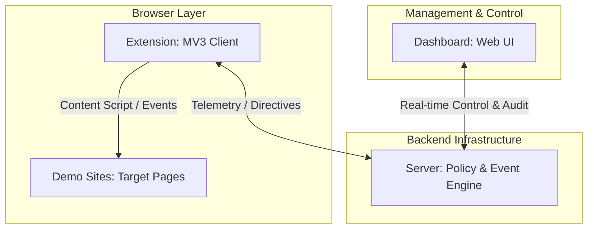

# System Architecture & Design Philosophy

## Separation of Concerns

The Guardrail system is split into four distinct layers to ensure isolation, testability, and security:

### 1. Extension (`extension/`)
* **Role:** Lightweight agent residing in the user's browser runtime.
* **Scope:** Capturing DOM events, handling Manifest V3 lifecycles, and presenting in-browser notifications/badges.
* **Isolation:** Operates independently of server code to maintain browser security boundaries and avoid bundling backend dependencies into extension packages.

### 2. Server (`server/`)
* **Role:** Centralized authority for policy evaluation, state persistence, and event processing.
* **Scope:** Secure verification, audit logging, and coordination between extension sessions and dashboard clients.
* **Isolation:** Keeps secret keys, heavy models, and database access off the client browser.

### 3. Dashboard (`dashboard/`)
* **Role:** Administrative interface for operators to monitor live sessions and configure guardrails.
* **Scope:** Viewing event timelines, managing blocklists/allowlists, and reviewing alerts.
* **Isolation:** Decoupled from extension builds to allow independent deployments and varied frontend frameworks.

### 4. Demo Sites (`demo-sites/`)
* **Role:** Realistic target environments (e-commerce checkouts, form submissions, admin panels).
* **Scope:** Providing reproducible test fixtures for testing guardrail policies without risking production sites.
