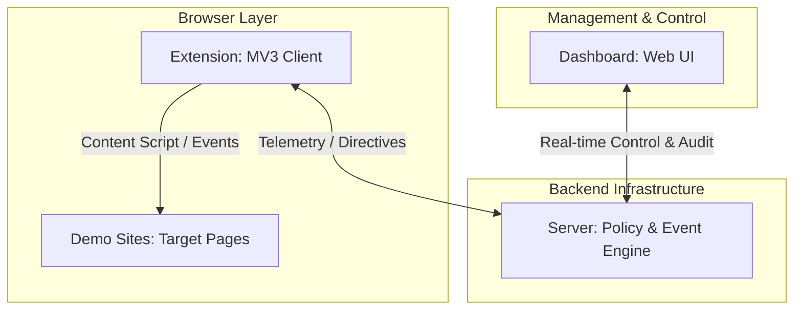

# System Architecture & Design Philosophy

## Separation of Concerns

The Guardrail system is split into four distinct layers to ensure isolation, testability, and security:

### 1. Extension (`extension/`)
* **Role:** Lightweight agent residing in the user's browser runtime.
* **Scope:** Capturing DOM events, handling Manifest V3 lifecycles, and presenting in-browser notifications/badges.
* **Isolation:** Operates independently of server code to maintain browser security boundaries and avoid bundling backend dependencies into extension packages.

### 2. Server (`server/`)
* **Role:** Centralized authority for policy evaluation, state persistence, and event processing.
* **Scope:** Secure verification, audit logging, and coordination between extension sessions and dashboard clients.
* **Isolation:** Keeps secret keys, heavy models, and database access off the client browser.

### 3. Dashboard (`dashboard/`)
* **Role:** Administrative interface for operators to monitor live sessions and configure guardrails.
* **Scope:** Viewing event timelines, managing blocklists/allowlists, and reviewing alerts.
* **Isolation:** Decoupled from extension builds to allow independent deployments and varied frontend frameworks.

### 4. Demo Sites (`demo-sites/`)
* **Role:** Realistic target environments (e-commerce checkouts, form submissions, admin panels).
* **Scope:** Providing reproducible test fixtures for testing guardrail policies without risking production sites.

---

## Detailed Architectural Specifications

For comprehensive deep dives into specific subsystems and behavioral contracts, refer to the focused architecture specifications:

1. **[Browser Action Interception Architecture](action-interception.md)**:
   - Mechanics of DOM capturing-phase event interception.
   - Normalization into `GuardrailAction` models.
   - The canonical `InterceptionController` state machine (`DETECTED` $\rightarrow$ `HELD` $\rightarrow$ `CONTINUED` / `CANCELLED`).
   - Exactly-once continuation execution guarantees via `ContinuationManager`.

2. **[Backend Approval Workflow Contract](approval-workflow-contract.md)**:
   - End-to-end contract between the browser extension, the backend service, and trusted contacts.
   - The multi-tenant domain model (`User`, `TrustedContact`, `ApprovalRequest`, `ApprovalDecision`, `ApprovalGrantToken`).
   - Full lifecycle state machine (`PENDING`, `APPROVED`, `REJECTED`, `EXPIRED`, `CANCELLED`) and atomic transition matrix.
   - Separation of concerns: Decoupling approval decisions from browser action execution.
   - Privacy by design: Complete exclusion of credentials, form values, and tokens.
   - Concurrency control, duplicate suppression, and cryptographic grant scoping.

3. **[Extension-to-Backend Integration Contract & Readiness](extension-to-backend-integration-contract.md)**:
   - Verified technical contract between Manifest V3 extension and the remote backend.
   - Exact endpoint specifications (`POST /api/v1/approval-requests`, `GET .../:id`, `POST .../cancel`).
   - Authentication requirements, token verifier, and zero client trust rules.
   - Action identification and correlation between client `actionId` and server entity.
   - Authoritative status polling protocol and explicit user execution gate.
   - Standard error representations (400, 401, 403, 404 anti-enumeration, 409, 410, 413, 415, 429).
   - Secret isolation architecture and base URL resolution strategy.
   - Comprehensive repository readiness audit and roadmap prerequisites.

4. **[Trusted-Contact Dashboard Integration Contract & Readiness](trusted-contact-dashboard-contract.md)**:
   - Comprehensive integration specification for the caretaker management web interface.
   - Authentication mechanism and authoritative identity derivation for trusted contacts (`Authorization: Bearer <token>`).
   - Exact REST endpoints (`GET /api/v1/approvals/pending`, `GET /api/v1/approvals/:id`, `POST /api/v1/approvals/:id/decide`).
   - Multi-tenant tenancy isolation, anti-enumeration (opaque 404), and strict self-approval prohibition.
   - Lifecycle state machine handling, atomic CAS first-responder concurrency (`409 ALREADY_RESOLVED`), and expiration (`410 REQUEST_EXPIRED`).
   - Separation of concerns: Decoupling approval decisions from browser action execution.
   - Strict privacy whitelist and sensitive credential exclusion rules.

