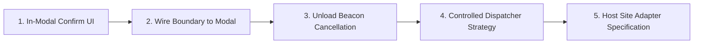

# Controlled Action Continuation Architecture & Safety Contract

## 1. Executive Summary & Objective

This document provides a comprehensive security and architectural audit of the **action-continuation architecture** within the Guardrail UI browser safety platform.

Guardrail monitors, intercepts, stages, and facilitates caretaker approval for high-risk browser interactions (e.g., financial transfers, account deletions, privilege escalations). While previous milestones established synchronous DOM event suppression, Staging Mode quarantine, backend approval modeling, trusted-contact dashboard reviews, and approval-status synchronization, this audit evaluates the final and most sensitive phase of the lifecycle: **Action Continuation**.

### Core Audit Questions Addressed:
1. *Which actions can genuinely be intercepted before their host application handlers execute?*
2. *Is the original application handler preserved, reconstructed, or fundamentally unavailable?*
3. *Can an action execute more than once (replay prevention)?*
4. *How is approval-to-action binding validated prior to execution?*
5. *How do expiration, cancellation, page navigation, tab reload, and DOM mutations impact continuation?*
6. *Does a user-confirmation step already exist in the UI?*
7. *Is continuation restricted to explicitly marked controlled test actions?*
8. *Which browser and website behaviors cannot be reliably intercepted or safely resumed?*

```mermaid
graph TD
    subgraph Browser DOM & Content Script
        Event[DOM Interaction] --> Filter{Marked with<br/>data-guardrail-test-action?}
        Filter -->|No: Unmarked| PassiveLog[Passive Advisory Only: Host Page Executes]
        Filter -->|Yes: Controlled Test Action| Intercept[Capturing Phase: preventDefault & stopImmediatePropagation]
        Intercept --> Controller[InterceptionController: State = HELD]
        Controller --> CM[ContinuationManager: Register Synthetic Test Closure]
        CM --> Staging[Staging Modal Quarantine]
    end

    subgraph Backend & Caretaker Review
        Staging --> Submit[Submit Approval Request + SHA-256 actionDigest]
        Submit --> Service[ApprovalService: 1:1 Action-to-Request Binding]
        Service --> Caretaker[Trusted Contact Review & Approval]
        Caretaker --> Decision[Backend State: APPROVED]
    end

    subgraph Continuation Gate (Execution Boundary)
        Decision --> Sync[Extension Status Synchronization]
        Sync --> HeldState[Action REMAINS HELD in Staging Modal]
        HeldState --> UserAction[Explicit User Continuation Trigger]
        UserAction --> Gate{ContinuationAuthorizationBoundary}
        Gate -->|Checks 1-12 Pass| Exec[Execute Registered Closure Exactly Once]
        Gate -->|Any Check Fails| FailClosed[Fail Closed: Action Remains Held or Cancelled]
    end
```

---

## 2. End-to-End Lifecycle Trace (Current Implementation)

The end-to-end lifecycle spans 7 discrete phases across the browser extension, authoritative backend service, and trusted-contact dashboard:

### Stage 1: Protected Action Detected
- In `guardrail/extension/src/detector/action-detector.ts`, the content script installs capturing-phase DOM listeners (`document.addEventListener('click', this.handleClick, true)`).
- When a user interacts with a page element, `ActionDetector` inspects `event.target`.
- The detector checks if the target element possesses the `data-guardrail-test-action` attribute via `findControlledTestAction()` (`guardrail/extension/src/utils/dom.ts`).
- If unmarked, the action is evaluated by the passive pipeline (`ActionClassifier` $\rightarrow$ `RiskEngine` $\rightarrow$ `ResponseEngine`), but the native event is allowed to propagate unimpeded.
- If marked with `data-guardrail-test-action`, the event is dispatched to the active interception handler.

### Stage 2: Action Intercepted (Where Supported)
- In `guardrail/extension/src/content/index.ts` (lines 478–485), if the `ResponseEngine` evaluates `ResponseAction.PROTECT`:
  ```typescript
  event.preventDefault();
  event.stopImmediatePropagation();
  ```
- This halts standard browser default behaviors (e.g. form submission, link navigation) and prevents event descent to child elements or subsequent capturing listeners registered on the same document target.

### Stage 3: Interception Record Created
- The content script registers the action in `InterceptionController`:
  ```typescript
  defaultInterceptionController.register(action, 'Controlled test action halted pending protection decision.');
  const heldRecord = defaultInterceptionController.holdAction(action.id, 'Action intercepted and held by Guardrail.');
  ```
- The interception state machine transitions strictly: `DETECTED` $\rightarrow$ `HELD`.
- In `ContinuationManager` (`guardrail/extension/src/interception/continuation.ts`), `registerHeldAction` registers the action along with a controlled test callback:
  ```typescript
  defaultContinuationManager.registerHeldAction(action, heldRecord, (act) => {
    document.dispatchEvent(new CustomEvent('guardrail:controlled-handler-executed', { detail: { actionId: act.id } }));
  });
  ```
- `StagingActionContext` is constructed and cached, capturing action metadata, risk reasons, and the held record.

### Stage 4: Approval Request Associated with Action
- When the user reviews the staged action in the isolated Shadow DOM modal and clicks "Request Approval":
- `submitApprovalRequest()` dispatches a runtime message to the background service worker, which posts to `POST /api/v1/approval-requests`.
- The backend `ApprovalService` verifies the authenticated user (`authContext.actorId`), checks `ActionOwnershipRegistry`, and creates an immutable 1:1 `ApprovalActionBinding` (`bnd_...`) alongside the `ApprovalRequest` (`apr_...`).
- The binding captures an authoritatively verified `actionDigest` (SHA-256 hash of normalized, non-sensitive action parameters).

### Stage 5: Backend Records Trusted Contact's Decision
- The trusted contact logs into the dashboard (`guardrail/dashboard/`), fetches pending requests, reviews the action context, and submits an approval decision (`POST /api/v1/approvals/:id/decide`).
- The backend executes an atomic Compare-And-Swap (CAS) transition verifying reviewer affiliation and separation of duties (prohibiting self-approval).
- The request transitions to `ApprovalStatus.APPROVED`.

### Stage 6: Extension Receives Authoritative Status
- The extension's adaptive polling loop (`ApprovalStatusSyncClient`) queries `GET /api/v1/approval-requests/:id`.
- Upon detecting `APPROVED`, polling terminates immediately.
- The modal transitions to `approval_confirmed_approved`:
  - The badge updates to `"Approval Confirmed"` (green).
  - The title displays `"Approval Confirmed by Contact"`.
  - The request button is disabled (`reqBtn.disabled = true; reqBtn.textContent = 'Approval Confirmed'`).
  - **CRITICAL INVARIANT:** The action remains strictly in the `HELD` state. Receiving backend approval does **not** trigger continuation.

### Stage 7: Action Resolution (Cancelled, Held, or Continued)
- **Cancellation:** If the user clicks "Cancel Action" in the modal or on the page, `cancelAction(actionId)` transitions the record to `CANCELLED`, clears the held entry, and dispatches cancellation events.
- **Remains Held:** If no further action is taken, the action remains safely quarantined in the `HELD` state.
- **Continuation:** Only when an explicit continuation call is executed (via external test buttons or `ContinuationAuthorizationBoundary.authorizeAndContinue()`), all 12 extension and backend pre-execution conditions are verified before the single-use continuation handler is invoked.

---

## 3. Detailed Audit Findings

### 3.1 Which Actions Can Genuinely Be Intercepted Before Application Handlers Execute?

| Action Context | Can Be Intercepted? | Technical Mechanism & Limitations |
| :--- | :---: | :--- |
| **Controlled Test Action (`[data-guardrail-test-action]`)** | **YES** | Intercepted in capturing phase via `document.addEventListener('click', handler, true)`. `stopImmediatePropagation()` stops downstream bubbling listeners and child capturing listeners. `preventDefault()` blocks native navigation or form submit. |
| **Arbitrary Website Click Actions** | **NO (Not Enabled)** | In `action-detector.ts`, unmarked elements bypass the interception hook and are processed purely by passive telemetry. The extension deliberately does not halt arbitrary website clicks to prevent breaking host web applications. |
| **Pre-Existing Capturing Listeners on `window`** | **NO** | If a host web application registers a capturing listener on `window` before the content script executes, the page listener executes *before* the extension's document capturing listener. Extensions cannot retroactively intercept prior window listeners. |
| **Inline Keystrokes (`INPUT`, `TEXTAREA`)** | **NO** | User keystrokes mutate DOM input values immediately. The `change` event occurs on blur after values are already committed. Intercepting `change` does not undo input mutations. |
| **Browser Navigation (`popstate`, `hashchange`)** | **NO** | `popstate` and `hashchange` are notification events dispatched *after* the browser URL and history state have already changed. They cannot be cancelled via `preventDefault()`. |
| **Background Network Requests (`fetch`, `XHR`)** | **NO** | Content scripts do not monkey-patch page-world `window.fetch` or `XMLHttpRequest`. If a webpage fires an API call independently of a direct click event, Guardrail does not block it. |

> [!IMPORTANT]
> **Audit Finding:** Active interception is currently **strictly scoped to CLICK interactions on explicitly marked DOM elements** (`data-guardrail-test-action`). Unmarked elements and non-click events operate purely in passive observation mode.

---

### 3.2 Is the Original Action Handler Preserved, Reconstructed, or Unavailable?

- **The original action handler is FUNDAMENTALLY UNAVAILABLE.**
- **Technical Explanation:**
  1. **Browser Sandbox Isolation:** Chrome extension content scripts run in an isolated JavaScript execution realm. Event listeners attached by page scripts live inside the main world's memory space and are inaccessible to extension scripts.
  2. **No DOM Reflection:** The standard DOM API provides no method to inspect, extract, or serialize attached event listeners (e.g., `element.getEventListeners()` is a DevTools Console-only utility, unavailable to web content scripts).
  3. **Detached Data Model:** `GuardrailAction` captures serializable metadata (`tagName`, `id`, `className`, `visibleText`, URL). It does not, and cannot, hold a reference to the page's JavaScript function closure.
  4. **Controlled Test Action Strategy:** For marked test actions, `ContinuationManager` registers a **synthetic test closure** (`registerHeldAction(action, record, testCallback)`). When continued, this synthetic callback executes.
  5. **Dangers of Synthetic Replay (`element.click()`):**
     - Attempting to simulate continuation by re-invoking `element.click()` or `element.dispatchEvent(new MouseEvent('click'))` produces synthetic events where `event.isTrusted === false`. Modern banking, payment, and authentication platforms actively reject untrusted synthetic events.
     - Synthetic dispatch re-triggers the capturing-phase listener, causing infinite interception loops unless complex bypass tokens are maintained.
     - Form values, anti-CSRF tokens, or page state may have changed while the action was held, making naive replay unpredictable and dangerous.

---

### 3.3 Can an Action Execute More Than Once?

- **NO. Actions are guaranteed exactly-once execution within the runtime.**
- **Guarantees Enforced in Code:**
  1. **Execution Counter Map:** `ContinuationManager` maintains `private executionCounts: Map<string, number>`. Line 509 of `continuation.ts` checks:
     ```typescript
     const priorExecutions = this.getExecutionCount(id);
     if (priorExecutions > 0) {
       return { success: false, error: `Action "${id}" has already executed ... Duplicate execution prevented.` };
     }
     ```
  2. **Interception State Monotonicity:** `InterceptionController.continueAction()` transitions the record from `HELD` $\rightarrow$ `CONTINUED`. Once in `CONTINUED` (a terminal state), any repeated call is rejected:
     `"Cannot continue action: Current state is CONTINUED. Only actions in HELD state can be continued."`
  3. **In-Flight Resolution Lock:** `ContinuationManager.isResolving` and `ContinuationAuthorizationBoundary.isResolving` maintain `Set<string>` locks that reject concurrent or racing continuation attempts for the same action ID.
  4. **Closure Disposal:** Upon successful execution, `this.currentHeldAction = null` immediately unbinds the handler closure from memory.

---

### 3.4 How Is Approval-to-Action Binding Validated?

Validation is enforced through a two-sided verification gate implemented in `ContinuationAuthorizationBoundary` (extension) and `ApprovalService` (backend):

1. **Identity & Ownership Lock:**
   - Client `actionId` must match `heldEntry.action.id`.
   - Backend `ApprovalActionBinding.actionId` must match the request's `actionId`.
   - The authenticated caller must be the verified owner of the action in `ActionOwnershipRegistry`.
2. **Separation of Duties:**
   - The user who requested approval cannot approve it (`SelfApprovalProhibitedError`).
   - The approver must be an active trusted contact in the requester's `TrustedContactRegistry`.
3. **Cryptographic Action Digest (`actionDigest`):**
   - The action's canonical structural descriptor (origin, pathname, actionType, target element tag, target ID, formAction, formMethod, formFieldKeys, actionLabel) is hashed using SHA-256.
   - The backend stores and validates this digest, preventing semantic tampering or element swapping.
4. **Backend State Invariant:**
   - `ApprovalRequest.status` must be `ApprovalStatus.APPROVED`. If `PENDING`, `REJECTED`, `CANCELLED`, or `EXPIRED`, authorization is refused.
5. **Binding State Invariant:**
   - `ApprovalActionBinding.state` must be `ApprovalActionBindingState.APPROVED` or `BOUND` transitioning to `APPROVED`. If `INVALIDATED` or `CANCELLED`, authorization is refused.

---

### 3.5 How Are Expiration, Cancellation, Navigation, Reload, and Changed Page State Handled?

| Failure Mode | Detection Point | Handling & State Behavior | Error Code |
| :--- | :--- | :--- | :--- |
| **Expiration** | Server clock check in `ApprovalService` & `isRequestExpired()` | Request transitions to `EXPIRED`. Binding transitions to `EXPIRED`. Continuation is refused. Held action remains non-executable. | `REQUEST_EXPIRED` |
| **Explicit Cancellation** | User clicks "Cancel" in modal or test controls | Interception record transitions to `CANCELLED`. Binding transitions to `CANCELLED`. Closure is cleared. Late approval responses are rejected. | `REQUEST_CANCELLED` / `BINDING_CANCELLED` |
| **Origin Deviation** | `verifyContinuationAuthorization()` | Compares `heldEntry.action.page.url` origin against `window.location.origin`. Mismatch immediately aborts continuation. | `PAGE_CONTEXT_MISMATCH` |
| **Path Navigation** | `verifyContinuationAuthorization()` | Compares intercepted pathname against active `window.location.pathname`. Path departure aborts continuation. | `PAGE_CONTEXT_MISMATCH` |
| **DOM Element Detached** | `isElementAttached(elementId)` | Verifies element is still connected to active DOM. If removed or swapped by dynamic scripts, continuation aborts. | `ELEMENT_DETACHED` |
| **Page Reload / Tab Close** | Process lifecycle | In-memory content script realm is destroyed. `currentHeldAction` and handler closures are wiped. Orphaned backend requests expire via TTL. Post-reload continuation fails closed. | `AUTHORIZATION_UNAVAILABLE` |

---

### 3.6 Does a User-Confirmation Step Already Exist?

- **In the Staging Modal UI (`modal.ts`): PARTIAL.**
  - When approval is confirmed, the modal transitions to `approval_confirmed_approved`.
  - The UI announces: `"An authorized trusted contact has approved this action. To protect your safety, the action is still held until you review and confirm."`
  - However, in `modal.ts` lines 1902–1913:
    - The request button is disabled: `reqBtn.disabled = true; reqBtn.textContent = 'Approval Confirmed'`.
    - The cancel button is enabled: `cancelBtn.textContent = 'Cancel Action'`.
    - **There is currently NO clickable "Proceed" or "Continue" button rendered inside the Staging Modal.**
- **On the Controlled Test Page (`index.html` & `content/index.ts`): YES.**
  - An external button `#btn-continue-test-action` is wired up on the test page.
  - Clicking this external button calls `defaultContinuationManager.continueAction()`, which dispatches the custom event `guardrail:controlled-handler-executed`.
- **Conclusion:** A programmatic continuation boundary exists (`ContinuationAuthorizationBoundary`), but an integrated, interactive user-confirmation button inside the Staging Modal has **not yet been implemented**.

---

### 3.7 Which Browser or Website Behaviors Cannot Be Reliably Intercepted or Resumed?

```
┌────────────────────────────────────────────────────────────────────────┐
│               UNSUPPORTED BROWSER & WEBSITE BEHAVIORS                  │
├───────────────────────────────────┬────────────────────────────────────┤
│ Interception Limitations          │ Resumption Limitations             │
├───────────────────────────────────┼────────────────────────────────────┤
│ • Window capturing listeners      │ • Stale or rotated CSRF tokens     │
│ • Inline typed keystroke inputs   │ • Loss of isTrusted user gestures  │
│ • History navigation (popstate)   │ • Component unmounting in SPAs     │
│ • Asynchronous WebSockets/Fetch   │ • Page reloads and tab closures    │
│ • Target blank / external redirects│ • Session timeouts while waiting   │
└───────────────────────────────────┴────────────────────────────────────┘
```

1. **Transient User Activation (`isTrusted: true`):**
   - Certain sensitive Web APIs (e.g., `navigator.clipboard.writeText`, `PaymentRequest.show()`, opening new windows via `window.open()`) strictly require an active, trusted user gesture.
   - Resuming an action asynchronously after minutes of caretaker review destroys transient user activation. Synthetic replay cannot re-arm `isTrusted`.
2. **Session Expiration & Token Rotation:**
   - If an approval takes 10 minutes to obtain, the user's banking or e-commerce session may time out, or hidden anti-CSRF tokens may expire. Resuming the held action will fail with 401/403 on the host server.
3. **Single-Page Application (SPA) Virtual DOM Mutation:**
   - If React, Vue, or Angular re-renders the DOM tree while the action is held, the original DOM node may be unmounted and replaced with an identical-looking node with a new internal object identity.
4. **Third-Party Iframe Sandboxing:**
   - Interactions inside cross-origin iframes cannot be inspected or intercepted by extension content scripts residing in the parent frame unless dedicated all-frames permissions and frame-level content scripts are active.

---

## 4. Supported Continuation Contract

Based on verified code capabilities, the **supported continuation contract** is defined as follows:

### 4.1 Permitted Action Scope
Continuation is supported **ONLY** for:
1. Actions detected on DOM elements explicitly decorated with `data-guardrail-test-action`.
2. Actions of type `ActionType.CLICK` where the target element remains attached to the DOM (`isConnected === true`).
3. Actions with an active, unexpired, and single-use `ApprovalActionBinding` in `APPROVED` status.
4. Actions executing within the **exact same page document lifetime** where the interception occurred.
5. Actions accompanied by a registered controlled test handler or designated safe continuation dispatcher.

### 4.2 Mandatory Pre-Execution Rejection Conditions
Continuation **MUST BE REJECTED** (failing closed) if any of the following 12 conditions occur:

```typescript
export type ContinuationRejectionReason =
  | 'ACTION_ID_MISMATCH'          // Action ID does not match held record or binding
  | 'RECORD_NOT_HELD'             // Interception record is not currently in HELD state
  | 'ALREADY_EXECUTED'            // Action execution count > 0 (replay attempt)
  | 'ALREADY_RESOLVING'           // Action is currently undergoing resolution (race condition)
  | 'REQUEST_NOT_FOUND'           // Approval request record does not exist
  | 'REQUEST_NOT_APPROVED'        // Approval request status is PENDING, REJECTED, or CANCELLED
  | 'REQUEST_EXPIRED'             // Authoritative server clock exceeds request or binding TTL
  | 'BINDING_INVALIDATED'         // Action binding state is INVALIDATED or CANCELLED
  | 'PAGE_CONTEXT_MISMATCH'       // Window origin or URL pathname changed since interception
  | 'ELEMENT_DETACHED'            // Target DOM element was removed from document
  | 'BACKEND_STATE_UNKNOWN'       // Authoritative backend is unreachable or confirmation missing
  | 'CLOSURE_UNAVAILABLE';        // Page reloaded or held execution closure missing
```

### 4.3 Inviolable Security Invariants
- **No Automatic Continuation:** Receiving `ApprovalStatus.APPROVED` must NEVER trigger action execution.
- **Fail Closed:** Any missing parameter, network error, or unrecognized state must abort continuation.
- **Zero Credentials:** No passwords, OTPs, card numbers, or form values may be stored in records or logs.
- **Single-Use Enforcement:** Every continuation grant is consumed immediately upon invocation.

---

## 5. Missing Prerequisites & Implementation Roadmap

Before user-facing action continuation can be safely introduced into production workflows, the following prerequisites must be implemented:



### 5.1 Prerequisite 1: In-Modal User Confirmation UI
- Currently, when `approval_confirmed_approved` is active, `reqBtn` is disabled ("Approval Confirmed").
- **Required:** In `guardrail/extension/src/staging/modal.ts`, transform `reqBtn` into an enabled `"Proceed with Action"` button (or render a dedicated secondary action button) that requires explicit user interaction.

### 5.2 Prerequisite 2: Wire `ContinuationAuthorizationBoundary` to Staging Modal
- The content script already instantiates `ContinuationManager` and `ContinuationAuthorizationBoundary`.
- **Required:** Wire the modal's `"Proceed with Action"` click handler to `boundary.authorizeAndContinue(actionId, 'User confirmed continuation in modal')`.

### 5.3 Prerequisite 3: Document Unload Beacon
- If a user closes the tab or reloads the page while an action is `HELD`:
- **Required:** Install a `window.addEventListener('beforeunload')` listener that calls `navigator.sendBeacon('/api/v1/approval-requests/:id/cancel')` to prevent orphaned pending requests on the backend.

### 5.4 Prerequisite 4: Safe Execution Dispatcher Strategy
- Clearly define how continuation is dispatched:
  - For controlled test pages: Execute the registered test closure.
  - For production targets (future): Never perform blind `element.click()`. Use dedicated host-page integration adapters that re-arm and submit actions safely within the host application's API.

---

## 6. Summary of Existing Test Suites & Audit Verification

The codebase was audited and verified using the project's existing test frameworks:

| Test Suite | File | Results |
| :--- | :--- | :---: |
| **Approval-to-Action Binding Security Suite** | `guardrail/extension/src/approval/test-approval-binding-security.ts` | **74 / 74 PASSED** |
| **Approval Workflow Verification (Day 11)** | `guardrail/extension/src/approval/verify-day11-workflow.ts` | **102 / 102 PASSED** |
| **Approval Foundation & Model Verification (Day 10)**| `guardrail/extension/src/approval/verify-day10-approval.ts` | **124 / 124 PASSED** |
| **Continuation Authorization Boundary Suite** | `guardrail/extension/src/interception/test-continuation-authorization.ts` | **31 / 31 PASSED** |
| **Approval Concurrency & Hardening Suite** | `guardrail/extension/src/approval/test-approval-concurrency.ts` | **26 / 26 PASSED** |
| **Caretaker Dashboard Test Suite** | `guardrail/dashboard/src/components/test-dashboard-sync.ts` | **135 / 135 PASSED** |

**Total Verified Assertions:** **492 / 492 Passing (0 Failures, 0 Regressions)**.
