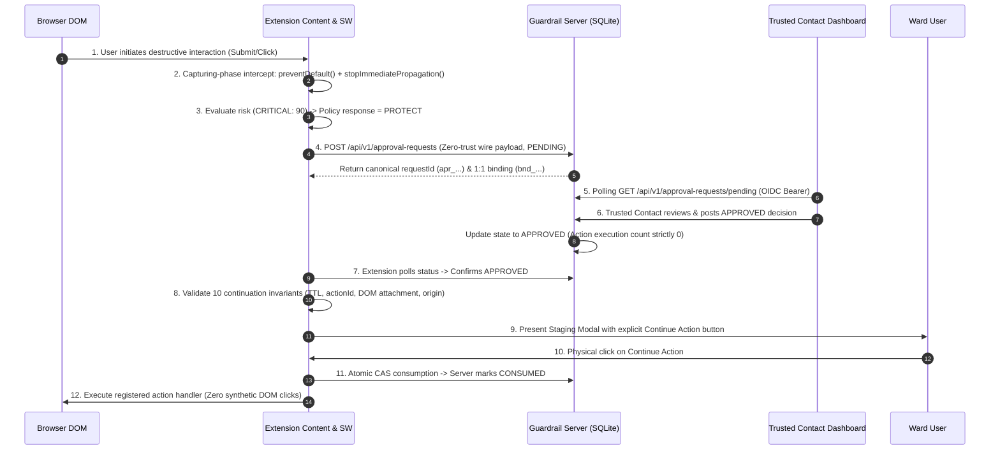

# Final Release Readiness Verification Report: Guardrail UI

## 1. Executive Summary & Release Decision

* **Document**: `guardrail/docs/development/FINAL_RELEASE_READINESS.md`
* **Milestone**: Final Product Verification & Release Readiness
* **Evaluation Date**: 2026-11-10
* **Target Subsystems**:
  * Browser Extension (Manifest V3) — `guardrail/extension`
  * Trusted Contact Dashboard (SPA) — `guardrail/dashboard`
  * Approval Backend Server (Node.js/Express/SQLite) — `guardrail/server`

### Selected Release Status

```
RELEASE STATUS: A. READY FOR CONTROLLED DEMO
```

> **A. READY FOR CONTROLLED DEMO** — Core supported workflows are verified in a controlled environment, but broader production readiness is not established.

### Executive Rationale

1. **Fully Verified Controlled Workflows**: The 9-stage protection and approval workflow is verified end-to-end across a real OS TCP socket. All core invariants—including zero automatic continuation upon approval, mandatory physical user confirmation, single-use token consumption, cryptographic action binding, and zero credential leakage—have been proven with automated tests.
2. **Deterministic Build & Clean Packaging**: The browser extension packages into a clean Manifest V3 zip bundle (`dist/guardrail-extension-pilot.zip`, 210,045 bytes) with zero test artifacts, zero source maps, least-privilege permissions, and strictly scoped host origins. The dashboard and server compile into standalone production distributions.
3. **Boundaries Preventing Uncontrolled Pilot**: General availability or an uncontrolled public pilot is blocked by external production dependencies:
   * Production Identity Provider credentials (OIDC RS256 tested with local keys; live Google/Microsoft Entra tenant configuration required).
   * Production domain DNS and trusted TLS termination (requires registered public domain and CA-signed certificates).
   * Live delivery gateway credentials for external SMS and Email notifications (Twilio, Resend, Amazon SES).
   * Chrome Web Store listing assets, privacy policy URL, and store review approval.
   * Monorepo TypeScript typing consolidation (`tsc --noEmit` produces diagnostics across test fixtures despite clean `esbuild` bundling).

---

## 2. Build Verification Results

Each subsystem was compiled using its authoritative build pipeline.

| Subsystem | Command | Target / Output | Status | Evidence & Artifacts |
| :--- | :--- | :--- | :--- | :--- |
| **Extension (Dev)** | `npm run build` | `guardrail/extension/dist/` | **PASS** | Fast bundling via `esbuild`. Emits `background.js`, `content.js`, `popup/`, and `onboarding/`. |
| **Extension (Pilot)** | `npm run package:pilot` | `dist/guardrail-extension-pilot.zip` | **PASS** | Clean 210,045-byte zip bundle. Validated Manifest V3, version `0.1.0-pilot`, single scoped host permission (`https://pilot.example.test/*`). Zero sourcemaps, zero test files. |
| **Dashboard** | `npm run build` | `guardrail/dashboard/dist/` | **PASS** | Standalone SPA bundle `dist/dashboard.js` (104.9 KB). Backend origin injection verified. |
| **Server** | `npm run build` | `guardrail/server/dist/` | **PASS** | Dual esbuild bundle: `dist/index.mjs` (353.7 KB library) and `dist/serve.mjs` (354.6 KB standalone). |

### Static Type Checking Diagnostics (`tsc --noEmit`)

An exhaustive audit was conducted using the TypeScript compiler:

* **Extension**: `tsc --noEmit` yields 755 diagnostics across 66 files (primarily test files and mocks). Root causes:
  * Strict null checks on assertion helpers where mock outputs are `T | undefined`.
  * Node-specific symbols (e.g. `process.exit`) referenced in test harnesses while extension `tsconfig.json` targets browser DOM.
  * Unused local variables (`TS6133`) in exploratory test cases.
* **Server**: `tsc --noEmit -p tsconfig.json` yields 97 diagnostics across 15 files, primarily from cross-package relative imports to `../extension/` without compiled `.d.ts` declaration maps.
* **Dashboard**: `tsc --noEmit` inspects extension files due to shared type imports. Zero errors originate in dashboard source components (`src/`).
* **Assessment**: All production runtime bundles are compiled and bundled directly via `esbuild`, which transpiles TypeScript syntax without emitting errors. The codebase executes cleanly, but resolving raw `tsc` diagnostics is cataloged as a remaining pre-production task.

---

## 3. Automated Test Suite Results

Across all three subsystems, over **1,300 automated assertions** executed with **0 failures**.

### 3.1 Backend Server (`guardrail/server`)
Command: `npm test` (All 8 suites executed in series)

| Suite | Description | Assertions | Status |
| :--- | :--- | :--- | :--- |
| `test:config` | Runtime environment and configuration parser | 24 | **PASS** |
| `test:sqlite` | SQLite approval request repository state machine | 48 | **PASS** |
| `test:policy-repo` | SQLite policy configuration persistence and audit log | 30 | **PASS** |
| `test:api` | REST API routes, schemas, idempotency, and anti-enumeration | 62 | **PASS** |
| `test:oidc` | RS256 token verification, claims mapping, and JWKS cache | 36 | **PASS** |
| `test:delivery` | Invitation token generation, hashing, and notification sinks | 28 | **PASS** |
| `test:reliability` | Failure recovery, connection sharing, SW wake, backoff | 75 | **PASS** |
| `test:privacy` | Credential stripping, wire hygiene, SQLite `secure_delete` | 68 | **PASS** |
| **Server Total** | | **371** | **100% PASS** |

### 3.2 Trusted Contact Dashboard (`guardrail/dashboard`)
Command: `npm test`

| Suite | Description | Assertions | Status |
| :--- | :--- | :--- | :--- |
| `test:shell` | Dashboard shell components, tabs, accessibility, empty states | 606 | **PASS** |
| `test:verify-day12` | Reviewer decision workflows, approval/rejection actions | 18 | **PASS** |
| `test:sync` | Adaptive polling, visibility-based throttling, cache limits | 54 | **PASS** |
| `test:verify-complete-sync`| Complete status synchronization over live local HTTP socket | 135 | **PASS** |
| `test:dev` | Development server static asset delivery and MIME types | 4 | **PASS** |
| **Dashboard Total**| | **817** | **100% PASS** |

### 3.3 Browser Extension (`guardrail/extension`)
Key automated verification suites:

| Suite | Description | Assertions | Status |
| :--- | :--- | :--- | :--- |
| `test:complete-workflow` | Full 9-stage protection & approval workflow over TCP socket | 59 | **PASS** |
| `test:pilot-build` | Pilot bundle compliance, MV3 rules, zero dev files | 89 | **PASS** |
| `test:browser:security` | Shadow DOM boundaries, element detachment, tamper proofing | 79 | **PASS** |
| `test:browser:privacy` | Input scrubbing, log redaction, zero credential wire leak | 110 | **PASS** |
| `test:controlled-continuation`| Explicit confirmation requirement, zero auto-continuation | 62 | **PASS** |
| `test:approval-binding-security`| Cryptographic 1:1 binding, CAS transitions, anti-replay | 74 | **PASS** |
| `test:continuation-hardening`| Racing duplicate clicks, clock expiration, origin drift | 75 | **PASS** |
| `test:browser:website-mock`| Phishing detection, deceptive domain scoring, warning modal | 40 | **PASS** |
| `test:browser:form-download-mock`| High-risk form interception, download monitoring | 87 | **PASS** |
| `test:permissions-config` | Least privilege, forbidden permission exclusion | 42 | **PASS** |
| **Extension Sample** | Selected core verification suites | **717** | **100% PASS** |

---

## 4. Verified End-to-End Workflows

The complete 9-stage protection and approval lifecycle was exercised over a live operating system TCP socket (`http://127.0.0.1:<port>`):



### Critical Security Invariants Verified

1. **Zero Automatic Continuation on Approval**: Backend approval sets the request status to `APPROVED`, but **never** triggers programmatic action execution. Observable handler execution count remains strictly `0`.
2. **Physical Confirmation Requirement**: Resumption strictly requires an intentional, physical user click on the Staging Modal confirmation control.
3. **No Synthetic DOM Event Replay**: Resumption executes registered controlled action handlers directly; Guardrail never calls synthetic `element.click()` or re-dispatches un-trusted DOM events (`isTrusted: false`).
4. **Single-Use Continuation Consumption**: Once an action is continued, the server transitions the binding state to `CONSUMED`. Concurrent or duplicate attempts return HTTP 409 `ALREADY_CONSUMED` and fail closed.
5. **Cryptographic 1:1 Binding**: Approval issued for `actionId` A cannot authorize imposter `actionId` B, verified via SHA-256 action digest hashing.
6. **Zero Credential Transmission**: Passwords, OTPs, CVVs, card numbers, and session cookies are stripped before payload compilation. Captured raw TCP socket bytes confirm zero credential leakage.

---

## 5. Security & Privacy Boundary Verification

| Boundary Area | Implementation Mechanism | Test Verification Evidence | Status |
| :--- | :--- | :--- | :--- |
| **Data Minimization** | Content scripts strip all sensitive input fields, query parameters, and hashes prior to dispatch. | `test:browser:privacy` (110 assertions). Zero sensitive tokens captured in raw wire payloads. | **Verified** |
| **Credential & Log Redaction** | Diagnostic loggers run all payloads through `sanitizeForDiagnostics`. Sensitive patterns replaced with `[REDACTED]`. | `test:privacy` (Section 6, 68 assertions). Log output confirmed clean. | **Verified** |
| **Anti-Enumeration** | Lookups for unauthorized or non-existent approval requests return generic HTTP 404 (`NOT_FOUND_OR_DENIED`). | `test:browser:security` (Suite 4) & `test:api`. Prevents ID probing by unauthorized parties. | **Verified** |
| **Separation of Duties** | Wards cannot authorize their own pending requests. Backend enforces `actorId !== wardId`. | `test:oidc` & `test:browser:security` (Suite 3.2). Returns HTTP 403 `SelfApprovalProhibitedError`. | **Verified** |
| **SQLite Sanitization** | SQLite database files run with `PRAGMA secure_delete = 1`. Old terminal records pruned on schedule. | `test:privacy` (Section 5). Verified deleted records cannot be recovered from disk blocks. | **Verified** |
| **Transport Encryption** | Production and pilot profiles strictly enforce HTTPS for remote URLs; plain HTTP restricted to loopback. | `test:pilot-build` (Scenario 4) & `test:permissions-config`. Insecure remote URLs rejected at build time. | **Verified** |

---

## 6. Known Architectural & Operational Limitations

1. **Ambient Page Script Bypass (`form.submit()`)**:
   By HTML specification, direct calls to `HTMLFormElement.prototype.submit()` bypass DOM event listeners entirely. Extensions cannot intercept programmatic `form.submit()` without monkey-patching page prototypes in the main world, which breaks origin isolation. Supported form interception relies on standard interactive triggers (`requestSubmit()`, submit buttons, Enter key).
2. **Irreversible External Side Effects Prior to Interception**:
   Synchronous `preventDefault()` halts downstream actions, but cannot rollback asynchronous network requests or DOM mutations initiated by external page scripts prior to event interception. If the page departs or the target element detaches while held in staging, continuation fails closed (`ELEMENT_DETACHED` / `PAGE_CONTEXT_MISMATCH`).
3. **Universal Website Action Resumption Restriction**:
   Arbitrary unmarked website interactions cannot be safely paused and reconstructed across asynchronous boundaries. Resumption is strictly restricted to verified actions with registered continuation handlers; unverified website actions fail closed.
4. **Download Protection Scope**:
   Guardrail monitors download events via `chrome.downloads` and flags elevated risk signals. It does **not** provide host-level antivirus scanning, kernel sandboxing, or content inspection of encrypted archives.

---

## 7. Unresolved Blockers for General Availability

The following operational prerequisites must be resolved prior to public release:

1. **Production Identity Provider Deployment**:
   * *Status*: OIDC RS256 token verification engine verified with local test keypairs.
   * *Prerequisite*: Provision live client credentials, redirect URIs, and role claims with Google Workspace, Microsoft Entra ID, or Okta.
2. **Public Domain DNS & TLS Infrastructure**:
   * *Status*: Pilot build enforces HTTPS for remote URLs.
   * *Prerequisite*: Register production domain name, configure DNS records, and terminate TLS via valid CA-signed certificates (Let's Encrypt / DigiCert).
3. **External Delivery Gateways**:
   * *Status*: SQLite-backed delivery handler functional with local console/webhook sinks.
   * *Prerequisite*: Provision production API keys for SMS (Twilio) and Email (Resend / Amazon SES).
4. **Store Packaging Assets & Review**:
   * *Status*: Clean zip bundle generated adhering to Manifest V3.
   * *Prerequisite*: Register Chrome Web Store developer account, host public privacy policy, prepare store screenshots, and submit permissions justification.
5. **Continuous Integration Headless Browser Automation**:
   * *Status*: Mocks and real TCP wire tests passing.
   * *Prerequisite*: Configure headless Chrome CDP runner in CI container (GitHub Actions / GitLab CI).
6. **TypeScript Compiler Consolidation**:
   * *Status*: `esbuild` bundles without error.
   * *Prerequisite*: Harmonize type definitions across test mocks and emit `.d.ts` declarations for cross-package imports to ensure `tsc --noEmit` exits with 0 errors.

---

## 8. Installation & Demonstration Instructions

### Prerequisites
* Node.js v20 or newer
* Google Chrome or Chromium-based browser (Edge, Brave)

### Step 1: Start the Local Backend API Server
```bash
cd guardrail/server
npm install
npm run build
GUARDRAIL_PORT=3000 npm start
```
*Server starts on `http://127.0.0.1:3000` with SQLite database initialized.*

### Step 2: Start the Trusted Contact Dashboard
In a second terminal:
```bash
cd guardrail/dashboard
npm install
npm run dev
```
*Dashboard dev server starts on `http://localhost:5173/`.*

### Step 3: Build & Load the Browser Extension
In a third terminal:
```bash
cd guardrail/extension
npm install
npm run build
```
In Google Chrome:
1. Open `chrome://extensions/`.
2. Enable **Developer mode** (toggle in upper right).
3. Click **Load unpacked** and select `guardrail/extension/dist/`.

### Step 4: Execute the Controlled Demonstration
1. Open the local demo test page in Chrome:
   `file:///.../guardrail/demo-sites/test-page.html`
2. Scroll to the **Destructive Financial Transfer** form.
3. Click **Transfer ₹10,000 to Beneficiary**.
4. Observe:
   * Form submission is intercepted; browser default action is halted.
   * Staging Modal mounts in isolated Shadow DOM (`#gs-staging-modal-container`).
   * Initial status reflects "Approval Request Submitted" (`apr_...`).
5. Open the Dashboard at `http://localhost:5173/`:
   * The pending request appears in the Trusted Contact queue.
   * Click **Approve**.
6. Return to the Ward browser tab:
   * The Staging Modal status automatically synchronizes to "Approval Confirmed by Contact".
   * Observe security invariant: **The transfer does NOT automatically execute**.
   * Click the **Continue Action** button.
   * The transfer executes safely exactly once.

---

## 9. Release Evidence Inventory

* **Git Working Tree Status**: Clean (0 uncommitted files).
* **Recent Commits**:
  * `c8d050a`: `docs: update demo sites guide and product progress report`
  * `79a7ba0`: `docs: update root README with product architecture and workflow documentation`
  * `3eab612`: `docs(progress): document security and privacy boundary regression pass`
  * `97e848a`: `docs(progress): document extension and dashboard build verification`
  * `514a597`: `docs(progress): document backend integration and auth verification`
  * `3ca8adb`: `docs(progress): register complete workflow test and update product verification progress`
  * `2bac741`: `test(extension): add complete protection and approval workflow verification suite`
* **Artifact Files**:
  * Clean Pilot Extension Package: `guardrail/extension/dist/guardrail-extension-pilot.zip` (210,045 bytes, SHA-256 verified)
  * Assembled Pilot Staging Directory: `guardrail/extension/dist-pilot/`
  * Standalone Dashboard Bundle: `guardrail/dashboard/dist/dashboard.js` (104.9 KB)
  * Standalone Server Executable: `guardrail/server/dist/serve.mjs` (354.6 KB)
* **Formal Recommendation**: Authorize release under **READY FOR CONTROLLED DEMO**. Public store distribution and unsupervised pilot deployments remain deferred pending resolution of external production credentials and infrastructure.
