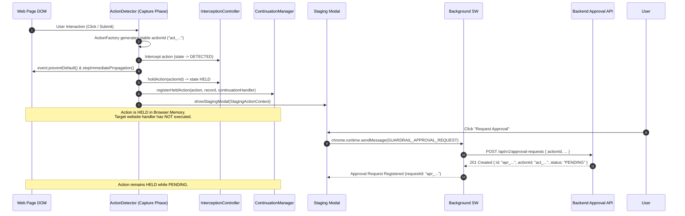
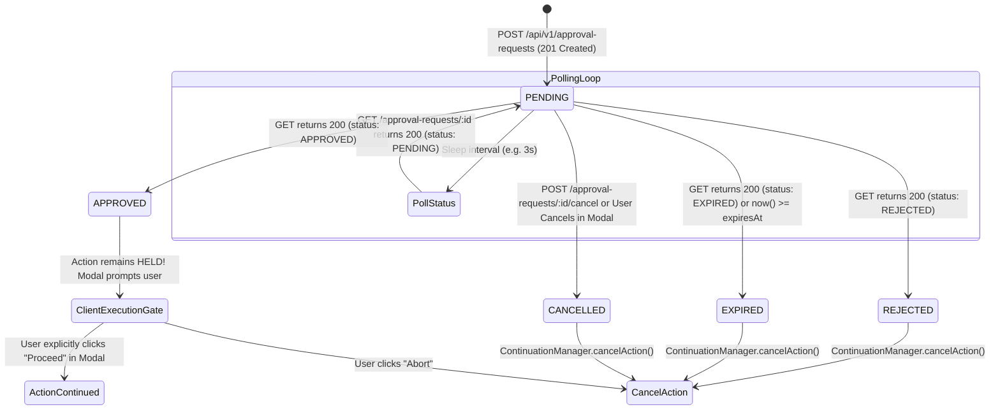
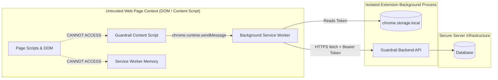

# Guardrail Extension-to-Backend Integration Contract & Readiness Assessment

## 1. Executive Summary & Verification Context

This document establishes the verified technical contract governing communication between the **Guardrail Manifest V3 Browser Extension** and the **Guardrail Remote Approval Backend**.

Guardrail is an in-browser interaction safety system:
* **Day 8** implemented the **controlled action interception foundation** (`InterceptionController`, `ContinuationManager`, and DOM capturing-phase cancellation).
* **Day 9** introduced **Staging Mode** (an accessible Shadow DOM quarantine interface), user cancellation, and the local approval request intent (`ApprovalRequestIntent` marked `LOCAL_PROTOTYPE_ONLY`).
* **Day 10** established the **server-side approval domain model, lifecycle state machine, multi-tenant authorization rules, coordination service, and REST API router** (`guardrail/extension/src/approval/`).

> [!IMPORTANT]
> **READINESS VERDICT: NOT YET READY FOR LIVE NETWORK INTEGRATION**
> While the Day 10 domain logic, lifecycle rules, authorization engine, in-memory atomic repository, and REST API routing have been fully implemented and verified with 124 passing checks across 17 test scenarios, **the repository cannot currently execute live network integration**. 
> 
> Specifically:
> 1. `guardrail/server` is an uninitialized placeholder containing only a `README.md`. No HTTP daemon (e.g. Express, Fastify, or Node `http.createServer`) is running or listening on a network port.
> 2. `guardrail/extension/public/manifest.json` does **not** declare `host_permissions`. Under Manifest V3, network requests from the extension to localhost or remote origins are prohibited.
> 3. The extension background service worker (`guardrail/extension/src/background/index.ts`) has no HTTP client implemented and explicitly responds with `{ isBackendConnected: false }`.
> 4. Persistence is currently an ephemeral, in-memory development abstraction (`DevelopmentInMemoryApprovalRequestRepository`). No persistent SQL database exists.
> 5. No user authentication session bootstrap or token storage mechanism exists in the extension.

This contract provides the definitive specification that must be fulfilled when implementing the backend server daemon (Day 11) and the extension network transport client (Day 12).

---

## 2. Repository Audit: Implemented Features vs. Active Gaps

An inspection of the real repository reveals the exact state of each architectural layer:

| Subsystem / Layer | Source Location | Implementation Status | Functional Reality & Active Gaps |
| :--- | :--- | :---: | :--- |
| **Extension Manifest** | `extension/public/manifest.json` | **Incomplete for API** | Manifest V3 declared with `"permissions": ["storage"]`. **Gap:** Missing `host_permissions`. Network `fetch()` calls to external hosts or `http://localhost:*` will be rejected by Chrome. |
| **Content Script** | `extension/src/content/index.ts` | **Operational (Day 8-9)** | Intercepts `CLICK`, `INPUT`, `SUBMIT`, `NAVIGATION`. Halts event propagation; puts action in `HELD` state; opens Staging Mode. Dispatches local intent via `chrome.runtime.sendMessage`. |
| **Staging Mode UI** | `extension/src/staging/modal.ts` | **Operational (Day 9)** | Shadow DOM dialog with WCAG 2.1 AA focus trap. "Request Approval" button constructs `ApprovalRequestIntent` and emits DOM event `guardrail:approval-requested` (`isBackendConnected: false`). |
| **Background Service Worker** | `extension/src/background/index.ts` | **Prototype Only** | Listens for `GUARDRAIL_APPROVAL_REQUEST` message. Logs intent locally to console. Returns mock acknowledgement with `{ isBackendConnected: false }`. **Gap:** No HTTP client or network requests exist. |
| **Approval Domain Model** | `extension/src/approval/model.ts` | **Complete & Verified** | Strongly typed `ApprovalRequest` entity, zero-trust validation engine (`validateApprovalRequest`), strict privacy whitelist, and lifecycle transition functions. |
| **Lifecycle State Machine** | `extension/src/approval/lifecycle.ts` | **Complete & Verified** | Deterministic state transitions (`PENDING` $\rightarrow$ `APPROVED` / `REJECTED` / `EXPIRED` / `CANCELLED`). Enforces terminal state immutability, duplicate suppression, and expiration timers. |
| **Server Authorization** | `extension/src/approval/authorization.ts` | **Complete & Verified** | Server-side authorization rules for `USER`, `TRUSTED_CONTACT`, and `ADMIN`. Enforces action ownership, trusted contact status, anti-enumeration (opaque 404), and strict self-approval prohibition. |
| **Approval Repository** | `extension/src/approval/repository.ts` | **Development Only** | Interface `ApprovalRequestRepository` with atomic CAS conditional updates (`atomicTransition`). Implementation `DevelopmentInMemoryApprovalRequestRepository` is in-memory and ephemeral. |
| **Approval Service** | `extension/src/approval/service.ts` | **Complete & Verified** | Coordinates creation, retrieval, reviewer approval, rejection, and user cancellation with atomic concurrency protection and safe, whitelisted logging. |
| **Approval API Router** | `extension/src/approval/api.ts` | **Complete & Verified** | REST API router with headless dispatch (`ApprovalApiRouter.dispatch()`). Enforces Bearer token authentication, 16 KB body limit, JSON content-type, narrow CORS, and standard error envelopes. |
| **Server Directory** | `guardrail/server/` | **Uninitialized** | Contains only `README.md`. **Gap:** No server process, no entry point, no database migrations, and no active network listeners. |
| **Dashboard Directory**| `guardrail/dashboard/` | **Uninitialized** | Contains only `README.md`. Caretaker review web dashboard is not yet implemented. |

---

## 3. Approval Creation Endpoint Contract

The approval creation endpoint is fully specified and implemented in `guardrail/extension/src/approval/api.ts`.

### 3.1 Endpoint Definition

* **HTTP Method**: `POST`
* **Route Path**: `/api/v1/approval-requests`
* **Content-Type**: `application/json` *(strictly required; missing or other MIME types trigger `415 UNSUPPORTED_MEDIA_TYPE`)*
* **Max Payload Size**: `16,384 bytes` (16 KB) *(larger payloads trigger `413 PAYLOAD_TOO_LARGE`)*
* **Rate Limit Policy**: Whitelisted per IP / client token *(breaches trigger `429 RATE_LIMIT_EXCEEDED` with `Retry-After` header)*

### 3.2 Authentication Requirements

1. **Authorization Header**:
   ```http
   Authorization: Bearer <valid_user_session_token>
   ```
   * An absent, non-Bearer, or unverified token immediately returns `401 UNAUTHENTICATED`.
2. **Authoritative Identity Derivation**:
   * The server decodes the token via `TokenVerifier` to produce an authoritative `AuthContext`.
   * The `requesterId` assigned to the request is derived **strictly from `authContext.actorId`**.
   * Any client attempt to provide a `requesterId`, `userId`, `status`, or `decision` in the request body is **strictly rejected** with `400 VALIDATION_ERROR`.
3. **Action Ownership Verification**:
   * The server validates that `payload.actionId` belongs to the authenticated user via `ActionOwnershipRegistry.isActionOwnedByUser(actionId, actorId)`.
   * If the action is registered to a different user, the request is rejected with `403 UNAUTHORIZED_ACTION_REQUESTER`.

---

## 4. Exact Request and Response Schemas

### 4.1 Client Submission Request Body

The client extension submits the `ClientApprovalRequestPayload` interface defined in [src/types/approval.ts](file:///Users/deepanshukhatri/Library/CloudStorage/GoogleDrive-deepanshukhatri20061972@gmail.com/My%20Drive/Cloud%20Desktop/Guardrail%20UI/guardrail/extension/src/types/approval.ts#L220-L250).

#### TypeScript Schema:
```typescript
export interface ClientApprovalRequestPayload {
  /** The intercepted action identifier matching client InterceptionRecord */
  readonly actionId: string;

  /** Safe, human-readable summary of the action */
  readonly actionDescription: string;

  /** Interaction mechanism: CLICK | INPUT | SUBMIT | NAVIGATION */
  readonly actionType: 'CLICK' | 'INPUT' | 'SUBMIT' | 'NAVIGATION';

  /** Semantic category if classified */
  readonly category?: 'GENERAL' | 'AUTHENTICATION' | 'PAYMENT' | 'DESTRUCTIVE' | 'DOWNLOAD' | 'EXTERNAL_NAVIGATION';

  /** Evaluated risk level from client pipeline */
  readonly riskLevel: 'LOW' | 'MEDIUM' | 'HIGH' | 'CRITICAL';

  /** Evaluated risk score from client pipeline (0-100) */
  readonly riskScore?: number;

  /** Non-sensitive heuristic explanations justifying risk score */
  readonly riskReasons?: readonly string[];

  /** Sanitized website origin (scheme + domain + optional port, no paths/query/auth) */
  readonly origin?: string;

  /** Sanitized website hostname */
  readonly hostname?: string;

  /** Sanitized webpage title */
  readonly pageTitle?: string;
}
```

#### JSON Example:
```json
{
  "actionId": "act_1729300000_a1b2c3d4",
  "actionDescription": "Click submit button 'Transfer Funds'",
  "actionType": "CLICK",
  "category": "PAYMENT",
  "riskLevel": "CRITICAL",
  "riskScore": 95,
  "riskReasons": [
    "Target element matches high-value transaction keyword",
    "Action leads to irreversible external fund transfer"
  ],
  "origin": "https://secure-bank.example.com",
  "hostname": "secure-bank.example.com",
  "pageTitle": "Wire Transfer Confirmation"
}
```

### 4.2 Strict Privacy Exclusion Rules

The backend validation engine (`validateApprovalRequest` in [src/approval/model.ts](file:///Users/deepanshukhatri/Library/CloudStorage/GoogleDrive-deepanshukhatri20061972@gmail.com/My%20Drive/Cloud%20Desktop/Guardrail%20UI/guardrail/extension/src/approval/model.ts#L77-L103)) recursively checks and strictly rejects payloads containing any forbidden properties matching:

```regex
/password/i, /passphrase/i, /passwd/i, /secret/i, /\botp\b/i, /\bpin\b/i,
/\bcvv\b/i, /\bcvc\b/i, /credit[-_]?card/i, /debit[-_]?card/i, /card[-_]?number/i,
/\bpan\b/i, /\btoken\b/i, /authtoken/i, /bearer/i, /cookie/i, /form[-_]?value/i,
/input[-_]?value/i, /form[-_]?data/i, /raw[-_]?html/i, /raw[-_]?content/i,
/dom[-_]?node/i, /element[-_]?node/i, /private[-_]?key/i, /\bssn\b/i
```

Any payload triggering these patterns fails with `400 VALIDATION_ERROR`.

### 4.3 Success Response Schema

All responses use the standard `ApiResponseEnvelope<T>` defined in [src/approval/api.ts](file:///Users/deepanshukhatri/Library/CloudStorage/GoogleDrive-deepanshukhatri20061972@gmail.com/My%20Drive/Cloud%20Desktop/Guardrail%20UI/guardrail/extension/src/approval/api.ts#L58-L67).

* **HTTP Status**: `201 Created`
* **Response Headers**:
  * `Content-Type: application/json; charset=utf-8`
  * `X-Content-Type-Options: nosniff`
  * `X-Frame-Options: DENY`
  * `Access-Control-Allow-Origin: chrome-extension://<EXTENSION_ID>`

#### JSON Example:
```json
{
  "success": true,
  "data": {
    "id": "apr_01J9X4M5N2ABCD1234EFGH",
    "actionId": "act_1729300000_a1b2c3d4",
    "requesterId": "usr_alice",
    "status": "PENDING",
    "actionDescription": "Click submit button 'Transfer Funds'",
    "actionType": "CLICK",
    "category": "PAYMENT",
    "riskLevel": "CRITICAL",
    "riskScore": 95,
    "riskReasons": [
      "Target element matches high-value transaction keyword",
      "Action leads to irreversible external fund transfer"
    ],
    "origin": "https://secure-bank.example.com",
    "hostname": "secure-bank.example.com",
    "pageTitle": "Wire Transfer Confirmation",
    "createdAt": "2026-10-19T02:30:00.000Z",
    "expiresAt": "2026-10-19T02:45:00.000Z"
  }
}
```

> [!NOTE]
> When `status` is `PENDING`, fields `resolvedAt`, `decision`, and `cancellationReason` are strictly `undefined` and omitted from the response.

---

## 5. Client-Supplied vs. Server-Assigned & Validated Fields

| Field Name | Origin | Validation / Enforcement Policy | Security & Architectural Rationale |
| :--- | :---: | :--- | :--- |
| **`id`** | **Server** | Assigned by server (`apr_` + UUIDv4/entropy). Client input rejected. | Prevents request ID spoofing and collision attacks. |
| **`requesterId`** | **Server** | Derived exclusively from verified Bearer token `AuthContext.actorId`. | Prevents user impersonation. Clients cannot initiate requests on behalf of other users. |
| **`status`** | **Server** | Initialized strictly to `PENDING`. Client input rejected. | Clients cannot grant self-approval or alter lifecycle states during creation. |
| **`actionId`** | **Client** | Required string. Must match active client `InterceptionRecord`. | Correlates the remote backend request with the client-held DOM event in `ContinuationManager`. |
| **`actionDescription`** | **Client** | Required string. Plain text only; no HTML tags. | Derived from sanitized element labels to give approvers context without capturing form content. |
| **`actionType`** | **Client** | Enum: `CLICK`, `INPUT`, `SUBMIT`, `NAVIGATION`. | Identifies the physical interaction mechanism. |
| **`category`** | **Client** | Validated against `ActionCategory` enum if provided. | Classifies intent (e.g. `PAYMENT`, `DESTRUCTIVE`). Server flags anomalies if inconsistent with element. |
| **`riskLevel`** | **Client** | Enum: `LOW`, `MEDIUM`, `HIGH`, `CRITICAL`. | Evaluated by client Risk Engine. Used by server routing rules to assign caretakers. |
| **`riskScore`** | **Client** | Finite number, range 0–100. | Quantitative heuristic score. |
| **`riskReasons`** | **Client** | Array of plain text strings. | Non-sensitive heuristic explanations. |
| **`origin`** | **Client** | Validated as `scheme://host[:port]`. Paths/queries rejected. | Prevents leaking sensitive URL query parameters (e.g. `?token=...`) to reviewers. |
| **`hostname`** | **Client** | Validated hostname string without slashes or spaces. | Displayed to approver as the affected web property. |
| **`pageTitle`** | **Client** | Optional sanitized string. | Browser tab context. |
| **`createdAt`** | **Server** | Server system clock timestamp (ISO 8601 UTC). | Authoritative baseline for expiration calculation. |
| **`expiresAt`** | **Server** | Calculated by server (`createdAt + TTL`, default 15m). | Prevents late decisions on stale actions. Client cannot set expiration. |
| **`resolvedAt`** | **Server** | Set when terminal state is reached. Absent while `PENDING`. | Audit record of when the decision occurred. |
| **`decision`** | **Server** | Assigned only when an authorized contact calls `/decide`. | Contains `{ decision, decidedBy, decidedAt, decisionReason }`. Never accepted on create. |
| **`cancellationReason`**| **Server** | Set when requester cancels via `/cancel`. | Records why the interaction was aborted by the user. |

---

## 6. How the Extension Identifies and Holds the Action

The client runtime uses a strict correlation chain to link the in-browser held interaction with the backend lifecycle:



1. **Generation of `actionId`**: When an interaction is intercepted during DOM capturing phase, `ActionFactory` assigns a unique `actionId` (format: `act_<timestamp>_<entropy>`).
2. **Registration in `InterceptionController`**: The action is registered and transitioned to `InterceptionState.HELD`.
3. **Execution Isolation in `ContinuationManager`**: The continuation handler closure (the code that would execute the original action) is stored **exclusively in client memory** inside `defaultContinuationManager` keyed by `actionId`. It is **never** sent to the backend.
4. **Correlation with Backend**: The client includes `actionId` in `ClientApprovalRequestPayload`. The backend stores this reference as `ApprovalRequest.actionId`.
5. **Holding Invariant**: The action remains in the `HELD` state in client memory throughout the approval lifecycle. If the user closes the tab, navigates away, or clicks "Cancel Action", `ContinuationManager.cancelAction(actionId)` runs, destroying the held closure.

---

## 7. How the Extension Learns the Authoritative Request Status

The extension learns the authoritative status of an approval request through the status inspection endpoint.

### 7.1 Status Inspection Endpoint

* **HTTP Method**: `GET`
* **Route Path**: `/api/v1/approval-requests/:id`
* **Authentication**: `Authorization: Bearer <user_token>`
* **Authorization Rule**: Caller must be the request owner (`authContext.actorId === request.requesterId`) or an admin. Unrelated users receive `404 NOT_FOUND_OR_DENIED`.

### 7.2 Polling Protocol & State Reconciliation

While a request is pending, the extension background service worker polls the status endpoint:



#### Polling Parameters:
* **Initial Interval**: 2 seconds.
* **Backoff Strategy**: Linear step to 5 seconds after 30 seconds.
* **Maximum Duration**: 15 minutes (`expiresAt` deadline).
* **Network Error Resilience**: Transient network failures do **not** cancel the held action. Polling retries up to 3 times before displaying a warning.

### 7.3 Decoupling Approval Decisions from Action Execution

> [!CAUTION]
> **CRITICAL ARCHITECTURAL INVARIANT: APPROVAL $\neq$ EXECUTION**
> When the polling loop receives `status: "APPROVED"`, **the browser action is NOT automatically executed**.
> 
> Automated blind continuation is strictly prohibited because:
> 1. The underlying web page state may have changed while waiting for caretaker review.
> 2. The user may have navigated away or lost interest.
> 3. Automatic remote execution creates a severe remote code execution vulnerability if a caretaker account is compromised.
> 
> **Execution Protocol**:
> 1. Status changes to `APPROVED`.
> 2. Staging Mode modal updates its UI: *"Your trusted contact has approved this action. Would you like to proceed?"*
> 3. The user must **explicitly click "Proceed"** in the Staging Mode dialog.
> 4. Only upon explicit user confirmation does `defaultContinuationManager.continueAction(actionId)` execute the held handler.

### 7.4 Client Cancellation Endpoint

If the user clicks "Cancel Action" in Staging Mode or closes the tab:
* **HTTP Method**: `POST`
* **Route Path**: `/api/v1/approval-requests/:id/cancel`
* **Authentication**: `Authorization: Bearer <user_token>`
* **Payload**: `{"reason": "User cancelled in Staging Mode"}`
* **Response**: `200 OK` with updated status `CANCELLED`.
* **Client Effect**: `ContinuationManager.cancelAction(actionId)` immediately clears the held closure.

---

## 8. Error, Expiration, Unauthorized, and Invalid Payload Representation

All API errors return a uniform error structure in the `ApiResponseEnvelope`:

```json
{
  "success": false,
  "error": {
    "code": "STRING_ERROR_CODE",
    "message": "Human-readable description of error.",
    "statusCode": 400,
    "details": ["Optional list of specific validation failures"]
  }
}
```

### Complete HTTP Error Mapping:

| HTTP Status | Error `code` | Trigger Condition | Handling by Extension |
| :---: | :--- | :--- | :--- |
| **`400`** | `VALIDATION_ERROR` | Missing required fields, unpermitted properties, or forbidden sensitive fields in body. | Reject request; log details; show error in Staging UI. |
| **`400`** | `MALFORMED_JSON` | Syntax error in request body JSON. | Internal bug; abort request. |
| **`401`** | `UNAUTHENTICATED` | Missing or invalid `Authorization: Bearer <token>` header. | Prompt user to log in or refresh session token. |
| **`403`** | `UNAUTHORIZED_ACTION_REQUESTER` | Caller is attempting to create an approval request for an `actionId` owned by another user. | Refuse request; security anomaly. |
| **`403`** | `SELF_APPROVAL_PROHIBITED` | A user attempts to approve or decide their own approval request. | Disallowed; separation of duties. |
| **`403`** | `CORS_ORIGIN_DENIED` | Preflight request from an unwhitelisted origin. | Extension ID not in backend CORS whitelist. |
| **`404`** | `NOT_FOUND_OR_DENIED` | Request ID does not exist **OR** caller does not have permission to view it. | **Anti-enumeration**: Prevents guessing request IDs. Stop polling; cancel held action. |
| **`409`** | `ALREADY_RESOLVED` | Attempted decision or cancellation on a request already in a terminal state (`APPROVED`, `REJECTED`, `EXPIRED`, `CANCELLED`). | Stop polling; update client state to match server. |
| **`409`** | `DUPLICATE_ACTIVE_REQUEST` | An active `PENDING` request already exists for this `(userId, actionId)` and `rejectDuplicates: true`. | Reuse existing request ID. |
| **`410`** | `REQUEST_EXPIRED` | Attempt to submit a decision after `expiresAt` deadline has passed. | Mark request expired; abort action. |
| **`413`** | `PAYLOAD_TOO_LARGE` | Request body exceeds 16 KB (16,384 bytes). | Payload too large; sanitize metadata. |
| **`415`** | `UNSUPPORTED_MEDIA_TYPE` | Missing or non-`application/json` Content-Type header on POST. | Set `Content-Type: application/json`. |
| **`429`** | `RATE_LIMIT_EXCEEDED` | Too many requests in time window. Header contains `Retry-After`. | Pause polling until `Retry-After` seconds elapsed. |
| **`500`** | `INTERNAL_SERVER_ERROR` | Unhandled server exception. Masked message. | Display generic server error; action remains held. |

---

## 9. API Base URL Configuration Strategy

### 9.1 Environment Base URLs

| Environment | Default Base URL | Host Permissions Required in `manifest.json` |
| :--- | :--- | :--- |
| **Development (Local Daemon)** | `http://localhost:3000` | `"host_permissions": ["http://localhost:3000/*", "http://127.0.0.1:3000/*"]` |
| **Staging / QA** | `https://staging-api.guardrail-safety.org` | `"host_permissions": ["https://staging-api.guardrail-safety.org/*"]` |
| **Production** | `https://api.guardrail-safety.org` | `"host_permissions": ["https://api.guardrail-safety.org/*"]` |

### 9.2 Configuration Storage & Resolution Hierarchy

The extension must resolve the API Base URL using a two-tier hierarchy:

1. **User / Developer Override**: Checked first in `chrome.storage.local`:
   ```typescript
   const { guardrailApiBaseUrl } = await chrome.storage.local.get('guardrailApiBaseUrl');
   ```
2. **Build-Time Fallback**: Injected during compilation via `build.mjs`:
   ```javascript
   const DEFAULT_API_BASE_URL = process.env.GUARDRAIL_API_BASE_URL || 'http://localhost:3000';
   ```

### 9.3 Extension Manifest Permissions Requirement

To allow `fetch()` calls to the backend from the background service worker, `guardrail/extension/public/manifest.json` must be updated prior to Day 12 client integration:

```json
{
  "permissions": [
    "storage"
  ],
  "host_permissions": [
    "http://localhost:3000/*",
    "http://127.0.0.1:3000/*"
  ]
}
```

> [!WARNING]
> Unrestricted wildcard host permissions (`"<all_urls>"` or `"*://*/*"`) must **never** be used as a shortcut. Permissions must be scoped strictly to the authorized backend API origins.

---

## 10. Extension-to-Backend Security & Secret Isolation

To prevent exposing backend authentication secrets or tokens to webpage scripts, the architecture enforces strict process isolation:



### Security Invariants:

1. **Content Scripts NEVER Possess Backend Credentials**:
   * Content scripts run in the context of untrusted webpages. They must **never** hold API keys, Bearer tokens, or passwords.
   * Content scripts communicate with the background worker **only** using Chrome extension messaging (`chrome.runtime.sendMessage`).
2. **Webpage DOM Events Contain Zero Secrets**:
   * DOM custom events (`guardrail:approval-requested`) dispatched for testing on controlled demo pages carry only non-sensitive action descriptions and identifiers.
3. **Background Service Worker as Secure Gateway**:
   * The background service worker resides in an isolated extension execution context inaccessible to webpage JavaScript.
   * All network requests to `/api/v1/*` are initiated **exclusively** from the background service worker.
   * Session tokens are stored securely in `chrome.storage.local` and read only by the service worker.
4. **Zero Backend Secrets in Client Code**:
   * No server signing secrets, database credentials, or admin API keys are bundled into extension source code or distributions.
5. **Narrow CORS Policy**:
   * The backend API router explicitly verifies `Origin` headers against a whitelist containing the Chrome extension ID (`chrome-extension://...`) and authorized dashboard origins. Wildcard `*` CORS is strictly forbidden.

---

## 11. Action Holding Invariants (Pre- and Post-Approval)

To guarantee interaction safety, the system enforces the following holding invariants:

1. **Immediate Pre-Interception Hold**:
   * When an interaction is intercepted, `event.preventDefault()` and `event.stopImmediatePropagation()` halt DOM processing before any target website listener can execute.
   * The action is registered with `InterceptionState.HELD`.
2. **Unbroken Hold During Pending Review**:
   * While the approval request is `PENDING`, awaiting network responses, or being reviewed by trusted contacts, the action remains `HELD` in `ContinuationManager`.
3. **Hold Maintained on Network Failure**:
   * If network connectivity is lost or the API returns an error (`500`, `503`, timeout), the action remains safely `HELD` until the user chooses to cancel.
4. **Hold Maintained Upon Approval (No Auto-Continuation)**:
   * Receiving `status: "APPROVED"` from the server updates the modal display, but does **not** trigger continuation. The action remains `HELD`.
5. **Single-Use Continuation on Explicit Confirmation**:
   * Only when the user reviews the caretaker's approval and clicks "Proceed" in Staging Mode does `ContinuationManager.continueAction(actionId)` release the action.
   * The continuation closure executes **exactly once**. Subsequent calls are rejected to prevent replay attacks.
6. **Destruction on Cancellation or Expiration**:
   * If the user cancels, the approver rejects, or the request expires (`410`), `ContinuationManager.cancelAction(actionId)` permanently deletes the continuation callback from memory. The action can never be resumed.

---

## 12. Verification Checklist & Day 11/12 Readiness Roadmap

Before the extension API client can be connected in Day 12, the following prerequisites must be met:

- [x] **Day 10 Domain Model & Validation**: Implemented and verified (`guardrail/extension/src/approval/model.ts`).
- [x] **Day 10 Lifecycle State Machine**: Implemented and verified (`guardrail/extension/src/approval/lifecycle.ts`).
- [x] **Day 10 Server Authorization Rules**: Implemented and verified (`guardrail/extension/src/approval/authorization.ts`).
- [x] **Day 10 In-Memory CAS Repository**: Implemented and verified (`guardrail/extension/src/approval/repository.ts`).
- [x] **Day 10 Approval Service**: Implemented and verified (`guardrail/extension/src/approval/service.ts`).
- [x] **Day 10 API Router & Schemas**: Implemented and verified (`guardrail/extension/src/approval/api.ts`).
- [x] **Day 10 Verification Suite**: 124 passing checks across 17 test scenarios (`guardrail/extension/src/approval/verify-day10-approval-workflow.ts`).
- [ ] **PREREQUISITE 1 (Day 11 - Server Daemon)**: Initialize `guardrail/server`, mount `ApprovalApiRouter` via an active HTTP listener (Node `http.createServer` or Express), and expose `/api/v1/*` on a configurable port (e.g. `3000`).
- [ ] **PREREQUISITE 2 (Day 11 - Database Persistence)**: Implement `PostgresApprovalRequestRepository` or `SqliteApprovalRequestRepository` implementing the `ApprovalRequestRepository` interface with ACID guarantees and row-level locking.
- [ ] **PREREQUISITE 3 (Day 12 - Extension Permissions)**: Update `guardrail/extension/public/manifest.json` to include `"host_permissions": ["http://localhost:3000/*"]`.
- [ ] **PREREQUISITE 4 (Day 12 - Background API Client)**: Implement `ApprovalApiClient` inside `guardrail/extension/src/background/` to perform authenticated `fetch()` requests and manage polling loops.
- [ ] **PREREQUISITE 5 (Day 12 - Token Storage & Management)**: Implement token management in `chrome.storage.local` to securely persist the user session token.
- [ ] **PREREQUISITE 6 (Day 13 - Caretaker Dashboard)**: Implement the trusted-contact review UI in `guardrail/dashboard` to consume `GET /api/v1/approvals/pending` and `POST /api/v1/approvals/:id/decide`.
