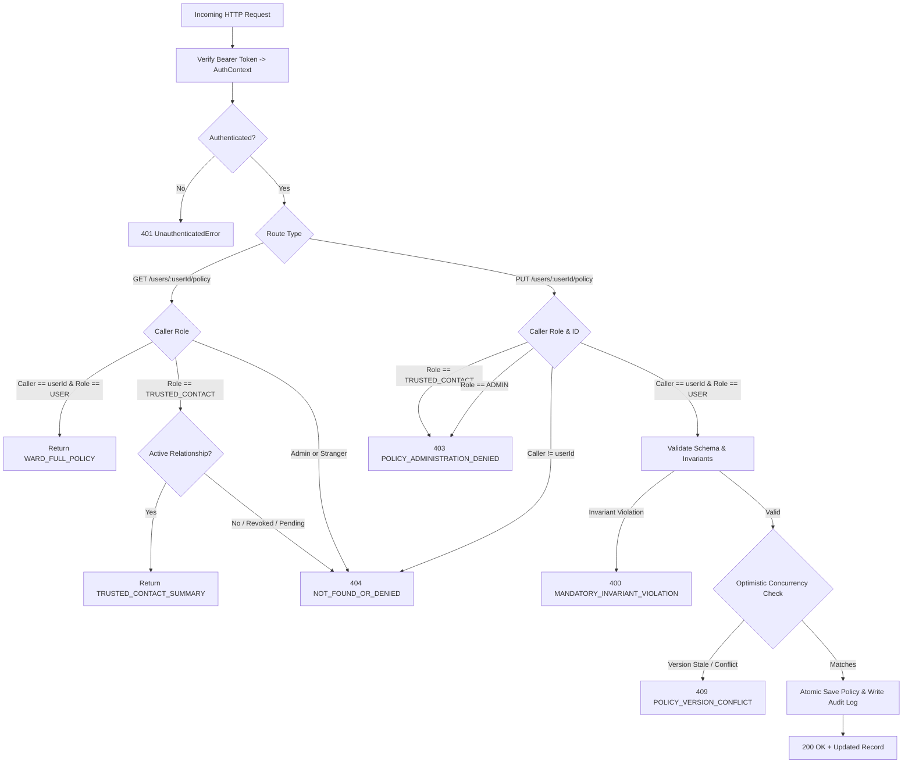

# Protection Policy Permission Boundaries & Authority Architecture

**Date:** 2026-11-07  
**Status:** Authoritative Specification & Verified Implementation  
**Audience:** Security Architects, Backend Engineers, Frontend Extension & Dashboard Developers  

---

## 1. Executive Summary & Core Security Invariants

Guardrail enforces strict multi-tenant authorization and role-based authority boundaries governing protection policy management.

### Foundational Invariants:
1. **Ward Sovereignty (Separation of Duties):**
   - Protection policies, risk thresholds, and staging containment settings belong **exclusively to the protected user (ward)**.
   - Trusted contacts hold **zero policy administration authority**.
   - A trusted contact's approval permission (deciding specific action requests) **does NOT grant policy administration permission**.
2. **Dashboard Visibility Does Not Imply Modification Rights:**
   - Active trusted contacts may view a read-only, sanitized policy overview to understand the ward's safety posture.
   - Dashboard views cannot edit, downgrade, or tamper with any policy rule.
3. **Client-Side Checks Are Not Authorization:**
   - All permissions are authoritatively verified on the backend (`PolicyService`, `SqlitePolicyRepository`, `ApprovalApiRouter`) using cryptographically verified `AuthContext`.
4. **No Broad Administrator Privileges:**
   - System administrators cannot arbitrarily weaken, disable, or modify user policies. Ward policy authority is sovereign.
5. **Immutable Security Invariants:**
   - Core protections (`CONTROLLED_DESTRUCTIVE` and `UNSUPPORTED_BOUNDARY_GUARD`) are permanently locked to `PROTECT` and cannot be disabled or downgraded by any actor.

---

## 2. Setting Authority Matrix

| Configuration Property | Authority Scope | Ward Rights | Active Trusted Contact Rights | Revoked Contact / Third Party | Rationale |
|---|---|---|---|---|---|
| `thresholds` (`lowMax`, `mediumMax`, `highMax`) | **WARD_EXCLUSIVE** | Full Read / Write | Sanitized Preset Only (`balanced`, `strict`, `custom`) | Opaque 404 (Denied) | Internal numeric score thresholds are private to the user's risk engine. Contacts only see preset tier name. |
| `signals` (weights & activation) | **WARD_EXCLUSIVE** | Full Read / Write | **Strictly Redacted** | Opaque 404 (Denied) | Internal heuristic detection weights are confidential and unnecessary for reviewer oversight. |
| `policies` (rules & decisions) | **WARD_EDITABLE_CONTACT_SUMMARY** | Full Read / Write | Sanitized Category Summary (`destructiveActions: PROTECT`, etc.) | Opaque 404 (Denied) | Contacts require visibility into whether high-impact interactions stage before continuation, but cannot alter decisions. |
| `trustedDomains` (exempt domain list) | **WARD_EXCLUSIVE** | Full Read / Write | **Strictly Redacted** | Opaque 404 (Denied) | The ward's trusted browsing allowlist discloses private browsing patterns and personal banking/work habits. Contacts have zero access. |
| `timeouts` (approval TTL, poll interval) | **WARD_EXCLUSIVE** | Full Read / Write | **Strictly Redacted** | Opaque 404 (Denied) | Operational lifecycle configuration managed by the ward's extension client. |
| `destructiveActionProtection` | **IMMUTABLE_SYSTEM_INVARIANT** | Locked to `PROTECT` | Viewable as `PROTECT` | Opaque 404 (Denied) | Irreversible data loss actions cannot be un-guarded by any policy configuration. |
| `unsupportedBoundaryGuard` | **IMMUTABLE_SYSTEM_INVARIANT** | Locked to `PROTECT` | Viewable as `PROTECT` | Opaque 404 (Denied) | Browser API boundaries fail-closed to prevent un-monitored execution. |

---

## 3. Operations Requiring Explicit User Authorization

The following policy and relationship operations strictly require direct, interactive ward authentication (`ActorRole.USER` where `authContext.actorId === targetUserId`):

1. **Policy Mutation (`PUT /api/v1/users/:userId/policy`):**
   - Altering numeric risk thresholds (`lowMax`, `mediumMax`, `highMax`).
   - Enabling/disabling non-mandatory policy rules.
   - Adjusting response decisions (e.g., configuring `CONTROLLED_PAYMENT` between `PROTECT` and `WARN`).
2. **Allowlist Management:**
   - Adding or removing hostnames from `trustedDomains`.
3. **Trusted Contact Lifecycle Management:**
   - Generating out-of-band contact pairing invitations (`POST /api/v1/invitations`).
   - Revoking existing trusted contact relationships (`POST /api/v1/trusted-contacts/:id/revoke`).
4. **Policy Reset (`POST /api/v1/users/:userId/policy/reset`):**
   - Resetting custom configurations to canonical safe defaults.
5. **Audit Inspection (`GET /api/v1/users/:userId/policy/audit`):**
   - Reviewing historical policy change logs.

---

## 4. Backend Permission Enforcement & Verification Points



---

## 5. Prevention of Unauthorized Policy Modifications

1. **Zero Client Trust:**
   - Neither the path `userId` nor body contents are used as proof of identity.
   - The authoritative identity is derived exclusively from the verified JWT `AuthContext`.
2. **Contact Denial:**
   - Any actor presenting `ActorRole.TRUSTED_CONTACT` on a policy mutation endpoint is immediately rejected with HTTP 403 `POLICY_ADMINISTRATION_DENIED`.
3. **Anti-Enumeration Opaque 404s:**
   - If an actor attempts to view or update another user's policy, the response is an opaque HTTP 404 `NOT_FOUND_OR_DENIED`. No status or error message discloses whether the target user exists.

---

## 6. Handling Revoked & Pending Trusted-Contact Relationships

1. **Active Relationship Requirement:**
   - A contact must possess status `TrustedContactStatus.ACTIVE` in `TrustedContactRegistry` to query `/api/v1/users/:userId/policy`.
2. **Instantaneous Cut-Off on Revocation:**
   - When a ward revokes a contact (`SqliteTrustedContactRegistry.revokeTrustedContact` or `InMemoryTrustedContactRegistry.revokeTrustedContact`), the database updates `status = 'REVOKED'`.
   - Any subsequent call by that contact fails `isTrustedContactForUser()` and yields an opaque HTTP 404 `NOT_FOUND_OR_DENIED`.
3. **Pending Invitations:**
   - Contacts holding invitations that are unaccepted (`PENDING_INVITE`) or expired are denied with HTTP 404.

---

## 7. Non-Sensitive Policy Change Audit Logging

Every authorized policy update generates an immutable `PolicyAuditRecord` stored in `user_policy_audit_log`:

```typescript
export interface PolicyAuditRecord {
  readonly id: string;                   // 'pol_aud_...'
  readonly userId: string;               // 'usr_alice'
  readonly updatedBy: string;            // 'usr_alice'
  readonly timestamp: string;             // ISO 8601 UTC
  readonly previousPolicyVersion: string;// '1.0.0'
  readonly newPolicyVersion: string;     // '1.1.0'
  readonly changedFields: readonly string[]; // ['thresholds.lowMax', 'trustedDomains']
  readonly changeSummary: string;        // 'Adjusted lowMax threshold from 24 to 20'
}
```

### Privacy & Secret Elimination:
- **No Passwords or Secrets:** The audit record never logs authentication tokens, bearer headers, or credentials.
- **Access Control:** Audit inspection (`GET /api/v1/users/:userId/policy/audit`) is restricted exclusively to the ward. Trusted contacts receive HTTP 403 `POLICY_ADMINISTRATION_DENIED`.

---

## 8. Optimistic Concurrency Control (OCC) & Stale Request Prevention

To prevent distributed clients or stale browser tabs from overwriting newer policies:

1. **Explicit Version Matching:**
   - Clients supply `expectedPolicyVersion` in `UpdateUserPolicyInput`.
   - If `expectedPolicyVersion !== existingRecord.policyVersion`, the backend aborts with HTTP 409 `POLICY_VERSION_CONFLICT`.
2. **Mandatory Version Progression:**
   - If `expectedPolicyVersion` is omitted, the candidate `config.policyVersion` cannot equal or regress behind the active version.
3. **Database Check-and-Set:**
   - In `SqlitePolicyRepository`, updates execute in atomic transactions verifying `policy_version` before committing to SQLite.

---

## 9. Verification & Test Suite

The permission boundaries are validated by automated suites across both extension and server:

| Suite | File | Assertions / Result |
|---|---|---|
| Permission Boundaries & Isolation | `guardrail/extension/src/approval/test-policy-permission-boundaries.ts` | **40 / 40 Passed** |
| SQLite Policy Repository & Concurrency | `guardrail/server/src/test-sqlite-policy-repository.ts` | **16 / 16 Passed** |
| Approval API End-to-End Suite | `guardrail/extension/src/approval/test-approval-api.ts` | **110 / 110 Passed** |
| Approval Service Coordination | `guardrail/extension/src/approval/test-approval-service.ts` | **102 / 102 Passed** |
| Policy Model Verification | `guardrail/extension/src/config/test-protection-policy-model.ts` | **182 / 182 Passed** |
| Protection Settings Interface | `guardrail/extension/src/settings/test-protection-settings.ts` | **61 / 61 Passed** |
| Server Integration Suite | `guardrail/server` (`npm test`) | **All 6 Suites Passed** |
