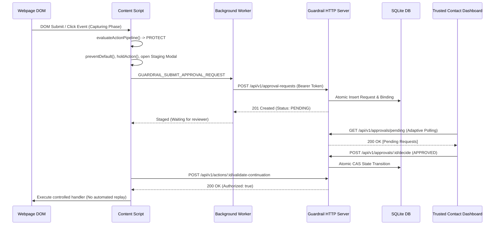

# Guardrail UI — Repository Architecture & Technical Context
**Canonical Architecture Reference for Security, Reliability & Hardening Tasks**
**Target:** Guardrail UI Subsystems (Extension, Server, Dashboard)

---

## 1. Project Architecture Overview

Guardrail UI is a zero-trust, client-supervised safety and policy enforcement platform designed to protect users against deceptive websites, malicious form data harvesting, credential exfiltration, and unsafe file downloads, backed by trusted-contact authorization.

The codebase consists of three primary subsystems:
```
guardrail/
├── extension/          # Manifest V3 Chrome Extension (Detection, Risk, Staging, Continuation)
├── server/             # Node.js HTTP Server & Durable SQLite Data Stores
├── dashboard/          # Trusted-Contact Web Portal & Decision History Shell
├── demo-sites/         # Synthetic Test Pages, Fixtures, and Harmless Test Payloads
└── docs/               # Architecture Contracts, Verification Reports & Specifications
```

---

## 2. Important Module Locations

| Module | Location | Purpose & Core Exports |
| :--- | :--- | :--- |
| **Action Detector** | `extension/src/detector/` | Event-delegation DOM listeners for `CLICK`, `INPUT`, `SUBMIT`, `NAVIGATION`. Exports `ActionDetector`, `createGuardrailAction`. |
| **Risk Engine** | `extension/src/risk/` | Pure-logic deterministic scoring rules (0-100) and signals. Exports `evaluateRisk()`, `evaluateFormSafety()`, `evaluateDownloadSafety()`. |
| **Response Engine** | `extension/src/response/` | Maps evaluated risk scores to operational directives (`ALLOW`, `WARN`, `PROTECT`). Exports `evaluateActionPipeline()`, `ResponseEngine`. |
| **Interception & Staging** | `extension/src/interception/` | Event suppression, HELD lifecycle, Staging UI preview context, exactly-once continuation. Exports `InterceptionController`, `ContinuationManager`. |
| **Approval Domain & Client** | `extension/src/approval/` | 1:1 action-binding models, state transitions, HTTP client, status sync. Exports `ApprovalService`, `ApprovalApiClient`, `ApprovalStatusSyncClient`. |
| **Content Script** | `extension/src/content/index.ts` | Webpage injection point; manages detector hooks, Staging Mode overlay, and controlled test hooks. |
| **Service Worker** | `extension/src/background/index.ts` | Central extension message router, background download monitoring (`chrome.downloads`), bounded caches. |
| **HTTP API Server** | `server/src/http-server.ts` | Node.js HTTP server wrapping `ApprovalApiRouter` with SQLite storage. |
| **Persistent Storage** | `server/src/` | SQLite implementations of requests, bindings, contacts, policies, and identities. |
| **Dashboard Shell** | `dashboard/src/shell.ts` | Trusted contact web application, pending review list, decision submission, audit log. |

---

## 3. Subsystem Communication



- **Content <-> Background:** Uses `chrome.runtime.sendMessage` with strict payload validation via `validateApprovalSubmissionMessage` and sender verification (`isTrustedContentScriptSender`).
- **Extension / Dashboard <-> Server:** JSON REST APIs over HTTP/HTTPS with standard Authorization Bearer JWT headers and sanitized error envelopes (`ApiResponseEnvelope`).

---

## 4. Authentication & Authorization Architecture

1. **Authentication (Identity Verification):**
   - Implemented via `TokenVerifier` interface. In production, verified by `OidcTokenVerifier` (`server/src/oidc-token-verifier.ts`) using RS256 JWT signatures against a remote JWKS endpoint.
   - Maps verified OIDC subjects (`sub`, `iss`, `role`) to persistent internal actor IDs (`usr_*`, `tc_*`) via `SqliteIdentityStore`.
2. **Authorization (Access Control & Roles):**
   - Three recognized roles: `USER` (ward), `TRUSTED_CONTACT` (reviewer), and `ADMIN`.
   - **Zero Client Trust:** Requester IDs, approver IDs, and verdicts in request JSON are ignored; identity is derived strictly from verified `AuthContext`.
   - **Anti-Enumeration / Multi-Tenancy:** Inquiries about unowned requests return opaque `404 / ApprovalAccessDeniedError` to prevent ID guessing.
   - **Separation of Duties:** Requesters are strictly forbidden from approving their own requests (`SelfApprovalProhibitedError`).

---

## 5. Risk Engine & Policy Architecture

1. **Deterministic Risk Scoring:**
   - Evaluated by pure, side-effect-free rules in `extension/src/risk/rules.ts`.
   - Clamped score: `0` to `100`. Severity bands: `LOW` (0-24), `MEDIUM` (25-49), `HIGH` (50-74), `CRITICAL` (75-100).
   - Signals: `DESTRUCTIVE_ACTION` (+50), `PAYMENT_ACTION` (+40), `PHISHING_INDICATOR` (+35), `AUTHENTICATION_ACTION` (+20), `DOWNLOAD_ACTION` (dynamic 10-95).
2. **Deterministic Response Precedence:**
   - Precedence: `PROTECT` (300) > `WARN` (200) > `ALLOW` (100).
   - **Monotonic Protection Invariant:** If any rule yields `PROTECT`, warnings or allowances cannot downgrade the verdict.
3. **Fail-Closed Configuration:**
   - If policy files or storage cannot be read, the runtime locks down fail-closed to `PROTECT` (`cancelControlledActionUntilPolicyInitialized`).

---

## 6. Approval & Action-Binding Lifecycle

- **1:1 Action-Binding Contract:** Each `ApprovalRequest` is linked immutably to exactly one `ApprovalActionBinding` via cryptographic action digest (`SHA-256` of normalized action payload).
- **Binding State Machine:**
  `BOUND` -> `APPROVED` | `REJECTED` | `EXPIRED` | `CANCELLED` | `INVALIDATED`
- **Continuation Authorization:**
  Before any held action is released, `ContinuationManager` queries the server (`/api/v1/actions/:id/validate-continuation`) to verify:
  1. Action binding is in `APPROVED` state.
  2. Action digest matches exactly.
  3. Request has not expired.
  4. Active page context (URL, DOM connectivity) has not drifted.
  5. Continuation has not already been consumed (`ALREADY_CONSUMED`).

---

## 7. Database & Persistence Architecture

- **Engine:** SQLite with WAL mode (`journal_mode = WAL`, `synchronous = FULL`, `busy_timeout = 5000`) via `better-sqlite3`.
- **Database Tables:**
  - `approval_requests`: Stores approval records, status, expiration, and JSON payloads.
  - `approval_bindings`: Stores 1:1 action bindings, action digests, states, and foreign key cascades.
  - `trusted_contacts`: Stores ward-to-caretaker relationships (`ACTIVE`, `PENDING_INVITE`, `REVOKED`).
  - `trusted_contact_invitations`: Stores cryptographic invitation codes, secrets, and timestamps.
  - `user_policies` & `user_policy_audit_log`: Stores user policy configurations with optimistic locking (`policy_version`).
  - `guardrail_users` & `guardrail_revoked_tokens`: Stores mapped external identities and revoked JWTs.

---

## 8. Dashboard Architecture

- **Framework:** Vanilla TypeScript component shell (`dashboard/src/shell.ts`) rendered with standard web components and scoped styles.
- **State & Synchronization:**
  - Adaptive polling with exponential backoff (2s -> 3s -> 5s -> 10s) and visibility pausing.
  - **Monotonic Sequence Guards:** Tracks sequence IDs on fetches to drop out-of-order stale network responses.
  - Live status indicator: Displays connection health and clear distinction between pending and confirmed states.

---

## 9. Existing Test Commands

```bash
# Extension Tests
cd guardrail/extension
npm run test:form-unit                 # Pure unit tests for form detection (65 assertions)
npm run test:form-protection           # Form workflow and continuation tests (49 assertions)
npm run test:download-unit             # Download safety scoring and MIME tests (186 assertions)
npm run test:download-workflow         # Multi-phase download monitoring tests (35 assertions)
npm run test:download-ui               # Download warning modal Shadow DOM tests (60 assertions)
npm run test:browser:form-download-mock # Tier 2 mocked browser test suite (87 assertions)
npm run test:browser:form-download-real # Tier 3 real headless Chrome CDP suite (25 assertions)
npm run test:permissions-config        # Extension permissions audit (42 assertions)
npm run test:approval-binding-security # Action-binding security regression suite (74 assertions)

# Backend Server Tests
cd guardrail/server
npm test                               # All backend tests (SQLite, API, OIDC, Config, Invites)

# Dashboard Tests
cd guardrail/dashboard
npm test                               # All dashboard component, synchronization, and dev tests
```

---

## 10. Known Limitations & Unresolved Issues

1. **`HTMLFormElement.prototype.submit()` Limitation:**
   Direct script invocation of `form.submit()` bypasses DOM `SubmitEvent` dispatching per the W3C HTML specification. Ambient interception cannot halt this without main-world prototype patching.
2. **In-Memory Continuation Consumption:**
   `consumedContinuations` is tracked in an in-memory Map in `ApprovalService`. A server restart prior to binding invalidation could theoretically allow re-validation of an already executed continuation.
3. **Unbounded SQLite Scanning in `findAll()`:**
   `ApprovalService.listPendingRequestsForContact` and `listHistory` call `this.repository.findAll()`, deserializing all stored JSON records in application memory instead of leveraging SQL `WHERE`, `LIMIT`, and `OFFSET`.
4. **Independent SQLite Connection Handles:**
   `createPersistentApprovalService` instantiates separate `Database` handles for requests, contacts, and policies against the same database file, increasing lock contention risks under high concurrency.
