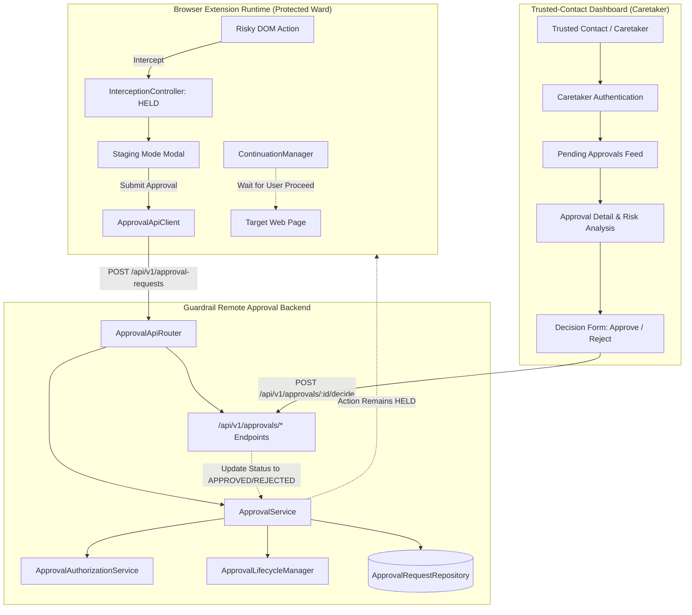
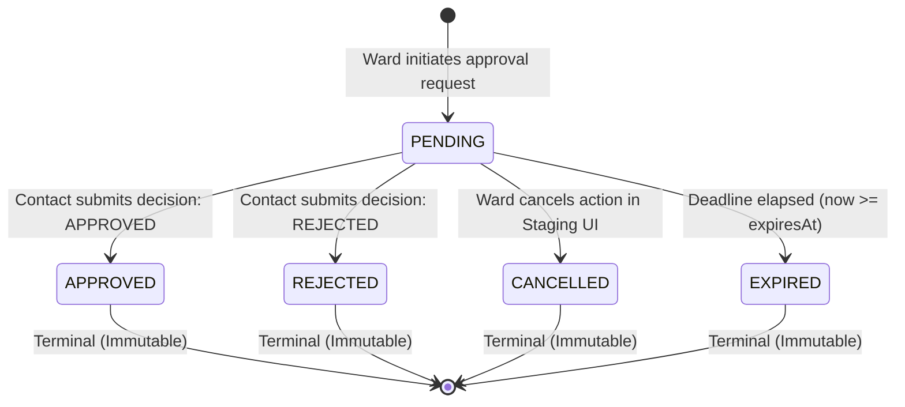

# Guardrail Trusted-Contact Dashboard Integration Contract & Readiness Specification

## 1. Executive Summary & Verification Context

This document establishes the verified technical contract governing the **Trusted-Contact Dashboard** and its integration with the **Guardrail Remote Approval Backend**.

Guardrail is an in-browser safety layer designed to protect users from high-risk, irreversible, or deceptive interactions:
* **Day 8** implemented **controlled browser action interception** (`InterceptionController`, `ContinuationManager`, DOM capture-phase cancellation).
* **Day 9** introduced **Staging Mode** (accessible Shadow DOM quarantine dialog), explicit user cancellation, and local intent representation.
* **Day 10** established the **server-side approval domain model, lifecycle state machine, multi-tenant authorization rules, coordination service, and REST API router** (`guardrail/extension/src/approval/`).
* **Day 11** verified the **approval request delivery, API client, mutual locking, compound idempotency, and network failure hardening**.
* **Day 12+** introduces the **Trusted-Contact Dashboard**: a dedicated web interface where designated caretakers review, evaluate, and decide pending approval requests on behalf of their assigned wards.

> [!IMPORTANT]
> **READINESS AUDIT: DASHBOARD UI IS CURRENTLY UNINITIALIZED**
> A comprehensive inspection of the repository reveals:
> 1. `guardrail/dashboard` contains only a stub `README.md` from Day 1. **No dashboard web application, UI framework, build pipeline, routing, or assets currently exist.**
> 2. `guardrail/server` contains only a stub `README.md`. No standalone HTTP daemon (e.g., Express, Fastify, or Node server) or persistent SQL database is currently running.
> 3. The **backend logic, multi-tenant authorization rules, deterministic state machine, and REST API endpoints already exist and are fully tested** in `guardrail/extension/src/approval/` (including `api.ts`, `service.ts`, `authorization.ts`, `lifecycle.ts`, `model.ts`, and `repository.ts`).
>
> This contract documents the authoritative backend capabilities, exact REST API boundaries, multi-tenant authorization rules, and security invariants that any future dashboard implementation must adhere to.

---

## 2. Architectural Architecture & Role Isolation



### Separation of Responsibilities

| Actor / Component | Role | Privileges & Boundaries |
| :--- | :--- | :--- |
| **Protected User (Ward)** | Browser Extension Operator | Initiates approval requests for own actions; cancels own actions. **Strictly prohibited from self-approving.** |
| **Trusted Contact (Caretaker)** | Reviewer & Decision Maker | Inspects sanitized metadata for assigned wards; submits `APPROVED` or `REJECTED` verdicts. **Has no access to browser tabs, form fields, or passwords.** |
| **Dashboard Web App** | Client Interface for Contacts | Displays pending requests, risk evaluations, and decision controls. **Cannot modify request state without authoritative backend confirmation.** |
| **Backend API** | Central Policy & Authority | Authenticates actors, enforces tenancy boundaries, guarantees first-responder atomicity, and records audit logs. |

---

## 3. Trusted-Contact Authentication & Identity Derivation

### 3.1 Authentication Mechanism

The backend enforces standard HTTP Bearer token authentication across all endpoints:

```http
Authorization: Bearer <trusted_contact_token>
```

1. **Token Verification**:
   - The [`ApprovalApiRouter`](file:///Users/deepanshukhatri/Library/CloudStorage/GoogleDrive-deepanshukhatri20061972@gmail.com/My%20Drive/Cloud%20Desktop/Guardrail%20UI/guardrail/extension/src/approval/api.ts#L572-L598) parses the `Authorization` header.
   - The token is verified by [`TokenVerifier.verifyToken(token)`](file:///Users/deepanshukhatri/Library/CloudStorage/GoogleDrive-deepanshukhatri20061972@gmail.com/My%20Drive/Cloud%20Desktop/Guardrail%20UI/guardrail/extension/src/approval/api.ts#L115-L121).
   - Missing, invalid, or malformed tokens immediately fail with HTTP `401 Unauthorized`:
     ```json
     {
       "success": false,
       "error": {
         "code": "UNAUTHENTICATED",
         "message": "Missing Authorization header. Bearer token is required.",
         "statusCode": 401
       }
     }
     ```

2. **Authoritative Identity Derivation**:
   - The verifier returns an authoritative [`AuthContext`](file:///Users/deepanshukhatri/Library/CloudStorage/GoogleDrive-deepanshukhatri20061972@gmail.com/My%20Drive/Cloud%20Desktop/Guardrail%20UI/guardrail/extension/src/approval/authorization.ts#L66-L78):
     ```typescript
     export interface AuthContext {
       readonly actorId: string;       // e.g., 'tc_carol'
       readonly role: ActorRole;       // ActorRole.TRUSTED_CONTACT
       readonly isAuthenticated: boolean;
       readonly sessionId?: string;
     }
     ```
   - **Zero Client Trust Rule**: The backend derives the reviewer's identity (`decidedBy`) **strictly from `authContext.actorId`**.
   - Any client-supplied `decidedBy`, `contactId`, `userId`, or `role` in request headers, query strings, or JSON bodies is **strictly ignored or overwritten**.

3. **Current Implementation vs. Production Gap**:
   - **Current State**: [`InMemoryTokenVerifier`](file:///Users/deepanshukhatri/Library/CloudStorage/GoogleDrive-deepanshukhatri20061972@gmail.com/My%20Drive/Cloud%20Desktop/Guardrail%20UI/guardrail/extension/src/approval/api.ts#L131-L151) verifies in-memory mock tokens mapped to test identities (`alice-token`, `carol-token`, `dave-token`).
   - **Production Requirement**: A production auth service (e.g., JWT signing keys, OAuth2 / OIDC provider, or signed magic-link email delivery system) must be established in `guardrail/server`.

---

## 4. Multi-Tenant Authorization & Access Control

The backend enforces strict multi-tenant authorization rules via [`ApprovalAuthorizationService`](file:///Users/deepanshukhatri/Library/CloudStorage/GoogleDrive-deepanshukhatri20061972@gmail.com/My%20Drive/Cloud%20Desktop/Guardrail%20UI/guardrail/extension/src/approval/authorization.ts#L348-L622) and [`ApprovalService`](file:///Users/deepanshukhatri/Library/CloudStorage/GoogleDrive-deepanshukhatri20061972@gmail.com/My%20Drive/Cloud%20Desktop/Guardrail%20UI/guardrail/extension/src/approval/service.ts#L180-L690):

### 4.1 Relationship Verification (`TrustedContactRegistry`)

A trusted contact may only view or decide requests belonging to users who have explicitly designated them:

```typescript
contactRegistry.isTrustedContactForUser(contactId, wardUserId) === true
```

* **Active Status Required**: The relationship status must be `TrustedContactStatus.ACTIVE`. Contacts in `PENDING_INVITE` or `REVOKED` status are rejected.
* **Separation of Duties (No Self-Approval)**:
  - If a user attempts to approve or reject their own request (`request.requesterId === authContext.actorId`), the server throws [`SelfApprovalProhibitedError`](file:///Users/deepanshukhatri/Library/CloudStorage/GoogleDrive-deepanshukhatri20061972@gmail.com/My%20Drive/Cloud%20Desktop/Guardrail%20UI/guardrail/extension/src/approval/authorization.ts#L307-L320), returning HTTP `403 Forbidden` (`SELF_APPROVAL_PROHIBITED`).
  - This rule applies even if the user fraudulently added themselves to the trusted contact registry.

### 4.2 Anti-Enumeration & Opaque Errors (404)

To protect user privacy and prevent unauthorized actors from probing whether a specific request ID exists:
* When an unassigned contact, an unrelated user, or an attacker requests `GET /api/v1/approvals/:id` or submits `POST /api/v1/approvals/:id/decide`, the server returns:
  ```http
  HTTP/1.1 404 Not Found
  Content-Type: application/json; charset=utf-8

  {
    "success": false,
    "error": {
      "code": "NOT_FOUND_OR_DENIED",
      "message": "Access denied: Request not found or insufficient permissions.",
      "statusCode": 404
    }
  }
  ```
* **Security Invariant**: This response is byte-for-byte identical to the response returned for a completely non-existent request ID. No timing oracle or status code distinction exists.

---

## 5. Dashboard REST API Endpoints Specification

All endpoints require `Authorization: Bearer <token>` and return a standardized envelope [`ApiResponseEnvelope<T>`](file:///Users/deepanshukhatri/Library/CloudStorage/GoogleDrive-deepanshukhatri20061972@gmail.com/My%20Drive/Cloud%20Desktop/Guardrail%20UI/guardrail/extension/src/approval/api.ts#L59-L75).

### 5.1 Endpoint 1: List Pending Approvals

Retrieves all active, non-expired pending requests that the authenticated trusted contact is authorized to review.

* **Method**: `GET`
* **Path**: `/api/v1/approvals/pending`
* **Headers**:
  ```http
  Authorization: Bearer <trusted_contact_token>
  ```
* **Status Code**: `200 OK`
* **Response Body**:
  ```json
  {
    "success": true,
    "data": [
      {
        "id": "apr_01J9X4M5N2ABCD1234EFGH",
        "actionId": "act_1710000000_abc123",
        "requesterId": "usr_alice",
        "status": "PENDING",
        "actionDescription": "Click button 'Delete All Account Data'",
        "actionType": "CLICK",
        "category": "DESTRUCTIVE",
        "riskLevel": "CRITICAL",
        "riskScore": 100,
        "riskReasons": [
          "Target element is a destructive delete button",
          "Action causes permanent bulk data removal"
        ],
        "origin": "https://app.example.com",
        "hostname": "app.example.com",
        "pageTitle": "Account Settings",
        "createdAt": "2026-10-20T10:00:00.000Z",
        "expiresAt": "2026-10-20T10:15:00.000Z"
      }
    ]
  }
  ```
* **Filtering Logic**:
  - Automatically excludes requests whose status is not `PENDING`.
  - Automatically excludes expired requests (`now >= expiresAt`).
  - Automatically filters by `contactRegistry.isTrustedContactForUser(actorId, request.requesterId)`.

---

### 5.2 Endpoint 2: Inspect Request Details

Retrieves full details for a specific approval request.

* **Method**: `GET`
* **Path**: `/api/v1/approvals/:id`
* **Headers**:
  ```http
  Authorization: Bearer <trusted_contact_token>
  ```
* **Status Code**: `200 OK`
* **Response Body (Pending Request)**:
  ```json
  {
    "success": true,
    "data": {
      "id": "apr_01J9X4M5N2ABCD1234EFGH",
      "actionId": "act_1710000000_abc123",
      "requesterId": "usr_alice",
      "status": "PENDING",
      "actionDescription": "Click button 'Delete All Account Data'",
      "actionType": "CLICK",
      "category": "DESTRUCTIVE",
      "riskLevel": "CRITICAL",
      "riskScore": 100,
      "riskReasons": [
        "Target element is a destructive delete button"
      ],
      "origin": "https://app.example.com",
      "hostname": "app.example.com",
      "pageTitle": "Account Settings",
      "createdAt": "2026-10-20T10:00:00.000Z",
      "expiresAt": "2026-10-20T10:15:00.000Z"
    }
  }
  ```
* **Response Body (Resolved Request)**:
  ```json
  {
    "success": true,
    "data": {
      "id": "apr_01J9X4M5N2ABCD1234EFGH",
      "actionId": "act_1710000000_abc123",
      "requesterId": "usr_alice",
      "status": "APPROVED",
      "actionDescription": "Click button 'Delete All Account Data'",
      "actionType": "CLICK",
      "category": "DESTRUCTIVE",
      "riskLevel": "CRITICAL",
      "riskScore": 100,
      "riskReasons": [
        "Target element is a destructive delete button"
      ],
      "origin": "https://app.example.com",
      "hostname": "app.example.com",
      "pageTitle": "Account Settings",
      "createdAt": "2026-10-20T10:00:00.000Z",
      "expiresAt": "2026-10-20T10:15:00.000Z",
      "resolvedAt": "2026-10-20T10:05:30.000Z",
      "decision": {
        "decision": "APPROVED",
        "decidedBy": "tc_carol",
        "decidedAt": "2026-10-20T10:05:30.000Z",
        "decisionReason": "Verified legitimate account cleanup request over phone."
      }
    }
  }
  ```
* **Error Scenarios**:
  - Missing/invalid token: `401 UNAUTHENTICATED`
  - Caller not assigned to requester or request ID does not exist: `404 NOT_FOUND_OR_DENIED`

---

### 5.3 Endpoint 3: Submit Decision (Approve or Reject)

Records an authoritative decision on a pending request.

* **Method**: `POST`
* **Path**: `/api/v1/approvals/:id/decide`
* **Headers**:
  ```http
  Authorization: Bearer <trusted_contact_token>
  Content-Type: application/json
  ```
* **Request Body**:
  ```json
  {
    "decision": "APPROVED",
    "decisionReason": "Verified legitimate action with user."
  }
  ```
  *(or `"decision": "REJECTED"`)*
* **Request Validation**:
  - `decision`: **Required**. Must be strictly `"APPROVED"` or `"REJECTED"`. Any other value returns `400 VALIDATION_ERROR`.
  - `decisionReason`: **Optional**. If provided, must be a string. Max length 1,000 characters recommended.
  - Body must be a valid JSON object (`400 MALFORMED_JSON` on parse failure).
  - Content-Type must be `application/json` (`415 UNSUPPORTED_MEDIA_TYPE` if omitted or different).
* **Success Response (`200 OK`)**:
  Returns the updated `ApprovalRequest` in `APPROVED` or `REJECTED` state, including the authoritative `decision` block and `resolvedAt`.
* **Error Responses**:
  - `401 UNAUTHENTICATED`: Missing or invalid Bearer token.
  - `403 SELF_APPROVAL_PROHIBITED`: Requester attempts to approve their own request.
  - `404 NOT_FOUND_OR_DENIED`: Contact not designated for this ward, or ID not found.
  - `409 ALREADY_RESOLVED`: Request is already in a terminal state (`APPROVED`, `REJECTED`, `CANCELLED`).
  - `410 REQUEST_EXPIRED`: Expiration deadline has passed (`now >= expiresAt`).

---

## 6. Lifecycle States & First-Responder Concurrency

### 6.1 State Machine



| Lifecycle State | Nature | Visible in Pending Feed? | Contact Can Decide? | Ward Can Cancel? |
| :--- | :---: | :---: | :---: | :---: |
| **`PENDING`** | Active | **YES** | **YES** | **YES** |
| **`APPROVED`** | Terminal | **NO** | **NO** (`409 Conflict`) | **NO** (`409 Conflict`) |
| **`REJECTED`** | Terminal | **NO** | **NO** (`409 Conflict`) | **NO** (`409 Conflict`) |
| **`EXPIRED`** | Terminal | **NO** | **NO** (`410 Gone`) | **NO** (`409 Conflict`) |
| **`CANCELLED`** | Terminal | **NO** | **NO** (`409 Conflict`) | **NO** (`409 Conflict`) |

### 6.2 First-Responder Concurrency Model

When multiple trusted contacts are designated for a ward (e.g., two family members or supervisors), both may review the same pending request simultaneously:

1. **Atomic CAS Commitment**:
   - The repository executes atomic conditional updates:
     ```typescript
     repository.atomicTransition(requestId, ApprovalStatus.PENDING, resolvedRequest)
     ```
2. **Winner**: Exactly one decision commits successfully. The backend records the verdict, sets `resolvedAt`, and logs the audit event.
3. **Subsequent Attempts**: The competing contact's submission fails the atomic condition. The server responds with `409 Conflict`:
   ```json
   {
     "success": false,
     "error": {
       "code": "ALREADY_RESOLVED",
       "message": "Approval request \"apr_...\" is already resolved (status: APPROVED). Cannot transition to REJECTED.",
       "statusCode": 409
     }
   }
   ```
4. **Dashboard Requirement**: When receiving a `409 Conflict`, the dashboard must update its UI immediately to reflect that another caretaker has already decided the request, preventing stale resubmission.

---

## 7. Decoupling Decisions from Browser Action Execution

A core architectural invariant of Guardrail:

$$\mathbf{Approval\ Decision\ \neq\ Action\ Execution}$$

1. **Zero Execution on Backend**: Recording an `APPROVED` decision on the backend updates the request record and generates audit metadata. **Under no circumstances does the backend execute, dispatch, or trigger the held browser action.**
2. **Action Remains Held**: The browser action remains strictly suspended in the ward's client tab under `InterceptionController` (`HELD` state) and `ContinuationManager`.
3. **Explicit User Continuation**:
   - Even after a caretaker approves, the protected user in Staging Mode retains ultimate agency.
   - The user must explicitly review the confirmation and click "Proceed" in Staging Mode for `ContinuationManager.continueAction()` to execute.
   - If the user clicks "Cancel" or closes the browser tab, the action is cancelled and **never executes**.

---

## 8. Dashboard Presentation & Privacy Whitelist

### 8.1 Safe Whitelist of Displayable Fields

The dashboard must display only safe, sanitized metadata provided in the `ApprovalRequest` schema:

| Field Name | Type | Description | Safe for Display? |
| :--- | :--- | :--- | :---: |
| `id` | `string` | Canonical request identifier (`apr_...`) | **YES** |
| `requesterId` | `string` | Ward identifier or alias (e.g., `usr_alice`) | **YES** |
| `actionDescription` | `string` | Sanitized summary (e.g., "Click button 'Delete All Account Data'") | **YES** |
| `actionType` | `enum` | Interaction mechanism (`CLICK`, `INPUT`, `SUBMIT`, `NAVIGATION`) | **YES** |
| `category` | `enum` | Semantic category (`PAYMENT`, `DESTRUCTIVE`, etc.) | **YES** |
| `riskLevel` | `enum` | Assessed risk level (`LOW`, `MEDIUM`, `HIGH`, `CRITICAL`) | **YES** |
| `riskScore` | `number` | Numerical score (0–100) | **YES** |
| `riskReasons` | `string[]` | Heuristic bullet points explaining risk factors | **YES** |
| `origin` | `string` | Sanitized website origin (`https://example.com`) | **YES** |
| `hostname` | `string` | Sanitized domain name (`example.com`) | **YES** |
| `pageTitle` | `string` | Document title at interaction time | **YES** |
| `createdAt` | `string` | ISO 8601 creation timestamp | **YES** |
| `expiresAt` | `string` | ISO 8601 expiration deadline | **YES** |
| `status` | `enum` | Current lifecycle status | **YES** |
| `decision` | `object` | Verdict, decidedBy, decidedAt, decisionReason (if resolved) | **YES** |
| `cancellationReason` | `string` | Reason if cancelled by user | **YES** |

### 8.2 Strict Exclusion of Sensitive Data

Under **no circumstances** may the dashboard request, expose, or log:
* **Passwords, PINs, or Secret Codes**: Form inputs of `type="password"`.
* **One-Time Passwords (OTPs)**: 2FA / MFA authentication codes or SMS verification numbers.
* **Payment Card Data**: Full PAN, CVV/CVC, expiration dates, or bank routing numbers.
* **Authentication Secrets & Cookies**: Session cookies, Bearer tokens from host pages, or OAuth access keys.
* **Raw Typed Form Values**: Search queries, personal messages, or form input strings.
* **Live DOM Nodes or Scripts**: Raw HTML trees, script bodies, or executable code snippets.

---

## 9. Error Handling & Loading State Specifications

The dashboard must implement resilient error and loading state patterns:

| Error Code | HTTP Status | Meaning | Dashboard UX Requirement |
| :--- | :---: | :--- | :--- |
| `UNAUTHENTICATED` | 401 | Missing, expired, or invalid token | Redirect to login screen or prompt contact to request fresh magic link. |
| `SELF_APPROVAL_PROHIBITED` | 403 | Requester attempting to approve own action | Display warning: "You cannot approve your own actions. Separation of duties required." |
| `NOT_FOUND_OR_DENIED` | 404 | Request does not exist OR caller not assigned to ward | Display clean message: "Approval request not found." (Anti-enumeration). |
| `ALREADY_RESOLVED` | 409 | Request was already decided by another contact or cancelled by ward | Transition UI state to resolved; show current status; disable decision buttons. |
| `REQUEST_EXPIRED` | 410 | Request deadline elapsed | Transition UI state to "Expired"; disable decision buttons. |
| `RATE_LIMIT_EXCEEDED` | 429 | Rate limit exceeded | Display "Too many requests. Please wait." Back off for `Retry-After` seconds. |
| `NETWORK_FAILURE` | Client Error | Network drop / timeout (`fetch` rejected) | Keep UI in pending state; show "Network error. Please check your connection and retry."; **do not claim decision succeeded**. |

### UI Loading State Rules

1. **Button Debouncing & Concurrency Guard**:
   - When a contact clicks "Approve" or "Reject", the dashboard must disable both buttons immediately.
   - Display an in-flight loading spinner on the clicked button.
2. **Never Optimistic**:
   - The UI must **never** show "Approved" or "Rejected" before receiving a `200 OK` response with the updated record from the server.
3. **Periodic Polling / Revalidation**:
   - The dashboard pending feed should poll `GET /api/v1/approvals/pending` at an interval (e.g., every 15–30 seconds) to automatically prune expired or concurrently resolved requests.

---

## 10. Repository Readiness & Missing Prerequisites Audit

| Subsystem / Component | Current Implementation Status | Verified Reality & Active Gaps |
| :--- | :---: | :--- |
| **`ApprovalApiRouter`** | **Operational (Day 10-11)** | Fully implements `GET /pending`, `GET /:id`, and `POST /:id/decide`. Verified with automated test suites. |
| **`ApprovalService`** | **Operational (Day 10-11)** | Authoritative coordinator enforcing CAS transitions, multi-tenant rules, and safe logging. |
| **`ApprovalAuthorizationService`** | **Operational (Day 10-11)** | Enforces contact tenancy, self-approval prohibition, and anti-enumeration. |
| **`ApprovalRequestRepository`** | **Development In-Memory** | Ephemeral storage. Data lost on server restart. **Gap: No persistent SQL/NoSQL datastore.** |
| **`TokenVerifier`** | **Development In-Memory** | Static token maps. **Gap: No production JWT signing, OAuth, or magic-link provider.** |
| **`guardrail/server`** | **Uninitialized** | Contains only `README.md`. **Gap: No running HTTP daemon listening on network port.** |
| **`guardrail/dashboard`** | **Uninitialized** | Contains only `README.md`. **Gap: No web app framework, routing, or components initialized.** |
| **Push / Alert Gateway** | **Missing** | **Gap: No WebPush, WebSocket, SMS, or Email alerts dispatched when requests are created.** |

---

## 11. Dashboard Implementation Checklist (Day 13+)

When creating the trusted-contact dashboard in `guardrail/dashboard`:

- [ ] **Project Setup**: Initialize lightweight web application using standard vanilla web standards (or selected frontend framework adhering to repository conventions).
- [ ] **HTTP Client**: Implement client wrapper for `GET /api/v1/approvals/pending`, `GET /api/v1/approvals/:id`, and `POST /api/v1/approvals/:id/decide`.
- [ ] **Auth Token Storage**: Securely store trusted-contact Bearer token in session storage or HTTP-only cookies.
- [ ] **Pending Feed View**: Render list of open pending requests with risk level badges, action descriptions, and expiration countdown timers.
- [ ] **Detail Modal / Drawer**: Display sanitized action metadata (`origin`, `category`, `riskScore`, `riskReasons`).
- [ ] **Decision Controls**: "Approve" and "Reject" buttons with confirmation step and optional `decisionReason` input.
- [ ] **In-Flight Disabling**: Disable buttons during submit to prevent duplicate submissions.
- [ ] **Conflict Handling**: Handle `409 ALREADY_RESOLVED` and `410 REQUEST_EXPIRED` gracefully.
- [ ] **Strict Privacy**: Verify zero rendering of raw forms, passwords, or authentication secrets.
- [ ] **No Action Execution**: Verify that the dashboard only records decisions and never attempts to interact with the user's browser tabs.
