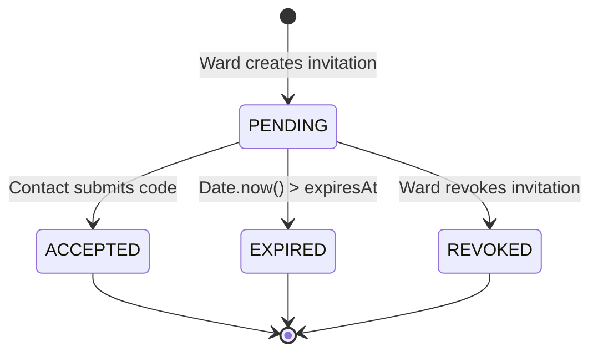

# Guardrail Trusted-Contact Setup & Pairing Protocol Specification

## 1. Executive Summary & Context

In the Guardrail safety ecosystem, a **Ward** is a user whose high-risk or irreversible browser interactions (e.g. wire transfers, bulk account deletions, permissions grants) are intercepted and held in Staging Mode. A **Trusted Contact** is a designated guardian, advisor, or caretaker empowered to evaluate and approve or reject those requests.

Previously, the backend approval state machine and dashboard evaluated authorization based on static user IDs. This release establishes the complete lifecycle for **User Management and Trusted Contact Setup**:
1. How wards invite and pair with trusted contacts securely.
2. Input validation and cryptographic pairing code generation.
3. Separation of duties and strict anti-enumeration multi-tenant isolation.
4. Unconfigured ward handling and orphan request prevention.
5. In-dashboard caretaker connection UX.

> [!IMPORTANT]
> **Zero-Friction, Out-of-Band Pairing Protocol (No Fake Email Delivery)**
> Invitation email delivery is optional and uses a backend-only Resend adapter. It sends only after a persistent invitation is created and uses an issuer-verified recipient email. Until Resend credentials, a verified sender, and the dashboard URL are configured, the API reports `NOT_CONFIGURED`; the issuer may share the one-time code out-of-band. Provider submission is not proof of inbox delivery.

---

## 2. Pairing & Relationship Architecture

```mermaid
sequenceDiagram
    autonumber
    actor Ward as Ward (User)
    participant Ext as Browser Extension / API Client
    participant Svc as Guardrail Approval Backend
    actor Contact as Trusted Contact (Caretaker)
    participant Dash as Trusted-Contact Dashboard

    Note over Ward,Ext: Initial Setup & Invitation Generation
    Ward->>Ext: "Invite Trusted Contact" (e.g., "Financial Advisor")
    Contact->>Svc: GET /api/v1/identity (authenticated)
    Svc-->>Contact: { actorId, role: "TRUSTED_CONTACT" }
    Contact->>Ward: Shares actor ID out-of-band
    Ext->>Svc: POST /api/v1/invitations { recipientActorId, relationshipLabel }
    Svc->>Svc: Create recipient-bound invitation; persist token hash only
    Svc->>Svc: Submit email after creation when provider is configured
    Svc-->>Ext: 201 Created { code, expiresAt, deliveryStatus }
    Ext-->>Ward: Shows provider submission state

    Note over Ward,Contact: Secure Out-of-Band Transfer (Signal / SMS / In-person)
    Ward->>Contact: May share one-time code out-of-band if email is unavailable

    Note over Contact,Dash: Pairing & Acceptance
    Contact->>Dash: Logs in & enters pairing code
    Dash->>Svc: POST /api/v1/invitations/accept { code }
    Svc->>Svc: Hash token, validate TTL, active status, verified recipient identity & self-pairing
    Svc->>Svc: Create TrustedContact (Ward <-> Contact)
    Svc-->>Dash: 200 OK { status: "ACCEPTED", wardId: "usr_alice" }
    Dash-->>Contact: Displays Active Ward Association & Separation of Duties Notice

    Note over Ward,Svc: Operational State Active
    Ward->>Svc: POST /api/v1/approval-requests { action: "transfer_funds" }
    Svc->>Svc: Check hasActiveTrustedContact(wardId) -> true
    Svc-->>Ward: 201 Created (Request pending review)
```

---

## 3. Pairing Code Specification & Security Properties

Pairing codes adhere strictly to the following specification:

| Property | Value | Rationale |
| :--- | :--- | :--- |
| **Format** | `GR-INV-XXXX-YYYY` | Recognizable brand prefix, human-readable hyphenation |
| **Alphabet** | Crockford Base32 (`0123456789ABCDEFGHJKMNPQRSTVWXYZ`) | Eliminates easily confused characters (`I`, `L`, `O`, `U`) |
| **Entropy** | $32^8 \approx 1.1 \times 10^{12}$ combinations | Prevents brute-force enumeration attacks |
| **Default TTL** | 168 hours ($604,800,000\text{ ms}$) | Ample time for non-technical setup without indefinite exposure |
| **Case Handling** | Case-insensitive in client, normalized to uppercase | Prevents user entry frustration on mobile keyboards |

---

## 4. Domain Models & Lifecycle State Machine

### 4.1 Invitation States (`InvitationStatus`)
* `PENDING`: Created by ward, unaccepted, within valid TTL.
* `ACCEPTED`: Claimed by a valid trusted contact; relationship established.
* `EXPIRED`: Current timestamp exceeds `expiresAt` prior to acceptance.
* `REVOKED`: Explicitly cancelled by the issuing ward prior to acceptance.



### 4.2 Trusted Contact Relationship Lifecycle
* `ACTIVE`: Contact is authorized to view and evaluate pending approvals for the ward.
* `REVOKED`: Ward has terminated contact authority. Immediate revocation takes effect: any pending or future requests cannot be reviewed by this contact.

---

## 5. Security & Invariant Rules

### 5.1 Separation of Duties
* **No Self-Pairing**: A ward cannot accept their own invitation (`contactId === wardId`). Attempting to do so immediately throws `SelfInvitationProhibitedError` (HTTP 403 Forbidden).
* **No Self-Approval**: A user cannot approve their own approval requests (`SelfApprovalProhibitedError`, HTTP 403 Forbidden).

### 5.2 Multi-Tenant Isolation & Anti-Enumeration
* **Opaque 404s**: When an unauthenticated or unauthorized user attempts to inspect, accept, or revoke an invitation or contact relationship that does not belong to them, the system returns `404 Not Found` (`InvitationNotFoundError`), never revealing whether the resource exists.
* **List Scoping**: Listing invitations or contacts returns strictly records where `wardId === actorId`.

### 5.3 Unconfigured Ward Handling (Orphan Prevention)
* **The Orphan Request Problem**: If a ward with zero active trusted contacts triggers an approval flow, an approval request would sit indefinitely in `PENDING` state with no caretaker to review it, trapping the held DOM action.
* **Invariant Enforcement**: `ApprovalService.createRequest` enforces `requireActiveContact`. If `hasActiveTrustedContact(requesterId)` is false, it rejects the request with `NoActiveTrustedContactError` (HTTP 422 Unprocessable Entity):
  > *"Cannot create approval request: No active trusted contact is linked to your account. Please pair a trusted contact before submitting actions."*
* **UX Recovery**: The extension and Staging Mode display a clear configuration banner with a direct link to the onboarding pairing flow.

---

## 6. Authoritative REST API Boundaries

All invitation and user management routes require valid Bearer token authentication and strict JSON payload validation.

`GET /api/v1/identity` returns only the authenticated caller's backend-mapped `actorId` and verified role. Clients must not derive this identifier from an unverified token payload.

### 6.1 `POST /api/v1/invitations`
* **Role**: `USER` (Ward)
* **Request Body**:
  ```json
  {
    "recipientActorId": "usr_verified_contact_id",
    "relationshipLabel": "Financial Advisor",
    "ttlMs": 604800000
  }
  ```
* **Response (201 Created)**:
  ```json
  {
    "success": true,
    "data": {
      "id": "inv_9b8f2c...",
      "code": "GR-INV-K8M2-P4X9",
      "wardId": "usr_alice",
      "relationshipLabel": "Financial Advisor",
      "status": "PENDING",
      "createdAt": 1798960000000,
      "expiresAt": 1799564800000
    }
  }
  ```

### 6.2 `GET /api/v1/invitations`
* **Role**: `USER` (Ward)
* **Response (200 OK)**: Returns array of active/pending invitations for the authenticated ward.

### 6.3 `GET /api/v1/invitations/:identifier`
* **Role**: Invitation owner or the exact verified recipient identity (opaque denial otherwise)
* **Param**: Canonical ID (`inv_...`) or pairing code (`GR-INV-...`)
* **Response (200 OK)**: Returns invitation metadata only to its owner or intended recipient. A pairing code alone does not authorize preview or acceptance by another identity.

### 6.4 `POST /api/v1/invitations/accept`
* **Role**: The `TRUSTED_CONTACT` identity whose internal actor ID matches `recipientActorId` on the invitation.
* **Request Body**: `{ "code": "<one-time invitation token>" }`. The token is sent in the POST body, not a URL path or query string.
* **Response (200 OK)**:
  ```json
  {
    "success": true,
    "data": {
      "invitation": { "status": "ACCEPTED", "acceptedByContactId": "usr_bob" },
      "contact": { "id": "tc_...", "wardId": "usr_alice", "contactId": "usr_bob", "status": "ACTIVE" }
    }
  }
  ```

### 6.5 `POST /api/v1/invitations/:id/revoke`
* **Role**: `USER` (Ward)
* **Response (200 OK)**: Marks a pending invitation as `REVOKED` with a persisted lifecycle timestamp. Expired or revoked codes cannot be accepted.

### 6.6 `GET /api/v1/trusted-contacts`
* **Role**: `USER` (Ward)
* **Response (200 OK)**: Returns list of active `TrustedContact` associations.
* Revocation changes the relationship state and persists `revokedAt`; approval review access checks the active relationship on each request, so the revoked contact loses access immediately.

### 6.7 `POST /api/v1/trusted-contacts/:id/revoke`
* **Role**: `USER` (Ward)
* **Response (200 OK)**: Terminates contact authority (`status: "REVOKED"`).

---

## 7. Pilot Implementation vs. Production Roadmap (Explicit Gaps)

To ensure strict transparency during the controlled pilot, the following architectural gaps are acknowledged:

| Feature Area | Controlled Pilot (Current) | Production Target (Roadmap) |
| :--- | :--- | :--- |
| **Registry Storage** | `InMemoryTrustedContactRegistry` in service memory | Relational PostgreSQL with Prisma ORM, migrations, and row-level security |
| **Notification Channel** | Manual out-of-band code exchange | Native WebPush notifications + mobile push (APNs/FCM) for real-time alerts |
| **Audit Logging** | In-memory log structures (`StructuredAuditLog`) | Tamper-evident append-only audit trail in cold storage |
| **Rate Limiting** | In-memory sliding window rate limiter | Distributed Redis token bucket per IP and Actor ID |
| **Code Expiration Cleanup** | On-read lazy evaluation | Background cron worker sweeping expired invitation tokens |
